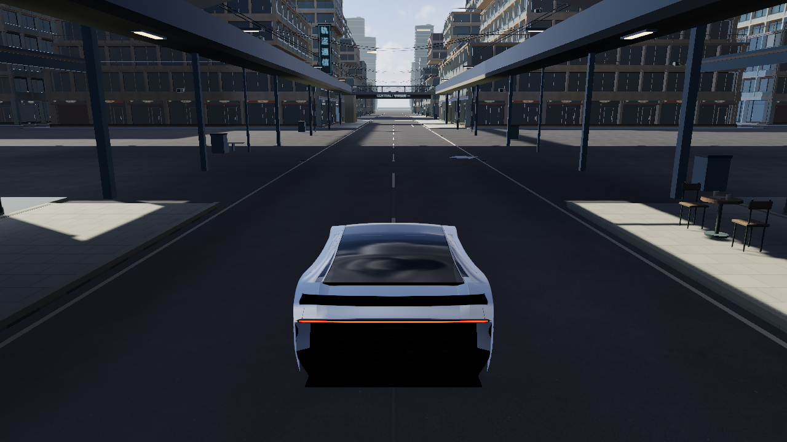
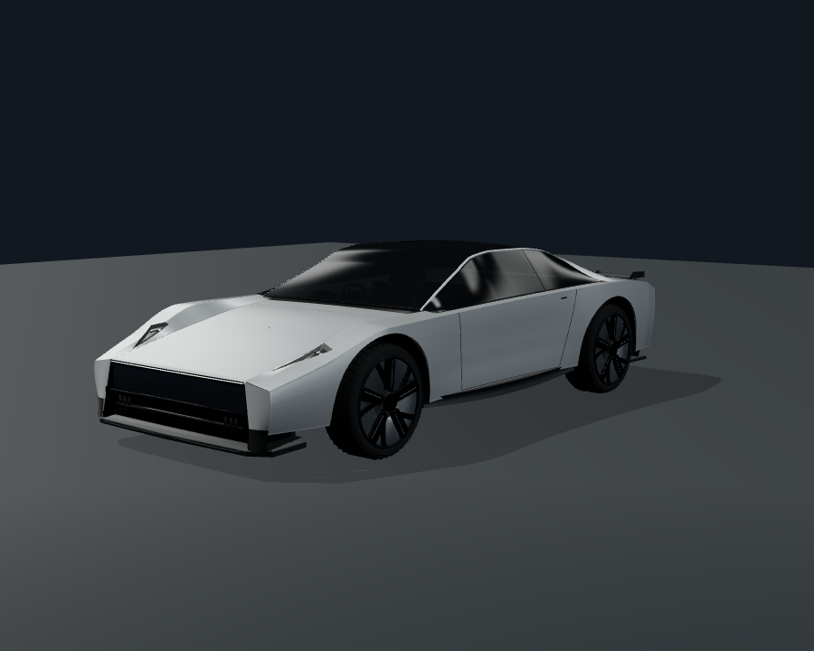

# Roadster Flight Lab

**Drive beyond the road, then turn the flight into an experiment you can inspect and replay.**

[简体中文](README.md) · English

[**Enter the city ↗**](https://windscode.github.io/roadster-flight-lab/) · [Wind laboratory](https://windscode.github.io/roadster-flight-lab/?view=lab) · [Vehicle studio](https://windscode.github.io/roadster-flight-lab/vehicle-inspection.html)

Roadster Flight Lab is an independent, playable vehicle and flight research project. Its original body reconstruction follows [Tesla’s current public Roadster imagery](https://www.tesla.com/roadster). Explore road driving, cold-gas propulsion, attitude control and near-surface suction in the original Vesper city. Tires, suspension, gas, nozzles, wing and controllers act on one six-degree-of-freedom rigid body.

Drive connected streets, leave the road for a maneuver, then turn the inputs and response into an exportable experiment. Wind, measurement delay, nozzle derating and finite gas change the actual result. Success, failure and cancellation retain their own identities.

## The proving ground





*These are actual **released 3.13 baseline frames**: a 1280×720 city frame and a 900×720 vehicle canvas. They are not 3.14 / 3.15 after-images or concept art. See the [vehicle study](docs/visual-quality-3.14.md) and [city continuity notes](docs/city-continuity-3.14.md) for current changes and outstanding matched-condition captures.*

## 3.15: combined inputs, landing reserve and a city flight route

**Candidate status: 3.15 is implemented locally; public upload is currently blocked by automatic approval review, and the existing site remains 3.13.** New controls below refer to this candidate. See [publication status](qa/publication-blocker-3.15.json) and the [acceptance matrix](docs/acceptance-3.15.md).

This release continues completed 3.14 work on the same city, 120 Hz solver and research history.

| Increment | Available behavior |
| --- | --- |
| **Combined controls and interruptions** | W + E + 1 combine. G temporarily yields pitch while 1 / 2 is held, then levels on release; Z / B remains lateral. Focus and mode changes release inputs and record why. |
| **Finite gas feedback** | Persistent supply, authority, wind and fault status; separate estimates for hover, descent arrest and gas after a forecast landing. Unsupported estimates are unavailable; bench supply has no invented finite endurance. |
| **Road navigation and one city task** | Selected road/ramp routes lead to vehicle entrances with turn and rejoin guidance. An upper-city task combines driving, takeoff, a directional air gate and settled platform landing, retaining input and failure events. |
| **Fast, stable, economical study** | Copy a baseline, edit the AST, scan three declared combinations, compare non-dominated candidates and validate under a separate disturbance. Failed and saturated runs remain visible. |
| **Passage and lighting** | Remove an evidenced 12 cm paving band across the existing Foundry vehicle mouth; compare with default regenerative braking. Driving lamps and road light pools agree, with regenerative brake signals. |

See the [3.15 release notes](docs/release-3.15.md) and [acceptance matrix](docs/acceptance-3.15.md) for implementation, retained failures and evidence limits. Numerical, DOM, Three-object and offline GLSL checks do not certify target-GPU after-images, native driving or performance.

## Inherited from 3.14: streets, vehicle, controls and experiments

| Area | What this version adds |
| --- | --- |
| **Driving and flight** | Chase / orbit obstruction handling; separate world centre-of-mass height and estimated envelope distances; bounded trim feasibility under nozzle faults, distinct from dynamic reserve and actual recovery; failure state, inputs and contacts retained before a safety reset. |
| **Vehicle studio** | Public-reference two-seat display and experimental single-seat configurations; an upper-edge headlamp signature with off / DRL / low-beam modes; clearer wheel materials, cabin layers and experimental rear recesses; photographic references, technical cameras, six-view comparison ZIP and a 12-second orbit video. |
| **Complete city** | A first curb, drainage and guidance pass across 12 planned streets; cross-street gateways, an industrial work bay, upper-city arrival and Southbank parking / walking transitions; tower crowns, industrial silhouettes and four outer transitions. All 114 buildings and 113 elevated / ramp segments remain. |
| **Research and play** | An editable bounded height-control graph, task re-execution and a disturbed-landing challenge; physical landing criteria, takeover / retry / event review; persistent save status separate from task results, with session exports when storage fails. |

The city continues to be refined street by street. This release provides a first continuity pass across the road network and selected connecting spaces. Art quality, native controls and target-device performance have separate acceptance requirements; see the [3.14 release notes](docs/release-3.14.md).

## Your first drive and flight

1. **Drive a street.** W / S accelerates and brakes, A / D steers, and Space applies wheel brakes. Follow Weavebridge, the cross-street link, Foundry service bridge and connecting ramp toward the upper city, then return down the original ramp toward Southbank. Press M to select a supported vehicle entrance and follow its road route and next turn. Navigation never teleports the vehicle; camera obstruction handling does not reroute it.
2. **Leave the ground.** H enables assisted flight; E / Q climbs and descends. Sliders directly set the vertical target from 0.5–14 m/s, default 5 m/s, with four response presets. Actual thrust, pressure, gas and attitude constrain the response. World height and nearby-surface distances have different meanings; envelope distances are labelled estimates.
3. **Explore attitude control.** G restores level attitude while retaining heading. Z / B commands lateral motion; holding 1 / 2 temporarily takes pitch control and releasing it returns to levelling. With G off, Z / B rolls and 1 / 2 pitches, then retains the manual attitude reference. W, E and 1 can be held together; achieved rotation and braking still depend on actual torque, supply and clearance.
4. **Record, then return.** Choose Record this drive / flight, stop, and inspect trajectories, curves and input events in the research console. Export full JSON. After a confirmed successful save, reload to reopen the record. R resets and pauses; P resumes.

Constant-pressure external supply is the practice default. Finite onboard gas depletes and cools; both modes retain valve response and installed nozzle limits. The interface supports **中文 / English**. Driving and procedure shortcuts pause while you edit forms.

### Quick roll, with real momentum

X retains the independent `quick-roll-1`: a short launch, fast roll, then thrust-driven braking and return. Unsuitable supply, initial attitude / angular speed or overhead clearance produce a specific refusal. An actual 3.13 constant-pressure run completed the roll and eventually returned to DRIVE, with recorded overshoot. This does not guarantee an exact 360°, the original landing position or success from every initial state.

For manual practice, choose **Quick-roll practice**, enable assisted flight with H and turn G off. Climb with E, then roll with Z / B; release at roughly three-quarters of a turn and enable G to attempt braking and levelling. G uses the current height reference, not an automatic return to launch height. See the [quick-roll comparison](docs/x-flip-3.13.md) and [current physics notes](docs/physics-controls-3.14.md) for timing, failures and supply conditions.

### Drive, fly through a gate, then land

Open **M → Upper City drive–flight challenge**, follow the road route to the start and stop before selecting supply and starting. Drive through the ground checkpoint, take off in the marked band using H / E, cross the air gate in the required direction, then slow over the platform and use L to attempt a settled landing. The preview declares height, direction, contact and timeout rules. Resetting, refilling or changing physical settings invalidates the result. Bench and finite runs are separate. The complete success evidence currently uses the actual numerical solver; finite failures remain recorded, and native play is not yet accepted.

## Change a control law through one landing task

Enter the [wind laboratory](https://windscode.github.io/roadster-flight-lab/?view=lab), then open **Research console → Control laws / landing**.

1. **Try the default task.** Review height, wind timing, supply and landing criteria, then choose **Live challenge / retry**. The default task takes off from rest to 2.5 m world centre-of-mass height, encounters two crosswind stages and descends into a 1.5 m radius target. First contact is not completion: the vehicle must settle. Pilot input takes over; Cancel / hand over also releases control.
2. **Change the controller structure.** Start from the PD or integral + filter template. Edit the JSON graph to combine error, proportional response, integration, filtering and limits. This interface controls the height outer loop only; output passes through existing constrained control, nozzle allocation, valves and gas. It cannot run arbitrary JavaScript or write rigid-body position, velocity or attitude.
3. **Let the new law make its own decisions.** Save the graph and use **Compare original and edited laws** from the same initial state and task. Check differences in initial state, model, wind, supply and task before reading the curves. Unmatched results are descriptive comparisons. The existing fixed-input A/B mode remains available.
4. **Inspect both success and failure.** Review landing error, pre-contact descent speed / attitude, saturation, gas and key events. Personal bests compare successful settled landings under matching conditions; no combined score hides a collision. Finite gas and constant-pressure external supply remain separate. External throughput is not onboard tank consumption.

Run task numerically executes the same task without moving the live vehicle. Main task statistics use every 120 Hz physical state; display curves use 20 Hz, with any historical decimation identified separately. Full JSON retains the algorithm, task, inputs / outputs, versions and failure events. The default wind is mild and V1 uses prescribed deterministic disturbances; it is not a universal recovery guarantee. [Interface scope and experimental results](docs/research-platform-3.14.md).

The 3.15 **fast, stable, economical comparison** copies the baseline and scans three declared PD / output-slew combinations. It retains every candidate and failure, compares non-dominated settling, overshoot and whole-task throughput, while separately showing fixed-window throughput and limiting, then validates against an independent wind schedule. A selected candidate can make new decisions in the same three-dimensional task. Whole-task throughput changes with completion time and must remain distinct from a fixed-window comparison. [Metrics and measured tradeoffs](docs/research-value-3.15.md).

Existing studies remain available: **G recovery height grid, five-seed controller comparisons, dry / wet / split-friction braking, finite-supply boundaries, live recording and reproduction checks**. The city and laboratory retain separate vehicle states; saved procedures can use keys 3–9.

## Two identities in the vehicle studio

The [vehicle studio](https://windscode.github.io/roadster-flight-lab/vehicle-inspection.html) offers a **public-reference two-seat display** and an **experimental single-seat configuration**. The first reconstructs visible seats, centre area, door panels and headlining from public images. The second retains tanks, pipes, a four-point harness and experimental hardware.

**These are inspection display configurations only. Switching does not rebuild mass, inertia or collisions, and does not change the driven vehicle or its history.** Undisclosed internal construction and nozzle installation remain engineering interpretations. Camera intrinsics are unknown; normalized landmark errors support design comparison, not a CAD-accuracy claim.

Independent technical cameras remain separate from estimated photographic matches. Switch lamp modes, sweep steering and suspension, inspect the wing, or compare frozen 3.13 / 3.9 / 3.8 models in the same studio. The six-view studio / daylight export contains actual frames and their capture conditions; city wet-night images must be captured in the city. The new two-seat identity is not presented as a configuration that existed in an older baseline.

## Keep your research

Results distinguish **execution status, physical outcome and persistence status**. If **Session only / unsaved** appears, computation may have finished, but export the full current result or library JSON before refreshing. A later completion message does not clear the warning.

Browser capacity remains finite. A failed append preserves the previous stored archive and keeps new work exportable in the session. Deletion, clearing and control-parameter saves verify the candidate write before changing saved state. Corrupt, unsupported or partly invalid archives retain their original text in read-only quarantine for export; upgrades do not automatically clear history to make space. Language switching preserves names, algorithms and experiment values.

Old records remain readable and exportable. Exact re-execution requires compatible model, protocol and collision identities. Unsupported full snapshots from another version are explicitly rejected; create a new task under the current model to generate a new record. [Storage behavior and compatibility](docs/research-platform-3.14.md).

## Common controls

| Action | Key |
| --- | --- |
| Accelerate / brake; keep reverse input after stopping to reverse | W / S |
| Ground steering / flight yaw | A / D |
| Mechanical brakes / rear cold-gas boost | Space / Shift |
| Assisted-flight toggle; climb / descend | H; E / Q |
| Auto-level on / off | G |
| Roll; lateral motion with G enabled | Z / B |
| Pitch up / down; G yields while held and levels on release | 1 / 2 |
| Suction / automatic roll / automatic landing | F / X / L |
| Saved research procedures | 3–9 |
| Camera / force vectors / map or research panel / hide instruments | C / V / M / F9 |
| Menu / pause or resume / reset and pause / explicit refill | ESC / P / R / T |
| Music play / next track | J / K |

## Model and graphics boundaries

This unofficial simulation combines public imagery with engineering assumptions. It has no Tesla CAD, tire database or real-vehicle calibration. **700 kW** mechanical power, dry-road **μ = 1.25** and **20 kN** per main nozzle are model assumptions. Physics includes wheel rotation, combined grip, suspension contact, finite-response valves, gas supply and constrained allocation. It has no industrial CFD, flexible body or full multibody suspension. Lift-off motor retardation is modeled as mechanical dissipation, without battery recharge.

The restoration of buildings and roads at a specified 3.13 high-quality wet-night viewpoint has actual GPU draw and pixel evidence; the former dense shadow stripes also have isolation evidence. 3.14 continues with ultra-quality offscreen-target and capture fixes, but successful linking or numerical checks do not prove successful drawing. The final build still needs target-device ultra matrix, full-route imagery, motion stability, driving feel and CPU / GPU frame-time checks. It is an evolving complete city, not a finished AAA production. [Rendering conditions and remaining coverage](docs/rendering-3.14.md).

Tesla’s official [The Kickflip | Roadster](https://www.youtube.com/watch?v=r5vsHHPVhJg) is a visual movement reference. Official provenance does not supply calibrated mass, pressure, exact height or engineering telemetry.

## Run locally

Use Node.js 22+; runtime dependencies are included. Run the following in the delivered 3.15 candidate checkout. Public main is still 3.13 and does not yet contain this candidate.

```sh
npm start
```

Open `http://127.0.0.1:8080/`. Windows users can also run `启动试验场.cmd`. 3D requires WebGL 2 and graphics acceleration; numerical research requires no GPU.

[3.15 release notes](docs/release-3.15.md) · [3.15 acceptance](docs/acceptance-3.15.md) · [Inherited 3.14](docs/release-3.14.md) · [Physics and controls](docs/physics-controls-3.14.md) · [Vehicle and references](docs/visual-quality-3.14.md) · [City continuity](docs/city-continuity-3.14.md) · [Rendering and capture](docs/rendering-3.14.md) · [Research platform](docs/research-platform-3.14.md) · [Development and validation](docs/DEVELOPMENT.md) · [Deployment identity](https://windscode.github.io/roadster-flight-lab/deployment.json)

Three.js · cannon-es · Poly Haven CC0 environment assets. Third-party licenses remain with the repository. Tesla branding identifies the research subject; this is an unofficial project, not a tool for vehicle design, safety assessment or performance certification.
