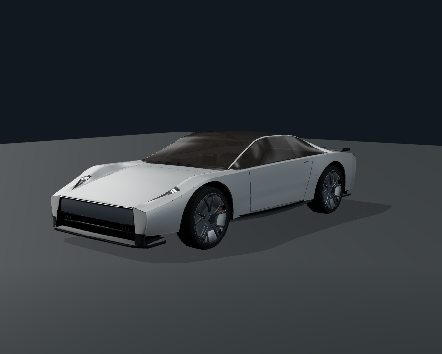
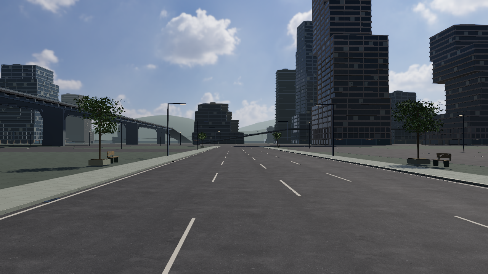

# Roadster Flight Lab · 3.16 candidate

**Drive beyond the road, then turn the flight into an experiment you can inspect and replay.**

[简体中文](README.md) · English

[**Enter the published city ↗**](https://windscode.github.io/roadster-flight-lab/) · [Wind laboratory](https://windscode.github.io/roadster-flight-lab/?view=lab) · [Vehicle studio](https://windscode.github.io/roadster-flight-lab/vehicle-inspection.html)

Roadster Flight Lab is a medium-scale, playable vehicle and flight research project. Its body reconstruction follows [Tesla’s public Roadster imagery](https://www.tesla.com/roadster). Explore road driving, cold-gas propulsion, attitude control and near-surface suction in the original Vesper city. Tires, suspension, gas, nozzles, wing and controllers act on one six-degree-of-freedom rigid body. The aim is understandable handling, connected urban spaces, steadily better visuals, and experiments that explain both success and failure. AAA is a visual-quality direction; development retains a sustainable project scope.

**3.16 continues the existing 3.15 source and is not deployed.** This round’s read-only identity check confirmed that the public site remains 3.13. The online links above open that published version; new features below describe the local 3.16 candidate. [3.16 release notes](docs/release-3.16.md) · [Acceptance matrix](docs/acceptance-3.16.md) · [Actual captures and candidate use](docs/candidate-capture-3.16.md)

## 3.16: substantive work across four areas

| Area | Available changes in this round |
| --- | --- |
| **Controls and contact** | X retains its original quick, low-altitude roll, with accepted/refused, phase and terminal receipts. The HUD separates actual attitude, accumulated rotation, authority and limiting reasons. Continuous tire support and smaller integration slices near hard contact correct observed defects. Finite gas can end the original plan early and hand over to landing without a refill or a false task-completion result. [Physics report](docs/physics-controls-3.16.md) |
| **Vehicle and cockpit** | The existing nose separates a closed upper fascia from the lower opening; shoulder, arch and wheel geometry is refined. Glass highlights, interior materials and the left-hand driver eye point are revised. Driving cockpit mode shows actual interior geometry. Rear experimental ducts have openings, sleeves, supports and fasteners, with two-seat reference and single-seat experimental identities kept distinct. [Vehicle images and references](docs/vehicle-finish-3.16.md) |
| **City and lighting** | Paving edges, junctions, ground-floor facades, furniture and lighting rhythm improve the existing Weave → Crosstown → Foundry connection, with foundational changes on ordinary streets too. Overbright wet paving, actual light positions, fixture supports and wet-road reflections receive specific corrections; night exposure is not raised globally. [City report](docs/city-quality-3.16.md) |
| **Research and usability** | Operate/observe, results analysis and collapsed observation workspaces reduce obstruction while retaining running, finished, saved and return states. Results explain speed, stability and gas tradeoffs through the original library and solver. Export shows stages, progress, cancellation and exact failures; ordinary JSON is encoded in a dedicated Worker. [Research and export](docs/research-experience-3.16.md) |

### What the evidence establishes

This round has actual Chrome/WebGL2 vehicle images: 34 renderer frames and four separate UI screenshots were individually inspected. The earlier city, control observations and completed research workflow on the user’s computer remain valid 3.15 evidence. Solver output, independent contact geometry, historical records, DOM wiring and actual pixels are separately documented. Final city imagery, continuous driving and per-draw/14-frame checks retain their own build identities in the [capture report](docs/candidate-capture-3.16.md).

- **A complete ground-start W / E / 1 backflip has not been verified.** Input receipt, combined requests and G’s levelling request after release are observable. An accumulated body-axis angle over 360° alone does not establish a clean completed backflip. Recovery depends on initial conditions, available force/torque, supply and clearance.
- **The full severe 90 km/h, 10 cm step trajectory has not converged.** Independent geometry and 60 / 120 / 240 Hz plus finer-step comparisons exposed and helped correct support defects. Large impulses and retained counterexamples do not establish a reasonable physical limit or certified impact response. [Contact evidence](qa/contact-convergence-3.16.json)
- **The new images use ANGLE SwiftShader, a software GPU.** They establish actual WebGL rendering, without establishing the user’s hardware frame rate, VRAM use or driving feel. Angular body contours, some repeated facades and simplified cabin detail remain visible.

### Public release status

The previously specified seven-record synthetic fixture, object `af339103…`, was retried **once, unchanged, under this round’s authorization**, and object creation succeeded. A subsequent inherited QA batch containing real device/GPU information, archive indexes and external-source metadata was refused by automatic approval review. Publication stopped at that batch; no remote branch was moved and 3.16 was not deployed. The reviews concern different payloads: see the [synthetic-fixture retry receipt](qa/publication-retry-3.16.json), [precise current blocker](qa/publication-blocker-3.16.json) and [source audit](docs/publication-source-audit-3.16.md).

## Actual vehicle images from this round



*900×720, ultra quality, fixed studio lighting. The original capture build is `2d88af03b1867667f85f6a638b12648424a378450636bd400ba0095b3341acfa`. This is an actual image after this round’s vehicle changes. The closed graphite fascia, lower opening, wheels and glass layers are visible; the nose and door planes remain angular.*

| Matched camera and lighting | Frozen 3.15 reference | This round’s 3.16 vehicle component |
| --- | --- | --- |
| Front three-quarter, studio | [Before](qa/vehicle-native-3.16/study/studio-front-quarter-reference.png) | [After](qa/vehicle-native-3.16/study/studio-front-quarter-current.png) |
| Rear wheel detail, studio | [Before](qa/vehicle-native-3.16/study/studio-rear-wheel-reference.png) | [After](qa/vehicle-native-3.16/study/studio-rear-wheel-current.png) |
| Experimental cabin, studio | [Before](qa/vehicle-native-3.16/study/studio-cabin-reference.png) | [After](qa/vehicle-native-3.16/study/studio-cabin-current.png) |
| Two-seat reference cabin, studio | [Original 3.15 page](qa/vehicle-native-3.16/stock/studio-cabin-3.15.png) | [3.16 page](qa/vehicle-native-3.16/stock/studio-cabin-3.16.png) |

The first three pairs use the same inspection renderer and a frozen 3.15 vehicle. The two-seat supplement uses the original 3.15 and current 3.16 pages, with matching state exports before and after each PNG; those are bracketing records rather than atomic same-frame metadata. The full set contains **24 technical matrix frames + eight reference-configuration supplements**, with city cockpit images listed separately. The [32-frame component-inheritance check to `c12a…`](qa/vehicle-native-3.16/component-inheritance-c12a.json) retains every source difference and explicitly identifies the generated identity-file change. It applies to that named target build only. The final `81926…` runtime has a [separate dependency review](qa/vehicle-final-3.16/README.md): city collision data changed, so the full static closure is not byte-identical. The reviewed call path identifies no route by which this remote footway correction changes the fixed studio rendered inputs. This is a conditional dataflow inference, not 32 new final-build captures; city and UI evidence are excluded. Two matching final-build views await the shared GPU window, and old image identities are preserved. [Complete images and provenance](qa/vehicle-native-3.16/README.md) · [Final candidate evidence scope](docs/candidate-capture-3.16.md)

<!-- CITY_SHOWCASE_316_BEGIN: replace only with identity-verified final city evidence. -->
### This round’s original city images · 3.16




These are unchanged **1280×720 native WebGL PNGs** from final local build `81926b47…`, with no cropping or brightness editing. Day and night exposure are locked to 0.87 / 1.02. The [original 3.15 daytime frame](qa/city-native-3.16/baseline/roadster-3.15.0-crosstown-clear-day.png) and [original 3.15 wet-night frame](qa/city-native-3.16/baseline/roadster-3.15.0-crosstown-wet-night.png) use the same camera, vehicle state, quality and exposure. Forecourt paving, lane lines that stop before crossings, tree-and-seat structures and lighting changes are rendered parts of the existing city.

The [ten original before/after pairs and two main-city cockpit views](qa/city-native-3.16/index.html) cover Weave, Crosstown, the district gateway, Foundry’s maintenance court and the upper connection. The [source and draw report](qa/city-native-3.16/report.json) and [individual image review](qa/city-native-3.16/visual-review.json) keep their exact scope. Fixed photos do not prove a completed native driving route. Boulevard edges remain sparse, distant towers repeat, night-time tower bodies remain dark and the Foundry court is still underlit. These are retained limitations of this round. [City report](docs/city-quality-3.16.md) · [Current acceptance](docs/acceptance-3.16.md)
<!-- CITY_SHOWCASE_316_END -->

## Inherited 3.15 work

3.16 continues the existing source, commit history, images from the user’s computer and research archives. The vehicle and city were not recreated, and completed workflows are retained as inherited work.

- **Combined input and handover:** G pitch-request arbitration, focus/mode input release, wheel-collision orientation synchronization, and persistent supply/authority/wind/fault status.
- **Navigation and play:** selected vehicle entrances, turn/rejoin guidance, the city driving-and-flight challenge, the corrected 12 cm Foundry entrance discontinuity, and driving/regenerative-brake light linkage.
- **Research workflow:** controller copy, editing, save-as, matched comparison, refresh/read-back and three-dimensional re-execution already passed on the user’s computer. Parameter scans, independent disturbance validation, fixed-window/whole-task gas metrics and failure records remain available.

The [3.15 release notes](docs/release-3.15.md) and [original acceptance matrix](docs/acceptance-3.15.md) retain that scope. Earlier camera obstruction handling, reference/experimental displays, protected archives, five-seed comparisons and bilingual controls remain available; see [3.14 history](docs/release-3.14.md).

## Your first drive and flight

1. **Drive a street.** W / S accelerates and brakes, A / D steers, and Space applies wheel brakes. Follow Weavebridge, the cross-street link, Foundry service bridge and connecting ramp toward the upper city, then return down the original ramp toward Southbank. Press M to select a supported vehicle entrance and follow its road route and next turn. Navigation never teleports the vehicle; camera obstruction handling does not reroute it.
2. **Leave the ground.** H enables assisted flight; E / Q climbs and descends. Sliders directly set the vertical target from 0.5–14 m/s, default 5 m/s, with four response presets. Actual thrust, pressure, gas and attitude constrain the response. World height and nearby-surface distances have different meanings; envelope distances are labelled estimates.
3. **Explore attitude control.** G requests level attitude while retaining heading. Z / B commands lateral motion; holding 1 / 2 temporarily takes pitch control and releasing it hands back to G. With G off, Z / B rolls and 1 / 2 pitches, then retains the manual attitude reference. W, E and 1 can be held together. Check actual rotation, authority and limiting reasons in the HUD; achieved rotation and recovery still depend on initial state, torque, supply and clearance.
4. **Record, then return.** Choose Record this drive / flight, stop, and inspect trajectories, curves and input events in the research console. Export full JSON. After a confirmed successful save, reload to reopen the record. R resets and pauses; P resumes.

Constant-pressure external supply is the practice default. Finite onboard gas depletes and cools; both modes retain valve response and installed nozzle limits. The interface supports **中文 / English**. Driving and procedure shortcuts pause while you edit forms.

### Quick roll, with real momentum

X retains the independent `quick-roll-1`: a short launch, fast roll, then thrust-driven braking and return. After a short press, inspect receipt, phase and terminal status in the HUD; a refusal leaves a readable reason. Unsuitable supply, initial attitude / angular speed or overhead clearance produce a specific refusal. An actual 3.13 constant-pressure run completed the roll and eventually returned to DRIVE, with recorded overshoot. This does not guarantee an exact 360°, the original landing position or success from every initial state.

For manual practice, choose **Quick-roll practice**, enable assisted flight with H and turn G off. Climb with E, then roll with Z / B; release at roughly three-quarters of a turn and enable G to attempt braking and levelling. G uses the current height reference, not an automatic return to launch height. See the [quick-roll comparison](docs/x-flip-3.13.md) and [current physics notes](docs/physics-controls-3.16.md) for timing, failures and supply conditions.

### Drive, fly through a gate, then land

Open **M → Upper City drive–flight challenge**, follow the road route to the start and stop before selecting supply and starting. Drive through the ground checkpoint, take off in the marked band using H / E, cross the air gate in the required direction, then slow over the platform and use L to attempt a settled landing. The preview declares height, direction, contact and timeout rules. Resetting, refilling or changing physical settings invalidates the result. Bench and finite runs are separate. This task is inherited from 3.15. Solver success, continuous native driving and the full flight task retain separate evidence, alongside finite-supply failures; current coverage is listed in [this round’s acceptance](docs/acceptance-3.16.md).

## Change a control law through one landing task

Enter the [wind laboratory](https://windscode.github.io/roadster-flight-lab/?view=lab), then open **Research console → Control laws / landing**. In the 3.16 candidate, use the **operate/observe** workspace to configure a task, switch to **results analysis** for curves and comparisons, or **collapse to observe** while running. The bottom strip retains task status, stop and return controls.

1. **Try the default task.** Review height, wind timing, supply and landing criteria, then choose **Live challenge / retry**. The default task takes off from rest to 2.5 m world centre-of-mass height, encounters two crosswind stages and descends into a 1.5 m radius target. First contact is not completion: the vehicle must settle. Pilot input takes over; Cancel / hand over also releases control.
2. **Change the controller structure.** Start from the PD or integral + filter template. Edit the JSON graph to combine error, proportional response, integration, filtering and limits. This interface controls the height outer loop only; output passes through existing constrained control, nozzle allocation, valves and gas. It cannot run arbitrary JavaScript or write rigid-body position, velocity or attitude.
3. **Let the new law make its own decisions.** Save the graph and use **Compare original and edited laws** from the same initial state and task. Check differences in initial state, model, wind, supply and task before reading the curves. Unmatched results are descriptive comparisons. The existing fixed-input A/B mode remains available.
4. **Inspect both success and failure.** Review landing error, pre-contact descent speed / attitude, saturation, gas and key events. Personal bests compare successful settled landings under matching conditions; no combined score hides a collision. Finite gas and constant-pressure external supply remain separate. External throughput is not onboard tank consumption.

Run task numerically executes the same task without moving the live vehicle. Input/control and fixed-step records remain at 120 Hz; smaller hard-contact integration slices contribute their actual gas and impulse totals. Display curves use 20 Hz, with historical decimation identified separately; statistics do not rely only on display samples. Full JSON retains the algorithm, task, inputs / outputs, versions and failure events. The default wind is mild and V1 uses prescribed deterministic disturbances; it is not a universal recovery guarantee. [Interface scope and experimental results](docs/research-platform-3.14.md).

The inherited 3.15 **fast, stable, economical comparison** copies the baseline and scans three declared PD / output-slew combinations. It retains every candidate and failure, compares non-dominated settling, overshoot and whole-task throughput, while separately showing fixed-window throughput and limiting, then validates against an independent wind schedule. A selected candidate can make new decisions in the same three-dimensional task. Whole-task throughput changes with completion time and must remain distinct from a fixed-window comparison. [Metrics and measured tradeoffs](docs/research-value-3.15.md).

Existing studies remain available: **G recovery height grid, five-seed controller comparisons, dry / wet / split-friction braking, finite-supply boundaries, live recording and reproduction checks**. The city and laboratory retain separate vehicle states; saved procedures can use keys 3–9.

## Two identities in the vehicle studio

The [vehicle studio](https://windscode.github.io/roadster-flight-lab/vehicle-inspection.html) offers a **public-reference two-seat display** and an **experimental single-seat configuration**. The first reconstructs visible seats, centre area, door panels and headlining from public images. The second retains tanks, pipes, a four-point harness and experimental hardware.

**These are inspection display configurations only. Switching does not rebuild mass, inertia or collisions, and does not change the driven vehicle or its history.** Undisclosed internal construction and nozzle installation remain engineering interpretations. Camera intrinsics are unknown; normalized landmark errors support design comparison, not a CAD-accuracy claim.

Independent technical cameras remain separate from estimated photographic matches. Switch lamp modes, sweep steering and suspension, inspect the wing, or compare frozen 3.15 / 3.13 / 3.9 / 3.8 models in the same studio. The six-view studio / daylight export contains actual frames and their capture conditions; city wet-night images must be captured in the city. The matrix under one renderer uses the experimental configuration; two-seat comparisons retain the configurations actually supported by each original page.

## Keep your research

3.16 export shows capture, preparation, file creation and browser handoff stages. Cancellation is available, and failures retain a reason and any usable retry action. Handoff describes the application boundary; the actual downloaded file is verified separately, as are application and automation timings. [Export stages and measurements](docs/research-experience-3.16.md)

Results distinguish **execution status, physical outcome and persistence status**. If **Session only / unsaved** appears, computation may have finished, but export the full current result or library JSON before refreshing. A later completion message does not clear the warning.

Browser capacity remains finite. A failed append preserves the previous stored archive and keeps new work exportable in the session. Deletion, clearing and control-parameter saves verify the candidate write before changing saved state. Corrupt, unsupported or partly invalid archives retain their original text in read-only quarantine for export; upgrades do not automatically clear history to make space. Language switching preserves names, algorithms and experiment values.

Old records remain readable and exportable. Exact re-execution requires compatible model, protocol and collision identities. Unsupported full snapshots from another version are explicitly rejected; create a new task under the current model to generate a new record. [Storage behavior and compatibility](docs/research-platform-3.14.md).

## Common controls

| Action | Key |
| --- | --- |
| Accelerate / brake; keep reverse input after stopping to reverse | W / S |
| Ground steering / flight yaw | A / D |
| Mechanical brakes / rear cold-gas boost | Space / Shift |
| Assisted-flight toggle; climb / descend | H; E / Q |
| Auto-level on / off | G |
| Roll; lateral motion with G enabled | Z / B |
| Pitch up / down; G yields while held and receives control on release | 1 / 2 |
| Suction / automatic roll / automatic landing | F / X / L |
| Saved research procedures | 3–9 |
| Camera / force vectors / map or research panel / hide instruments | C / V / M / F9 |
| Menu / pause or resume / reset and pause / explicit refill | ESC / P / R / T |
| Music play / next track | J / K |

## Model and graphics boundaries

This unofficial simulation combines public imagery with engineering assumptions. It has no Tesla CAD, tire database or real-vehicle calibration. **700 kW** mechanical power, dry-road **μ = 1.25** and **20 kN** per main nozzle are model assumptions. Physics includes wheel rotation, combined grip, suspension contact, finite-response valves, gas supply and constrained allocation. It has no industrial CFD, flexible body or full multibody suspension. Lift-off motor retardation is modeled as mechanical dissipation, without battery recharge.

The project already has actual native city and vehicle graphics. The 3.15 images and research records from the user’s computer remain valid evidence, and this round also ran Chrome/WebGL2 and inspected new vehicle frames. Software-GPU draw audits, visual review, continuous native control and user-device performance are separate acceptance areas. Older passing images do not automatically cover later changes, and offline GLSL success is not per-draw acceptance. Final build identities, original images and unverified coverage are listed in the [3.16 capture report](docs/candidate-capture-3.16.md) and [acceptance matrix](docs/acceptance-3.16.md).

Tesla’s official [The Kickflip | Roadster](https://www.youtube.com/watch?v=r5vsHHPVhJg) is a visual movement reference. Official provenance does not supply calibrated mass, pressure, exact height or engineering telemetry.

## Run locally

Use Node.js 22+; runtime dependencies are included. Run the following in the complete 3.16 candidate checkout. This round’s read-only check confirmed public main and the site are still 3.13; cloning public main does not yet obtain the 3.16 candidate.

```sh
npm start
```

Open `http://127.0.0.1:8080/`. Windows users can also run `启动试验场.cmd`. 3D requires WebGL 2 and graphics acceleration; numerical research requires no GPU.

[3.16 release notes](docs/release-3.16.md) · [3.16 acceptance](docs/acceptance-3.16.md) · [Actual captures and candidate use](docs/candidate-capture-3.16.md) · [Physics and controls](docs/physics-controls-3.16.md) · [Vehicle and references](docs/vehicle-finish-3.16.md) · [City and lighting](docs/city-quality-3.16.md) · [Research and export](docs/research-experience-3.16.md) · [Inherited 3.15](docs/release-3.15.md) · [Development and validation](docs/DEVELOPMENT.md) · [Public deployment identity](https://windscode.github.io/roadster-flight-lab/deployment.json)

Three.js · cannon-es · Poly Haven CC0 environment assets. Third-party licenses remain with the repository. Tesla branding identifies the research subject; this is an unofficial project, not a tool for vehicle design, safety assessment or performance certification.
