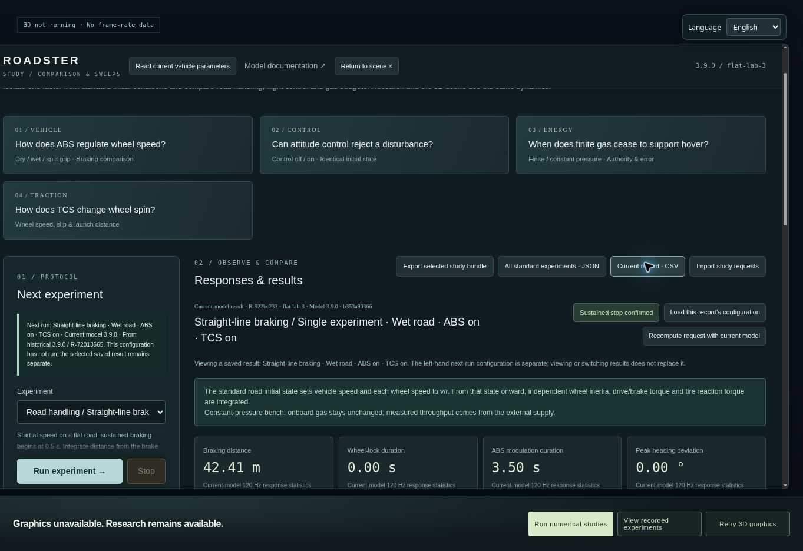

# Roadster Flight Lab

**把一辆车，从街道开到空中；把一次驾驶，变成可以解释和重放的实验。**

简体中文 · [English](README.en.md)

[**立即进入城市 ↗**](https://windscode.github.io/roadster-flight-lab/) · [风场实验室](https://windscode.github.io/roadster-flight-lab/?view=lab) · [车辆曲面检视](https://windscode.github.io/roadster-flight-lab/vehicle-inspection.html)

Roadster Flight Lab 是一个独立、可玩的车辆与飞行仿真研究项目。参照 [Tesla 公开的 Roadster 图像与功能说明](https://www.tesla.com/roadster)，在原创 Vesper 城市中探索道路驾驶、冷气推进、姿态控制与近表面吸附。轮胎、悬架、气体、喷口、尾翼和控制器共同作用于同一个六自由度刚体。

它有车辆的力学边界，也给你研究这些边界的工具：改变路面和控制参数，观察轮速、滑移与耗气；记录现场输入，用相同初态重放；给同一控制问题做公平 A/B。大倾角、有限气源、喷口降额或密封失效都可能让动作失败，失败也会留下记录。

## 先玩起来

打开 [在线试验场](https://windscode.github.io/roadster-flight-lab/)，选择 **进入城市**。默认使用流畅画质和外部持续供气；初次载入需要下载本地打包的场景素材。右上角可切换 **中文 / English**，选择会保存在本机。

1. **开一段街道。** W / S 加速与制动，A / D 转向，Space 制动。画质面板中选择“织桥 · 南岸环线”，沿约 1.1 km 的连续街道、路口和桥下路线驾驶。
2. **离开路面。** 按 H 进入辅助飞行，E / Q 上升与下降。屏幕上的“升降响应”滑条直接设置目标垂直速度：**0.5–8 m/s，默认 3 m/s**。实际加速度受可用喷力限制，不是按住越久越快。
3. **试试姿态控制。** G 开启自动回正，恢复水平滚转和俯仰；航向参考保留在切换时的方向。关闭 G 后，Z / B 连续滚转，1 / 2 调整俯仰，松开后尝试稳住达到的姿态。X 执行有净空与气源预检的完整滚转。
4. **把这次飞行留下。** 工程遥测里选择“记录这次驾驶 / 飞行”，结束后在研究控制台查看曲线、导出或重放；不用重新搭建实验。

持续外供是方便练习与对照的试验工况。它维持供气，不提高喷口硬件上限，也不表示实车能够无限悬停。有限气源可在模型参数或研究控制台中选择。

## 三种探索方式

| 入口 | 可以做什么 |
|---|---|
| **Vesper 城市** | 自由驾驶、飞行、吸附、滚转；日间与湿夜；地图导航和连续街区路线；现场实验录制与重放。 |
| **同页风场实验室** | 自定义位置与姿态目标，调节控制增益，设置风与观测扰动，编辑有物理执行过程的自动流程，并绑定 3–9 快捷键带回城市。城市与实验室分别保留车辆状态。 |
| **标准数值研究** | 定义初态、工况与协议，比较制动、起步、转向、升降、悬停、滚转和姿态响应；参数扫描、控制器 A/B、历史查看与显式重算。无需 WebGL。 |

[车辆工坊](https://windscode.github.io/roadster-flight-lab/vehicle-inspection.html) 是专门的外形检查入口：锁定焦距与机位，查看曲面、玻璃、灯具、轮毂、转向和悬架行程。它展示的是依照照片制作的原创几何，不是 Tesla CAD。



*实际 3.9 浏览器界面：从历史配置显式重算湿地 ABS，生成独立新记录。截图环境没有 WebGL，因此这里展示的是可运行的数值研究，不是城市或车辆的三维画质样张。[浏览器实测与原始导出](qa/browser-release-3.9.json)。*

## 几个值得做的实验

- **同样全力制动，为什么方向不同？** 选择干地、湿地或左右分离附着，比较 ABS 开 / 关的制动距离、抱死时间和航向偏移。ABS 调节每轮制动压力，不等于 ESC；距离与方向稳定性可能存在权衡。
- **这个姿态真的能停住吗？** 在风场实验室设置倾斜姿态，观察重力、喷口竖直分量和力矩分配。有限推力不能承重时，车会下落；回正控制通过真实力矩恢复，不瞬间修改姿态。
- **同一段输入，不同控制器。** 记录一次受风扰动的飞行，固定初态、输入和扰动种子，仅改变声明过的控制增益进行 A/B。可加入测量延迟、有种子噪声或一个喷口降额。
- **这一遍真的复现了吗？** 原条件重放分别报告执行状态、模型兼容性和复现一致性；终态、关键曲线与控制状态有误差、容差和首次分歧。查看历史、原条件重放、按当前模型重算是不同操作。
- **翼面不是装饰。** 对照固定翼与主动翼，查看执行器展开、阻力、下压力与轮荷变化。网格和气动力读取同一个状态。

## 常用按键

| 操作 | 按键 |
|---|---|
| 加速 / 先制动，停稳后保持反向输入倒车 | W / S |
| 地面转向 / 辅助飞行偏航 | A / D |
| 车轮机械制动 / 后部冷气推进 | Space / Shift |
| 辅助飞行开关 | H |
| 上升 / 下降；接地后继续 Q 完成着陆并关闭阀门 | E / Q |
| 自动回正开 / 关，始终只有两态 | G |
| 连续滚转；G 开启时为横移 | Z / B |
| 受限角速度抬头 / 低头 | 1 / 2 |
| 吸附开关 / 自动滚转 / 自动降落 | F / X / L |
| 已保存的研究流程 | 3–9 |
| 菜单 / 暂停或继续 | ESC / P |
| 重置场景 / 明确的补气干预 | R / T |
| 相机 / 力矢量 / 地图或研究控制台 / 隐藏仪表 | C / V / M / F9 |
| 车载音乐播放 / 下一首 | J / K |

输入表单时，驾驶与流程快捷键暂停接收。任意研究目标姿态留在研究控制台中，G 不会进入定姿定点模式。

## 可信到什么程度？

**有物理依据，不等于真车标定。** 模型包含独立轮速与轮惯量、驱动和制动反力矩、正则化滑移、联合附着限制、悬架与接触、喷口阀门、温压相关排速与耗气、低阶压差吸附、气动尾翼，以及带约束的控制分配。默认物理步长为 120 Hz，显示画质不改变物理精度。

公开图像与功能描述用于选择研究对象。质量、惯量、几何尺寸、逐喷口推力和布局、轮胎曲线、风机、阀门、尾翼系数和内部构造均包含工程假设，未取得完整 Tesla 原厂数据与实车标定。没有 CFD、柔性车身、完整多体悬架、结构有限元或真实高压气体数据库。[推力与控制边界](dist/physics-3.9-notes.md) 会说明喷口能力如何限制悬停、倾斜和回正。

**视觉是持续制作中的浏览器场景。** 城市保留完整区域，优先完善连续可驾驶街道、材质、车体与光影，没有建筑内部或人群。日间和湿夜独立调校，远近细节与反射受画质预算限制。流畅档的 60 FPS 是目标，不是对所有设备的保证；本轮云端浏览器没有可用 WebGL，尚未完成三维像素、驾驶手感和真实 GPU 帧时间验收，不能宣称达到原生 3A 画质。

界面自带固定机位、PNG 与条件导出，以及预热 / 稳态分开的帧时间记录。请用本机实际渲染结果判断画质和性能。图形不可用时，同一页面仍能运行数值研究、查看历史和导出，显示“无帧率数据”。

## 数据留在你的浏览器

现场实验记录保存初态、模型 / 构建 / 协议身份、实际风场和扰动相位、每物理步输入、控制内部状态与干预事件。旧模型无法执行时，历史照常可查看，原条件执行会被明确拒绝；只有你选择“当前模型重算”才使用新模型。

现场整库 JSON、标准研究整库 JSON、流程配置 JSON 各有明确范围。CSV 只导出选中的单条记录，使用记录自身的身份、实际保留采样间隔与原始统计来源。语言切换只影响显示，不改字段、单位、用户命名或历史数据。研究记录存于本机浏览器；清除网站数据会删除本地记录，请用 JSON 备份。

## 本地运行与开发

需要 Node.js 22+。运行依赖已包含在仓库，不需要 `npm install` 或打包构建。

```sh
git clone https://github.com/Windscode/roadster-flight-lab.git
cd roadster-flight-lab
npm start
```

浏览器打开 `http://127.0.0.1:8080/`。Windows 也可双击 `启动试验场.cmd`。三维需要 WebGL 2 和可用的图形加速；数值研究不需要 GPU。

- [开发、验证与 Pages 发布](docs/DEVELOPMENT.md)
- [3.9 实际变化与证据范围](3.9-UPDATE-NOTES.md)
- [数值验证摘要](https://windscode.github.io/roadster-flight-lab/validation.json)
- [3.8 历史说明](3.8-UPDATE-NOTES.md) · [更早版本的开发记录](docs/history/README-3.8.md)

Three.js · cannon-es · Poly Haven CC0 环境素材。各素材许可随仓库保留。Tesla 品牌仅用于识别研究对象；本项目非官方，不用于车辆设计、安全评估或性能认证。
