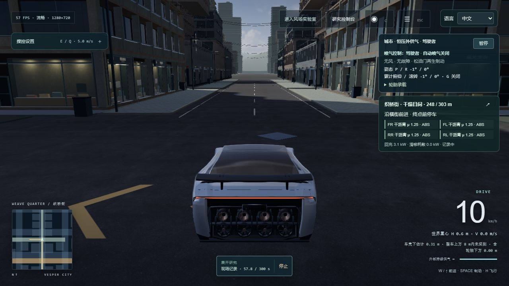
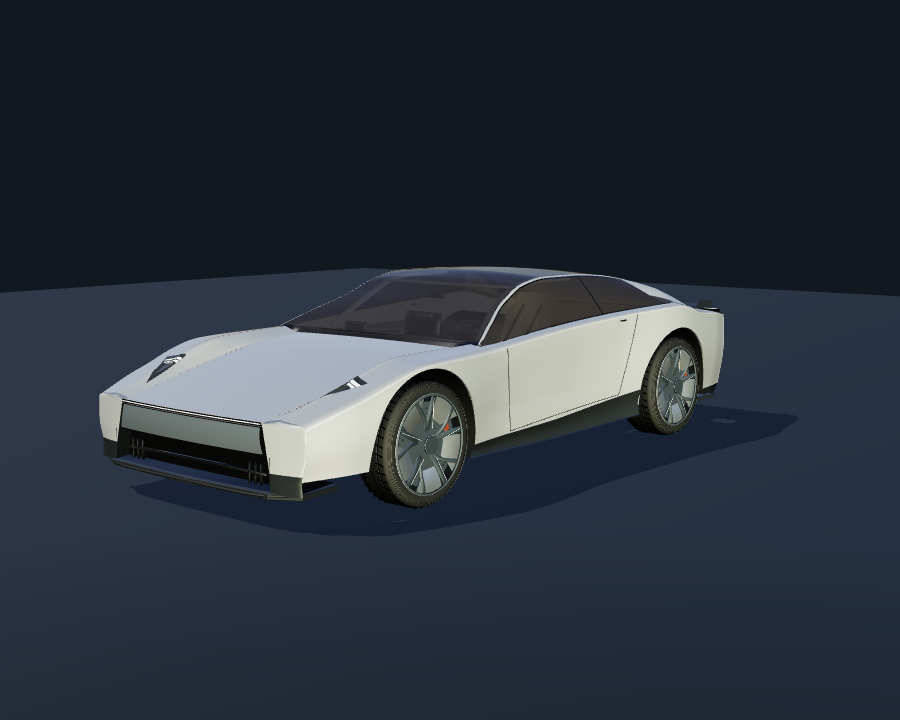
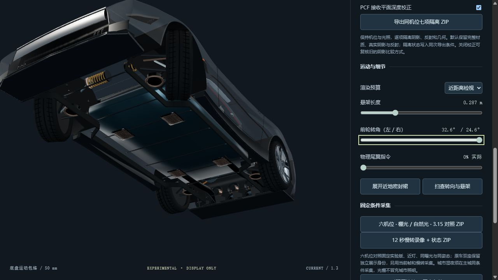

# Roadster Flight Lab

在浏览器里开一辆能用冷气喷口飞行的概念跑车。沿 Vesper 的高架进城，在织桥街看准弯心、收油、停车。想知道湿地要早多少米制动，或者同一阵横风下哪种控制器更稳，可以把一次驾驶变成可重放的实验。

**[进入城市](https://windscode.github.io/roadster-flight-lab/)** · [制动对照实验](https://windscode.github.io/roadster-flight-lab/?view=study) · [风场实验室](https://windscode.github.io/roadster-flight-lab/?view=lab) · [车辆工坊](https://windscode.github.io/roadster-flight-lab/vehicle-inspection.html) · [English](README.en.md)

## 第一次打开

| 想尝试什么 | 从这里开始 |
| --- | --- |
| 自由驾驶与飞行 | 选 **进入城市**。W / S 加速、减速与倒车，A / D 转向，空格制动。到开阔处按 H 进入辅助飞行，E / Q 上升和下降。 |
| 用一段街道练制动 | 选 **路线与挑战 → 准备路线 → 开始驾驶并记录**。通过三道金色计时线，在路口左转，进入青色圈并停稳半秒。自由练习可以停车熟悉弯道。 |
| 比较干湿地制动 | 打开 **制动对照实验**，选择直线制动、初始电量和路面，配对比较回收关 / 开。结果同时给出停车距离、回充与摩擦制动热量。 |
| 调飞行控制器 | 进入 **风场实验室**，选扰动、初态和控制器。保存一次实验后，在记录中回看输入和姿态，或从同一初态比较控制器。 |
| 看车身与机构 | 进入 **车辆工坊**，切换外观、底盘和剖视，调节悬架行程与转向，观察推杆、减振器和尾翼。 |

C 切换视角，M 打开地图，P 或 Esc 暂停。自动动作、改键和手柄校准在游戏内提供，操作提示跟随当前绑定。城市路线、任务和实验共用 120 Hz 车辆求解器、输入与资源记录。推荐先在桌面浏览器体验。

## 湿地要早多少米刹车？

把起始电量设为 80%，目标车速设为 80 km/h。相同的刹车输入在干地约需 25 m，在湿地约需 42 m。可以换路面、关掉能量回收，观察相同制动需求怎样分配给电机和摩擦制动器。

| 路面 | 停车距离（回收关 / 开） | 电池回充（回收开） | 摩擦制动热量（关 → 开） |
| --- | ---: | ---: | ---: |
| 干地 | 24.97 / 24.97 m | 6.73 Wh | 130.45 → 121.81 Wh |
| 湿地 | 42.23 / 42.23 m | 6.04 Wh | 124.70 → 116.96 Wh |
| 分离附着（左右抓地不同） | 30.76 / 30.76 m | 6.47 Wh | 128.66 → 120.37 Wh |

六次仿真实际踩下制动时为 79.34–79.35 km/h，低于 0.1 m/s 连续半秒确认停车；账目从开始制动计到首次停稳。以上为项目模型的结果。[运行实验](https://windscode.github.io/roadster-flight-lab/?view=study) · [六次原始测量](qa/release-1.3/driving-study.json)

## 同一条路，三种驾驶策略

有限资源挑战从 **120 Wh 可用电量、100 bar / 600 L 车载气罐**出发。65 秒内跑完 302.5 m，终点至少保留 5 Wh 和 5 kg 气。轮端制动功决定能收回多少电，电机、风扇、附件和喷口各有自己的账。

| 干燥白天，同一完整初态 | 用时 | 净用电 | 制动回充 | 车载用气 |
| --- | ---: | ---: | ---: | ---: |
| 节能驾驶 | 52.82 s | 56.74 Wh | 13.63 Wh | 0 kg |
| 均衡驾驶 | 43.73 s | 70.04 Wh | 16.14 Wh | 0 kg |
| 起步喷气辅助 | 40.93 s | 61.48 Wh | 16.14 Wh | 15.67 kg |

这些是 1.3 模型中通过常规油门、制动、转向和喷气输入跑出的三次完整结果。净用电已扣除回充。赛后展开四段收支，可以看到时间和资源花在哪一段，再与上一次同条件完赛逐段比较。中途失败也会保留已经过线的分段。[有限任务数据](qa/resource-1.3) · [一次完整键盘驾驶及原条件复算](qa/browser-1.3/observations.json)

## 车辆、城市与研究

- **驾驶与飞行**　四轮分别计算接地、悬架和抓地。手动阀门、辅助飞行、回平保高和自动动作各有明确的控制来源。着陆估算考虑气压、剩余电能、阀门响应及推力方向。
- **车辆工坊**　车身、座舱、轮拱与底部由程序化曲面和机构组成。车漆、玻璃、橡胶和金属各有材质。独立复原依据公开外观资料，隐藏机构和冷气系统采用公开说明的工程假设。[模型参考与素材](dist/assets/references/README.md)
- **完整城市**　地面街网、坡道与高架相连。织桥街有双层步廊，南岸水庭沿水设置潮位展示，机造里保留厂房和机床橱窗，换乘区橱窗展示桥墩与高架剖面。可切换日间、湿夜和三档画质，建筑以外部街景为主。
- **可重复实验**　记录保存完整物理初态、有效输入和模型身份。同一构建可原条件重放并核验状态，兼容的历史记录可显式选择按当前模型重算。实验、控制器对比和结果可导出。项目由爱好者独立开发，模型用于控制与驾驶研究，精度范围见发布说明。

查看工坊与底盘实景

[1.3 审查、实测与限制](docs/release-1.3.md) · [当前发布检查](qa/release-1.3/validation.json) · [浏览器验收](qa/browser-1.3/observations.json) · [官方 Roadster 外观参考](https://www.tesla.com/roadster)

## 本地运行

需要 Node.js 22 或以上。运行依赖和素材随仓库提供。

~~~sh
git clone https://github.com/Windscode/roadster-flight-lab.git
cd roadster-flight-lab
npm start
~~~

浏览器打开 `http://127.0.0.1:8080/`。可编辑源码位于 `dist/`。完整验收先安装仓库锁定的 DOM 测试依赖，再执行以下命令。

~~~powershell
npm ci --prefix tests/dom --ignore-scripts
$env:JSDOM_MODULE_PATH = (Resolve-Path tests/dom/node_modules/jsdom/lib/api.js).Path
npm run model:build
npm run test:release
node scripts/check-static.mjs
~~~

macOS / Linux 使用 `export JSDOM_MODULE_PATH="$PWD/tests/dom/node_modules/jsdom/lib/api.js"`。历史检查所依赖的归档与当前发布流程详见[开发说明](docs/DEVELOPMENT.md)。

## 版本与反馈

1.0 是首个正式版，此前的 3.x 为开发迭代。历史审查与原始验收材料随版本保留。[1.2](docs/release-1.2.md) · [1.1](docs/release-1.1.md) · [1.0](docs/release-1.0.md) · [3.24](docs/release-3.24.md) · [开发方向](docs/development-plan.md) · [线上构建身份](https://windscode.github.io/roadster-flight-lab/deployment.json)

欢迎报告可复现的问题。浏览器、画质、操作顺序和游戏内导出的记录可以帮助定位。[提交反馈](https://github.com/Windscode/roadster-flight-lab/issues)

原创代码与程序化资产采用 MIT 许可。第三方素材和库遵循各自许可。[LICENSE](LICENSE) · [素材署名](dist/CREDITS.md)
