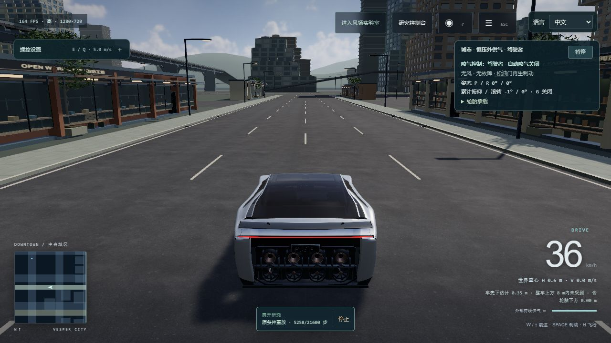

# Roadster Flight Lab

**在城市里驾驶，在空中练习控制，把每一次尝试变成可以解释和复盘的实验。**

[开始驾驶](https://windscode.github.io/roadster-flight-lab/) · [风场实验室](https://windscode.github.io/roadster-flight-lab/?view=lab) · [车辆工坊](https://windscode.github.io/roadster-flight-lab/vehicle-inspection.html) · [English](README.en.md)

Roadster Flight Lab 是一个独立的车辆驾驶、冷气喷射飞行与自动控制研究项目。你可以沿完整路网探索原创城市 Vesper，练习起飞、翻转和着陆，也可以改变控制律、风场和资源条件，记录过程并比较结果。驾驶、挑战和研究使用同一套物理、输入与资源模型。

## 可以体验什么

| 方向 | 当前能力 |
| --- | --- |
| 驾驶与飞行 | 120 Hz 刚体求解、轮胎与悬架、碰撞、不同附着路面、手动喷气、姿态辅助、自动翻转与着陆 |
| 车辆工坊 | 独立重建的 Roadster 概念车身、座舱、底部与喷口；转向、悬架、尾翼、灯光对应仿真状态；剖视及模型导出 |
| 城市探索 | 连续可驾驶路网、高架与坡道、商业街、公共空间、工业滨水区；白天与湿夜、三档画质和多种驾驶视角 |
| 挑战与研究 | 有限资源路线、飞越与精确着陆、风扰动、控制器 A/B、参数研究、完整初态与输入记录、重放及结果导出 |

资源会影响实际过程：电机和风扇消耗电量，有限气源随喷气耗减，制动回充按实际车轮功计算并受电量、效率与功率约束。自由驾驶默认采用外部持续供气，有限资源挑战则明确声明自己的初始条件。

## 第一次驾驶

1. 打开网站，选择 **进入城市**，先在地面熟悉转向和制动。
2. 在开阔位置尝试辅助飞行；需要时展开操控设置。自动翻转会检查当前条件和上方净空。
3. 从 **路线与挑战** 进入导航、有限资源驾驶或飞越着陆。失败后可以查看原因并重新开始。

| 默认按键 | 操作 |
| --- | --- |
| W / S，A / D | 前进 / 减速与后退，转向；也支持方向键 |
| Space | 摩擦与再生混合制动 |
| H，E / Q | 辅助飞行开关，上升 / 下降 |
| 1 / 2，Z / B | 手动俯仰、滚转；G 开启时 Z / B 用于横移 |
| P，Esc，R | 暂停 / 继续，菜单，结束本次并复位 |
| C，M | 切换相机，地图与路线 |

完整按键、自动动作和改键设置都在游戏内。支持手柄映射与校准；帮助提示随实际绑定更新。建议先用桌面浏览器和键盘体验，再按设备性能选择画质。

## 把驾驶变成研究

风场实验室与城市在同一页面切换。研究控制台可设置控制参数、扰动和流程，保存完整初态与输入序列，查看响应曲线、能量收支及失败结果。同一记录可以保留并切换查看多次重算或控制器 A/B 分析。

**重放和重算有区别。** 同一构建的原条件重放会核验状态误差；兼容的历史记录必须显式选择按当前模型重算，保留来源身份，不宣称执行了旧模型。只有条件与完整初态相符的记录才构成公平对照。存储容量或多页面冲突会明确提示，重要实验请导出备份。

## 本次更新 · 1.1

- 统一环境压力下的喷口能力与实际执行器计算，修复低电量时翼面、阀门等动作的供电边界。
- 修复车头上盖、折边与前包角的几何衔接，保持既有机械硬点与绘制预算。
- 完善材质准备，避免遗漏共享材质的着色器变体；湿路反射完成后不再重复提交已消费的阴影更新请求。
- 保护多页面实验存档，支持选择和导出每次分析；兼容记录可明确按新模型重算。

[完整审查与变更](docs/release-1.1.md) · [当前发布检查](qa/release-1.1/validation.json) · [真实浏览器验收](qa/browser-1.1/observations.json) · [开发方向](docs/development-plan.md)

## 模型依据与限制

项目结合公开 Roadster 外形资料与明确标注的工程假设。冷气推进、轮胎、悬架、碰撞和资源模型用于交互研究，**不是 Tesla 官方产品、原厂 CAD、真实车辆性能预测或工业认证仿真**。完整城市保留探索空间，建筑目前以外部街景为主。

画面、性能和物理真实性持续改进。首次加载或更换画质需要准备资源和着色器，期间车辆暂停；准备时间与驾驶长帧分别记录。验收报告说明设备与测试范围，不把单台机器的结果泛化到所有设备，也不把数值检查当成真实键盘、手柄或音频听感验收。

## 本地运行与开发

需要 **Node.js 22+**。运行依赖和公开素材随仓库保存，无需安装生产依赖。

~~~sh
git clone https://github.com/Windscode/roadster-flight-lab.git
cd roadster-flight-lab
npm start
~~~

打开 http://127.0.0.1:8080/ 。运行源码位于 `dist/`，它不是可删除的构建缓存。使用 HTTP 启动，不要直接打开 HTML 文件。

完整发布检查（PowerShell）：

~~~powershell
npm ci --prefix tests/dom --ignore-scripts
$env:JSDOM_MODULE_PATH = (Resolve-Path tests/dom/node_modules/jsdom/lib/api.js).Path
npm run model:build
npm run test:release
node scripts/check-static.mjs
~~~

macOS / Linux 可用 `export JSDOM_MODULE_PATH="$PWD/tests/dom/node_modules/jsdom/lib/api.js"` 设置同一变量。历史 `npm test` / `npm run validate` 依赖早期归档，不是当前发布入口。架构、验证范围和发布流程见[开发说明](docs/DEVELOPMENT.md)。

## 历史、反馈与许可

1.0 是首个正式产品版本；3.19–3.24 是此前的开发迭代。历史成果、报告及限制保留在各版说明中：[1.0](docs/release-1.0.md)、[3.24](docs/release-3.24.md)、[3.23](docs/release-3.23.md)、[3.22](docs/release-3.22.md)、[3.21](docs/release-3.21.md)。线上实际版本以[部署身份](https://windscode.github.io/roadster-flight-lab/deployment.json)为准。

欢迎通过 [Issues](https://github.com/Windscode/roadster-flight-lab/issues) 提交可复现问题、研究方案和体验反馈。问题报告请尽量附浏览器、画质、操作步骤，以及游戏内导出的记录或画面条件。

原创代码与程序化资产采用 [MIT License](LICENSE)；第三方素材与库按各自许可使用，见[素材署名](dist/CREDITS.md)。
