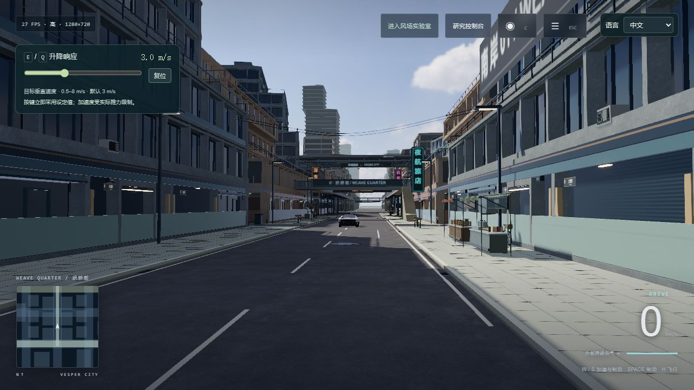
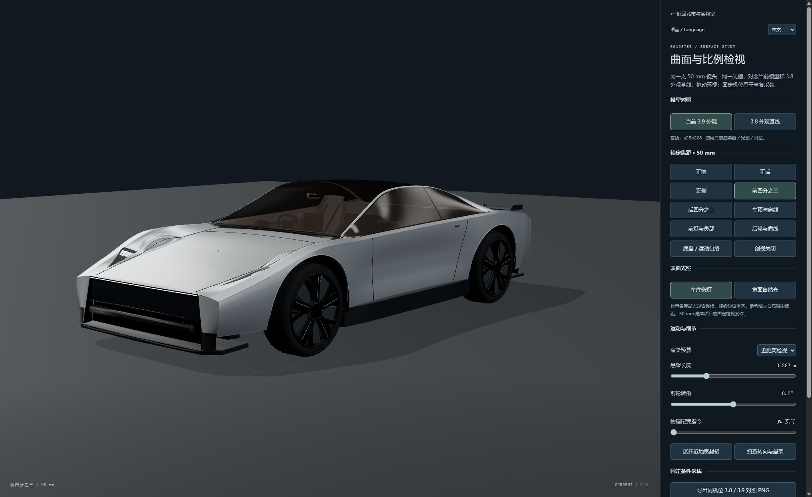

# Roadster Flight Lab

**把一辆车，从街道开到空中；把一次驾驶，变成可以解释和重放的实验。**

简体中文 · [English](README.en.md)

[**进入城市 ↗**](https://windscode.github.io/roadster-flight-lab/) · [风场实验室](https://windscode.github.io/roadster-flight-lab/?view=lab) · [车辆工坊](https://windscode.github.io/roadster-flight-lab/vehicle-inspection.html)

Roadster Flight Lab 是一个独立、可玩的车辆与飞行仿真研究项目。依据 [Tesla 当前公开的 Roadster 图像](https://www.tesla.com/roadster)重建外形，在原创 Vesper 城市中探索驾驶、冷气推进、姿态控制与近表面吸附。轮胎、悬架、气体、喷口、尾翼和控制器共同作用于同一个六自由度刚体。

你可以沿连续街道驾驶，离开路面完成姿态机动，再把这段输入变成可导出、可重放的实验。风、观测延迟、喷口降额和有限气源会实际改变响应，成功与失败都会留下记录。

## 看看试验场





*以上为实际渲染的 **3.9 历史画面**，用于展示项目的城市与车模基础；不代表当前 3.13 的同条件验收结果。[画面来源与对照条件](docs/visual-evidence-3.10.md)。*

## 快翻，也保留真实惯性

X 采用短起跳和独立快翻轨迹。从水平地面或水平飞行开始，旋转后靠实际推力制动，落地或返回原空中高度；压力、气量、初始角速度或上方净空不合适时会给出具体原因。

想手动练习，可选 **快翻练习**，H 开启辅助飞行、关闭 G，先 E 起升再 Z / B 滚转；约转过四分之三圈时松键并开 G 制动回正。G 会回正到当前高度参考附近，不自动回到起跳高度。时序和气耗见[自动与手动实测对照](docs/x-flip-3.13.md)。

## 第一次怎么玩

1. **开一段街道。** 进入城市后，W / S 加速与制动，A / D 转向，Space 制动。视景面板的“织桥 · 南岸环线”串起约 1.1 km 的道路、商业街、路口和高架桥下空间。
2. **离开路面。** H 开启辅助飞行，E / Q 上升与下降。界面滑条调整升降速度及加速度；参考值持续受实际推力、供压和姿态限制。它们不会随按住时间无限增大。
3. **试试姿态机动。** G 开启时自动恢复水平滚转与俯仰，并保留切换时的航向。关闭 G 后，Z / B 滚转、1 / 2 俯仰；手动角速度与角加速度可调。X 提供经过净空和气源预检的完整滚转。
4. **记录与对照。** 工程面板选择“记录这次驾驶 / 飞行”，完成后查看轨迹与曲线、导出、原条件重放，或明确选择按当前模型重算。

默认外部持续供气方便练习。有限气源进一步受储气消耗和温降限制；两种模式都保留供压、阀门响应与喷口推力上限。右上角支持 **中文 / English**。

## 三个入口，一套物理

| 入口 | 主要玩法 |
|---|---|
| **Vesper 城市** | 道路驾驶、飞行、滚转与吸附；晴天 / 湿夜；地图导航、连续路线与现场记录。 |
| **风场实验室** | 设置位置和姿态目标，编辑控制增益、风与观测扰动；把有实际执行过程的自动流程保存并绑定到 3–9 快捷键。城市与实验室分别保留车辆状态。 |
| **车辆工坊** | 固定焦距与机位，检查外形、玻璃、灯组、轮毂、转向及悬架行程；切换冻结历史模型，导出真实对照画面。 |

城市与实验室里的高级研究面板使用相同求解器，在后台执行标准初态试验，保留现场车辆状态。记录、JSON / CSV 导出和数值实验也可在没有三维图形的设备上使用。

## 几个值得做的研究

**找到普通 G 回正的离散恢复边界。** 选择“空中稳姿恢复 → G 恢复高度网格”。同一套实际喷口与供气下，运行 30° / 60° / 90° / 120° 初始滚转 × 3 / 6 / 12 / 24 m 初始质心高度，共 16 次试验。加入侧风或右前主喷口降额，查看哪些样本持续回稳、触地或在 12 秒内未恢复；点击格子查看真实姿态、高度、推力和耗气曲线。它报告“最低成功的已采样高度”，没有把稀疏样本插值成安全承诺。

**比较控制器在噪声与延迟下的表现。** 选择“空中稳姿恢复 → 五种子控制器对照”。在同一初态、风场和供气下，比较 A / B 两组姿态响应：5 个明确种子 × 2 档观测延迟 × 2 组控制器，共 20 次、每次 12 秒。可加入右前主喷口降额。界面显示逐种子成功与失败、姿态 / 高度误差、最大掉高、饱和和实际耗气；点击一行就能查看该种子的配对曲线。此模式使用实验室的定姿定点控制器，普通 G 回正实验仍单独保留。

**比较干地、湿地和左右分离附着的制动。** 用相同初态比较 ABS 开 / 关的制动距离、抱死时间与航向偏移，或观察起步时各轮转速与 TCS 调制。ABS 与方向稳定性之间的权衡会直接反映在响应中。

**检查有限气源的任务边界。** 对照有限储气与外部供气，观察悬停失守、实际耗气、喷口饱和和稳定着陆。主动尾翼与轮胎载荷使用同一个物理状态。新会话默认采用恒压试验台，选择有限气源后保留冲量不足的真实拒绝。滚转实验默认观察 20 秒，旧 8 秒窗口可单独选择并随记录保存。

**验证历史轨迹的复现。** 原条件重放分别报告执行状态、模型兼容性和复现一致性。历史始终保留自己的模型与构建身份；选择当前模型重算后，差异和参数映射会单独记录。

## 常用按键

| 操作 | 按键 |
|---|---|
| 加速 / 制动，停稳后保持反向输入倒车 | W / S |
| 地面转向 / 飞行偏航 | A / D |
| 机械制动 / 后部冷气推进 | Space / Shift |
| 辅助飞行开关；上升 / 下降 | H；E / Q |
| 自动回正开 / 关 | G |
| 滚转；G 开启时为横移 | Z / B |
| 悬浮且 G 关闭时抬头 / 低头 | 1 / 2 |
| 吸附 / 自动滚转 / 自动降落 | F / X / L |
| 已保存的研究流程 | 3–9 |
| 相机 / 力矢量 / 地图或研究面板 / 隐藏仪表 | C / V / M / F9 |
| 菜单 / 暂停 / 重置 / 明确补气 | ESC / P / R / T |
| 音乐播放 / 下一首 | J / K |

输入表单时，驾驶与流程快捷键暂停接收。Q 持续下降至可靠接地后关闭喷口。大倾角或低空恢复可能失败；车辆通过真实力矩转动和制动。

## 模型与数据边界

这是依据公开图像和工程假设制作的非官方仿真，未取得 Tesla 原厂 CAD、轮胎数据库或实车标定。额定机械功率 **700 kW**、干地摩擦系数 **μ = 1.25**、单主喷口 **20 kN** 等为当前模型假设。实验喷口、吸附系统和内部构造包含原创研究设计，不能当作官方车辆技术资料。

物理采用独立轮速、联合附着、悬架接触、有限响应阀门、气源与控制分配；不含工业 CFD、柔性车身或完整多体悬架。城市为持续制作的浏览器实时场景，保留完整街区并按画质分配照明、阴影和反射预算。画质、实际驾驶帧时和数值正确性各有独立验证要求。当前车身条纹、夜间照明、材质与反射运动仍待同条件 WebGL 对照验收；进度与条件见[图形验证记录](docs/visual-3.13.md)。松油电机制动按机械耗散建模，未计电池回充。

记录存于当前浏览器。达到存储上限后，已有历史保留，新结果会明确提示仅存于当前会话；请用完整 JSON 导出保存。语言切换不会改写实验字段、用户命名或历史数据。五个指定种子的结果只解释这些工况，不构成真实车辆可靠性保证。

## 本地运行

需要 Node.js 22+；运行依赖已包含在仓库。

```sh
git clone https://github.com/Windscode/roadster-flight-lab.git
cd roadster-flight-lab
npm start
```

打开 `http://127.0.0.1:8080/`。Windows 也可双击 `启动试验场.cmd`。三维需要 WebGL 2 和图形加速；数值研究无需 GPU。

[本轮发布说明](docs/release-3.13.md) · [制动转弯对照](docs/braking-controls-3.12.md) · [驾驶与飞行基础](docs/vehicle-dynamics-3.11.md) · [开发与验证](docs/DEVELOPMENT.md) · [G 恢复网格](docs/g-recovery-grid-3.12.md) · [研究对照协议](docs/research-robustness-3.11.md) · [物理假设](dist/physics-3.9-notes.md) · [历史版本](3.9-UPDATE-NOTES.md) · [部署身份](https://windscode.github.io/roadster-flight-lab/deployment.json)

Three.js · cannon-es · Poly Haven CC0 环境素材。第三方素材许可随仓库保留。Tesla 品牌仅用于识别研究对象，本项目非官方，不用于车辆设计、安全评估或性能认证。
