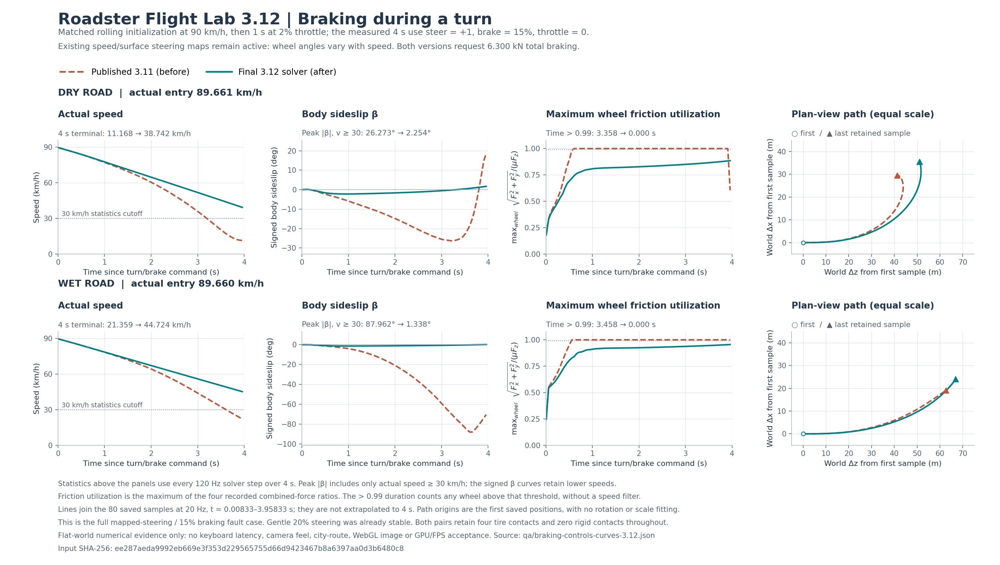

# 3.12：弯中制动、轻刹交接与手柄中心连续性

## 承接版本与验收范围

本轮承接已经发布的 **3.11，`ab9372b56a01c2a47b18d32baf48162f3cd8f86c`**。它的树与恢复工作区的 `96346a65497c994061d3bedda56464067e5e31ef` 等价。没有把 3.11 已完成的低速侧向力平滑、松油制动按轮载分配、湿地随速转向、纵横联合 TCS 或手动飞行/X 协调重新列成本轮成果。

本报告及以下文件是本轮的可复查证据：

- `tests/braking-corner-3.12.test.mjs`：三阶段隔离、驾驶回归、力/功账和输入映射测试。
- `qa/braking-controls-3.12.json`：所有 120 Hz 步长统计、初始条件、源码哈希、限制及结果。
- [qa/braking-controls-curves-3.12.json](https://windscode.github.io/roadster-flight-lab/qa/braking-controls-curves-3.12.json)：24 条完整 20 Hz 数值曲线；包含实际车速、转向/油门/制动命令、轮转角、横摆率、车身侧滑角、各轮载荷/侧偏/纵滑、摩擦利用率、施力、制动力矩及轨迹。
- `qa/fixtures/baseline-3.11/dynamics-manifest.json`：冻结的 3.11 物理、轮胎、车辆辅助公式及输入映射来源和哈希。仅将物理模块使用的共享运行时/几何导入重定向到 `dist`，没有冻结一套渲染场景。

这里的结果来自平坦数值场景。车辆有一次明确声明的滚动初态，四轮角速度与车速匹配；之后全部由真实力、轮系积分及刚体积分推进。主对照先用 2% 油门运行 1 s，再以同样的转向/制动命令测量 4 s，测量期不改写实际速度或姿态。它不等同于在城市道路从静止加速，更不代表真实键盘手感、相机体验、WebGL 画面或 GPU 路线帧率。实际键盘与相机属于本轮另外的验收。

## 1. 弯中服务制动仍在过度制动内轮

### 现象和根因

3.11 已将松油电机制动按瞬时轮载分配，但服务制动仍然固定为前轮各 30%、后轮各 20%。在有侧向载荷转移时，同一根轴上较轻的内轮得到与外轮相同的制动请求。内轮的纵向需求更容易占满自己的 `μ Fz`，轮胎纵横合力限幅随后削弱侧向作用，车身进入进一步失稳。3.11 的 ABS 会根据测得的纵滑释放压力，但不能使这种最初的预算分配成为合理的弯中制动分配。

因此本轮没有提高 μ、修改车身横摆、强制对齐速度或加大动力。修改发生在 `dist/physics.js::_wheels` 的**服务制动预算分配**，轮胎接触求解仍保留已有轮载、纵滑和联合附着限制。

先进行了只有一项变化的隔离：冻结 3.11 其余源码，只将既有前/后轴服务预算，在轴内按法向载荷分配。随后才加入第 2 节的轻刹交接。下表三阶段保持总服务请求 **6300 N（15% × 42000 N）**；主测试为全幅、经过现有随速/路面映射的转向命令，不是 20% 轻幅输入。

| 目标速度/路面 | 实际测量起速 | 指标 | 发布的 3.11 | 只改轴内分配 | 最终 3.12 |
| --- | ---: | --- | ---: | ---: | ---: |
| 90 km/h，干地 | 89.661 km/h | 实际车速 ≥30 km/h 时峰值车身侧滑 | 26.273° | 2.254° | 2.254° |
| 同上 | 同上 | 峰值轮胎侧偏角 | 40.621° | 5.732° | 5.732° |
| 同上 | 同上 | 峰值纵向滑移比 | 0.457 | 0.0183 | 0.0183 |
| 同上 | 同上 | 任一轮摩擦利用率 >0.99 的时长 | 3.358 s | 0 s | 0 s |
| 同上 | 同上 | 4 s 后实际速度 | 11.168 km/h | 38.742 km/h | 38.742 km/h |
| 90 km/h，湿地 | 89.660 km/h | 实际车速 ≥30 km/h 时峰值车身侧滑 | 87.962° | 1.338° | 1.338° |
| 同上 | 同上 | 峰值轮胎侧偏角 | 86.436° | 2.959° | 2.959° |
| 同上 | 同上 | 峰值纵向滑移比 | 1.000 | 0.0370 | 0.0370 |
| 同上 | 同上 | 任一轮摩擦利用率 >0.99 的时长 | 3.458 s | 0 s | 0 s |
| 同上 | 同上 | 4 s 后实际速度 | 21.359 km/h | 44.724 km/h | 44.724 km/h |

最终生产模块与轴内分配单项隔离的关键指标在 `1e-6` 容差内相同。这提供了对这组**弯中制动失稳**的因果证据；不是根据修改源码数量或测试通过数量推断操控改善。

侧滑和轮胎侧偏需要分别解释：干地旧版本的全程峰值车身侧滑为 26.346°，发生时车速 29.138 km/h；湿地旧版本为 87.962°，发生时车速 30.406 km/h。上述表格的车身侧滑评估只取实际速度 ≥30 km/h 的样本，同时在 JSON 中保留全程曲线。低速紧定圆里，质心速度与车头不完全平行可以包含正常运动学成分，不能单凭一个车身角度判定轮胎失控。

### 同条件原始曲线图



[放大矢量图](../qa/figures/braking-turn-3.12.svg)。图线直接读取每条实际保存的 80 个 20 Hz 样本，覆盖命令后的 0.008333–3.958333 s；标题统计来自同一记录内每个 120 Hz 步、完整 4 s 的指标。峰值侧滑仅统计实际车速 ≥30 km/h，图线保留低速部分；抓地占用时长无车速过滤。轨迹以各自第一个保存点平移为原点，米制等比例，无旋转、拟合或补终点。可通过 `python scripts/plot-braking-controls-3.12.py` 从归档重建。这是数值证据，不是 WebGL 或真实驾驶手感验收。

### 方案与边界

前轴仍持有总服务请求的 60%，后轴仍持有 40%。对于轴 A 上接地轮 i：

\[
F_{i,service}=B_{service}\,a_A\,\frac{F_{z,i}}{\sum_{j\in A}F_{z,j}},\qquad a_F=0.6,\ a_R=0.4
\]

单轮离地时，仍接地的同轴轮分得该轴预算；离地轮不重复得到另一份。整轴都离地时，保持该轴的自旋制动预算，均分到两只空转轮，且不会产生虚构地面力。测试通过六种接触组合逐项核对轴预算，包含前/后轴整体离地和四轮离地。

这是轴内按载荷分配的简化制动模型。它没有引入可随工况变化的前后轴 EBD 标定，没有使用车身横摆闭环，也不是工业 ESC。选择保留既有 60/40 而不是按全车轮载重新分配，是因为单项隔离已解决所复现问题，并能保留直线制动语义和结果。

### 回归与仍存在的滑移

54/90 km/h、干/湿地、20% 转向加 15% 制动的四组对照在 3.11 已处于小侧偏区：3.12 仍保持实际车速 ≥30 km/h 时车身侧滑 <2°、全程轮胎侧偏 <3°。这些稳定工况没有被描述成新解决的大幅打滑。反向转弯与正向转弯保留镜像一致性。

以下直线全刹距离是从刹车命令发出起累计的**实际路径长度**，停车门槛为速度 <0.36 km/h。两版本数值相同：

| 路面 | 实际起速 | 3.11 停止时间 / 路径 | 3.12 停止时间 / 路径 |
| --- | ---: | ---: | ---: |
| 干地 | 89.661 km/h | 2.317 s / 30.689 m | 2.317 s / 30.689 m |
| 湿地 | 89.660 km/h | 4.158 s / 53.181 m | 4.158 s / 53.181 m |

这两组确实触发了 ABS 压力释放。各主对照保留四轮接地，没有车体或刚性轮止挡撞击替代轮胎减速。

左右分离附着路面（`split`）仍有物理边界。90 km/h 目标、全刹、全幅映射转向时，实际车速 ≥30 km/h 的峰值车身侧滑从 55.387° 降到 **26.419°**，并未消失。不能据本轮结果承诺高速极限转弯、两侧 μ 不一致或所有街道条件都不会滑移。

## 2. 刹车踏板跨过 1% 时，制动力原来反而下降

### 第二个独立根因

旧实现使用 `brake <= .01` 区分松油电机制动与服务制动。54 km/h、油门 0 的同一滚动初态中，踏板从 1.0% 增至 1.1%，制动力矩折算总力从 **2600 N 降至 462 N**，实际第一步减速度从约 **0.998 降至 0.257 m/s²**。只有先改轴内分配时，这个跳变仍然完整存在，因而它是另一项独立问题。

修改仍在 `_wheels`，统一计算全车总请求，然后才分配到各轮。定义：

- `R`：已有松油电机制动请求，仍受 `regenForce`、`regenPower / max(|v_long|,1)` 和现有油门释放平滑控制；无电或无接地轮时为 0。
- `S = brake × brakeForce`：既有服务制动踏板请求。
- `B = max(R,S)`：总请求包络，不把两份请求叠加到一起。
- `u = clamp(S/R,0,1)`，`h(u) = u²(3−2u)`；R 为 0 时按 u=1 处理。
- 等效电机制动份额 `E = R(1−h(u))`，服务制动份额 `B−E`。

`E` 继续按全车轮载分配；服务部分使用前述固定 60/40 轴预算与轴内轮载分配。`S >= R` 后全部成为服务制动，所以 15% 制动、满刹以及原额定 **42 kN** 请求上限没有变化。

这种语义下，刹车踏板的最初一段先把原有松油减速交给服务制动，随后才增加总减速需求。在 54 km/h、默认 R=2600 N 时，约 6.19% 踏板后 S 才大于 R。它是非递减的总请求包络，并不是保证每增加一点踏板都严格增大减速度；车辆实际减速度仍由速度、载荷、轮胎和 ABS 决定。

| 踏板 | 3.11 实际制动力矩折算总力 | 3.11 首步减速度 | 3.12 实际制动力矩折算总力 | 3.12 首步减速度 |
| --- | ---: | ---: | ---: | ---: |
| 1.0000% | 2600 N | 0.998002 m/s² | 2600 N | 0.998002 m/s² |
| 1.0001% | 420.042 N | 0.242180 m/s² | 2600 N | 0.998011 m/s² |
| 1.1000% | 462 N | 0.256747 m/s² | 2600 N | 0.998002 m/s² |
| 3.0000% | 1260 N | 0.533539 m/s² | 2600 N | 0.997992 m/s² |
| 6.2000% | 2604 N | 0.999544 m/s² | 2604 N | 0.999544 m/s² |

细小的最后几位变化来自有容差的轮胎隐式求根及前后轴分配，而非恢复一个控制分支跳变。0–100% 的独立请求扫描检查了总预算非递减且不超过 42 kN。

### 静止附近的踏板交接

旧低速驻车保持也使用了 `brake <= .01` 条件，因此稍加刹车会先撤掉已有保持。现在保留原有低速接地条件（局部纵速 <0.18 m/s、油门 <1%），但不再因为轻刹输入撤掉保持；各轮补充只使用全车尚未分配的制动预算。

在水平地面给车体连续施加 **1000 N 纵向外力 3 s**，踏板为 1.1% 时：

| 指标 | 3.11 | 3.12 |
| --- | ---: | ---: |
| 车体位移 | 1.0791 m | 0.01456 m |
| 期间最大速度 | 2.5711 km/h | 0.03185 km/h |

0%、0.9%、1.1%、20%、100% 踏板均检查过。42 kN 是请求上限，实际作用仍受轮胎和接地约束；1.46 cm 的小位移也说明这里保留的是有柔性的静摩擦近似，没有锁死车体位置或速度。原有 <0.18 m/s 的低速保持边界不是新标定的真实驻车系统。

## 3. 纠正“真实能量回收”表述并记录实际机械功

源码核查确认，现有所谓 `regen` 通道产生的是等效松油电机制动。`_energyUsed` 计算电驱、风扇和辅助电耗，**没有电池回充项**。本轮不凭空增加回收效率、电池充电量或更大推力。

`dist/driving-capture.js` 的 `steer-90-coast` 说明已同步改为：

> 包含松油电机制动与抓地竞争，未计电池回充。

对应英文明确写出 `battery recharge is not modeled`，删除原来的 `real regenerative braking`。

在 `dist/tire-dynamics.js::integrateWheel`，分项计量使用**实际 ABS 压力释放、轮停转截断后的制动力矩和中点机械功**，不是直接累加未施加的命令。新增轮级诊断为：

| 字段 | 含义 |
| --- | --- |
| `serviceBrakeDemandN`、`regenBrakeDemandN` | 分配到该轮的服务/等效电机制动请求 |
| `brakeDemandN` | 两者总请求，包含低速保持请求 |
| `serviceBrakeTorqueNm`、`regenBrakeTorqueNm`、`rollingBrakeTorqueNm` | 该步实际服务/等效电机/滚阻力矩的分项 |
| `brakeTorqueNm` | 既有实际总被动力矩，仍包含滚动阻力 |

新增 `driveAccounting.brakeMechanicalWorkJ`、`liftOffBrakeMechanicalWorkJ` 记录每步移出的被动机械功及等效电机制动子集；`electricalRecoveredWorkJ` 明确为 0。原有累计 `brakeDissipationJ` 继续记录从机械运动移出的能量，不能把它全部解释成制动盘热量。

为了避免旧版本没有字段却看起来像“原来没有制动功”，报告中旧版的新分项字段写 `null`；旧版原有累计被动机械功仍照实记录。旧 `brakeDemandN` 原本漏记松油与保持请求，所以跨版本轻刹表格比较的是实际制动力矩折算总力，未将旧遥测中的 0 冒充成没有制动力。

54 km/h 初态、湿地、3% 刹车、运行 2 s 的账目为：移出被动机械功 **70685.67 J**，其中等效电机制动 **36976.12 J**；电池回充 **0 J**，既有 800 W 辅助电耗合计 **1600 J**。轮系离地自由制动的正/反转案例还核对了机械功与转动动能损失一致；已发生纵滑的湿地轮胎案例检查了实际 ABS 分项，并逐项证明新增计量不改变旧轮胎求解得到的力、力矩冲量及功。

原 `regenPower=60 kW` 是按车身纵速折算的请求限制。本轮没有把它描述成已验证的实际电机子步回收功率上限，也没有建立可充电的电驱逆变器模型。新的字段只是把目前实际发生的被动机械作用解释清楚。

## 4. 手柄中心死区原来存在约 13% 的命令跳变

`dist/controls.js::driverAxes` 原先在摇杆幅度 <0.13 时输出 0，一旦越过边界便直接输出原摇杆值。因此轻微越界就跳到约 13% 转向、滚转或升降命令。

现在使用连续的死区外重映射：

\[
y=\operatorname{sign}(x)\max\left(0,\frac{|x|-0.13}{0.87}\right)
\]

之后仍按既有驾驶坐标转换方向。中心死区和 ±1 满量程不变；`.130001` 的摇杆幅度由约 `.130001` 命令变为约 **`.000001149`**。它意味着轻推时不会立刻发出 13% 指令，中段命令也会相应更细。键盘有输入时仍优先于对应摇杆轴，Z/B、E/Q、方向坐标均未互换。

测试通过真实的 `driverAxes` 函数检查转向、滚转、升降三轴，包含中心、边界两侧、正负对称、满量程与按键优先。这是命令映射验证，没有把它写成真实手柄设备延迟或触感验收。

## 5. 验证结果与尚未完成的验收

执行：

```sh
node tests/braking-corner-3.12.test.mjs
node tests/handling-controls.test.mjs
```

新增测试包含以上七组有区分力的数值/映射检查，所有结果保留在 3.12 路径。已有操控回归也通过：100–300 km/h 微小初始横摆扰动的直线制动、实际喷口阀门/压力/耗气、音效负载语义、静态城市碰撞宽相位、六个真实场景安全出生点和滨水坡道停车。

新制动状态在当前 3.12 模型中完整导出/导入，继续混合制动和反向转向 180 步后，完整快照逐字段精确相同。复位同时清空新增诊断，不继承上次制动数据。跨版本历史记录和显式迁移由项目的记录兼容机制单独处理，这项测试不宣称在 3.12 中精确执行 3.11 旧求解器。

仍需要在现有网站上验证真实输入、相机和行驶体验。这里没有采集新 GPU 画面，也没有把平地数值曲线充当城市路线帧率。极限 split-μ 转弯仍能滑移，低速保持仍有小蠕动，服务制动仍采用简化的固定前后轴预算，电池回充尚未建模。干地 μ=1.25、轮系额定机械功率 700 kW、服务制动请求上限 42 kN 和主喷口每个 20 kN 都保持原工程假设。
