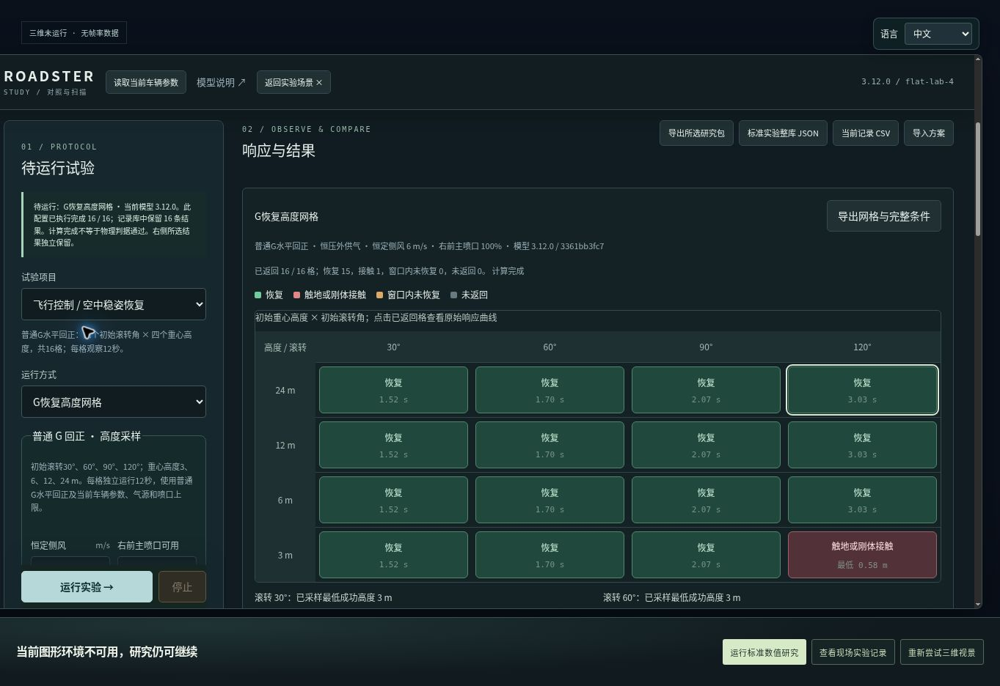
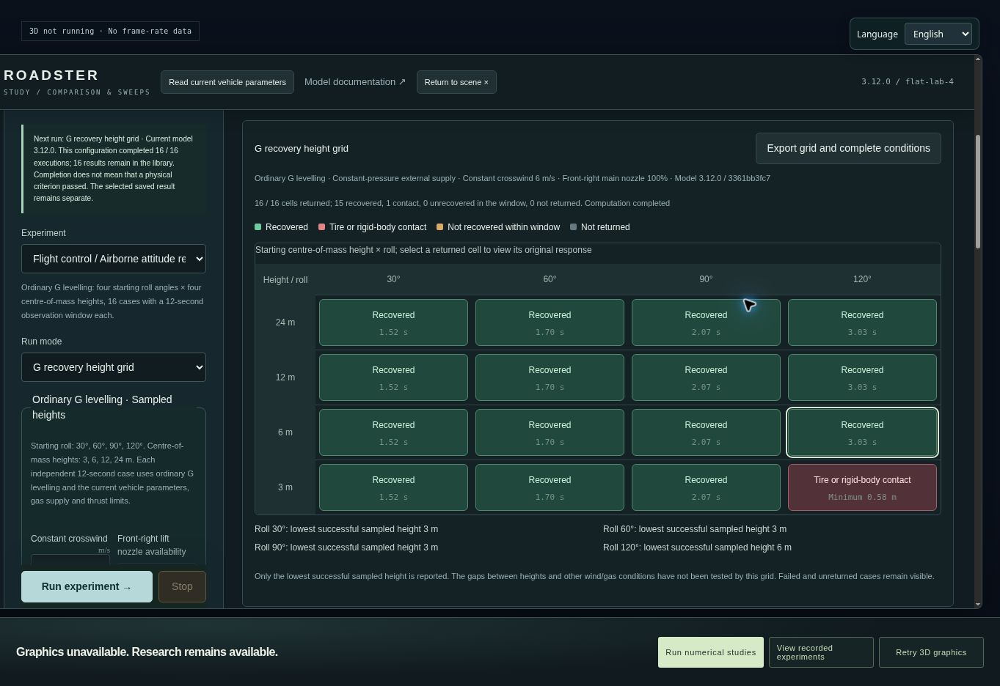
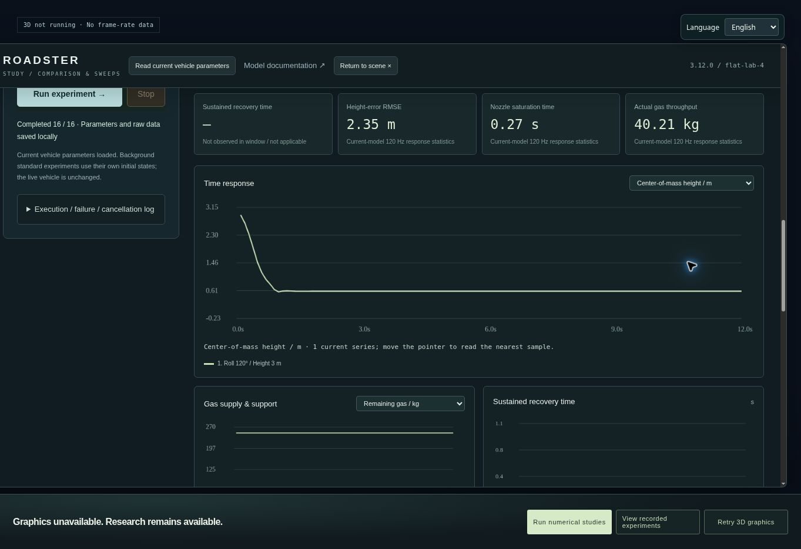
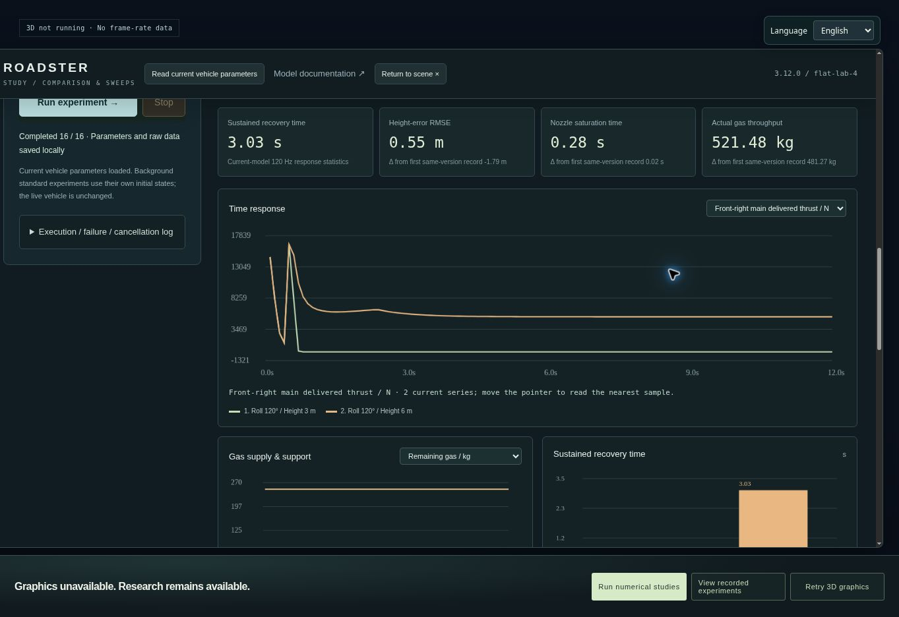

# 3.12 线上原生浏览器验收

本记录来自已部署网页的实际操作、截图和下载文件。没有在浏览器中注入求解器或替换页面结果；也没有把标准数值研究截图算成三维画面。

## 版本与环境

- 受检公开提交：`2002955e767742c61d526bf79c74f9f53a1f1843`。
- 完整 Git 树：`c63ba46b3a388e3980bf04c36cc5db3c21aad2d5`。
- 模型：`3.12.0`；构建：`3361bb3fc75c778555e46846b9299c271b8557cbe24d244af9c0719e27ff5255`。
- [Pages 运行 39374459451](https://github.com/Windscode/roadster-flight-lab/actions/runs/39374459451) 成功，最后更新于 2026-10-20 05:22:35 UTC；实际网页的 `deployment.json` 返回上述版本、提交、树和构建。
- 实际浏览器自报 Chrome 154 / Linux；本组界面截图均为 **1363×936**。GPU 身份和 DPR 未采集。

主页面和车辆检视页均无法建立图形上下文。原始控制台为 `GL_VENDOR = Disabled, GL_RENDERER = Disabled`；页面显示三维未运行、没有帧率数据。这是当前云浏览器的明确限制，不证明用户设备无法运行网站。

## 实际执行步骤及结果

从原网站 `?view=lab` 进入标准研究，选中“普通 G 回正需要多少高度？”，恢复默认模型参数，再明确核对恒压外供气、6 m/s 侧风及右前主喷口 100%。没有清空历史；该浏览器的标准研究库在本次运行前显示 0 条。

点击“运行实验”后，浏览器原生 Worker 在 2026-10-20 **05:24:31.626–05:24:38.118 UTC** 返回全部 16 格。这个 6.492 s 是批次起止时间差，不能当作游戏帧时、驾驶 FPS 或 GPU 性能。

| 验收项 | 实际结果 |
|---|---|
| 执行与物理结果分开 | 执行完成 16/16；15 格恢复、1 格接触，不把“已完成”当作全部成功 |
| 旧“尚未执行”残留 | 中文显示“此配置已执行完成 16 / 16”；英文显示 `This configuration completed 16 / 16 executions` |
| 失败格 | 120° / 3 m 显示接触；点击后真实高度曲线和接触结果同步切换 |
| 成功格 | 120° / 6 m 显示持续回稳，3.03 s；可与接触样本叠加比较右前喷口实际推力 |
| 英文覆盖 | 新预设、运行方式、风/故障条件、网格、图例、导出、结果和响应变量均有实际英文显示 |
| 刷新与保存 | 英文、网格配置、16 条结果、已完成判定、所选记录和叠加集合保留；100 字符上限内的备注即时保存后刷新保留 |
| 完整网格导出 | 使用网格专用按钮，获得全部 16 请求、16 报告、汇总和冻结的执行尝试；没有漏格或空报告 |
| 原始数据语义 | 报告保持实际 `g-recovery-grid-1` 身份，未将通用导出器页眉的 `flat-lab-4` 当成网格协议 |

本次原生浏览器验证了新生成的 16 条结果保留。旧版本历史迁移、容量边界与取消/失败尝试仍由已记录的回归和 DOM 测试覆盖，不能把这次空库运行写成用户全部既有历史的人工浏览器验收。

## 实际网页截图

以下是未经缩放或绘制替换的原始 JPEG。它们展示网页数值研究及其图形限制；不是车模或城市的 WebGL 后图。

### 中文完成矩阵

### 刷新后的英文矩阵

### 接触格的高度曲线

### 成功与接触样本的喷口推力对照

## 与已有完整数值证据的对照

原始浏览器下载共 **4,473,359 B**，SHA-256 为 `8bba6de357cd14a417ee99cba10521daf5da2fdaa022aad63dbc534bffb8342a`。完整字节保留在[浏览器网格包](https://windscode.github.io/roadster-flight-lab/qa/browser-live-grid-export-3.12.json)，本地恢复后的路径为 `qa/browser-live-grid-export-3.12.json`。下载包含请求、报告、汇总和尝试中的重复条件，其体积不等于内部历史库的存储体积。

逐项只读比较了该包与原 `qa/research-recovery-grid-curves-3.12.json`，没有再次运行求解器。16 个完整请求、全部 72 个实际模型参数、源码清单、初态、气源、风场与喷口条件对应一致；每格保留 1440 步统计与 120 行 10 Hz 曲线，共 **1920 行**。

| 项目 | 浏览器与原基准的最大绝对差异 |
|---|---:|
| 保存时间、事件时刻、结果分类 | 0 |
| 重心高度 | 3.553×10⁻¹⁵ m |
| 滚转角 | 5.329×10⁻¹⁴° |
| 车身倾角 | 5.001×10⁻⁷° |
| 右前主喷口实际推力 | 3.638×10⁻¹¹ N |
| 总冲量统计 | 5.821×10⁻¹¹ N·s |

84,931 对曲线数值中，61,423 对逐值相等，23,508 对有微小浮点差异；结构、类别和科学空值位置一致。最大倾角差出现在接近零的 `acos(bodyUpY)` 结果，对应余弦差约 2.22×10⁻¹⁶。这与跨运行环境的双精度舍入相符，是从保存值和源码得到的解释，不是新的实车有效性证明。不能宣称两份报告逐字节相同。

详细比较、容差、每个通道和每格结果见 [browser-live-grid-comparison-3.12.json](../qa/browser-live-grid-comparison-3.12.json)。最终 15/1 的分类、接触格及最低成功采样高度 **3、3、3、6 m** 完全一致；不插值为连续安全高度。

## 检视页与证据边界

实际[车辆检视入口](https://windscode.github.io/roadster-flight-lab/vehicle-inspection.html)显示 `Current 3.12 exterior`。图形失败后，同机位对比 PNG、七项隔离 ZIP 和独立 PNG 按钮均禁用；独立状态 JSON 仍可导出。

该真实导出明确记录 `graphicsAvailable=false`、`recordScope=current-state-unbound`，`captureId`、`frameAssociation`、相机、实际渲染分辨率与 GPU 均为 `null`。它没有假装绑定一张未生成的截图。原文件在 [browser-inspection-metadata-3.12.json](../qa/browser-inspection-metadata-3.12.json)。

原始界面状态、控制台和截图哈希见 [browser-live-3.12.json](../qa/browser-live-3.12.json)、[研究界面状态](../qa/browser-live-3.12-ax.txt)、[检视页状态](../qa/browser-inspection-3.12-ax.txt)和 [WebGL 日志](../qa/browser-webgl-3.12.json)。

## 仍需改善的表述与未通过项目

通用“高度误差持续超限”警告记录本次运行中曾连续超限的事件，末段恢复判据另外计算。实际 120° / 24 m 样本在 0.575 s 记录超限，最低高度 21.991595456 m，随后于 3.033333333 s 确认恢复并维持至终点；两条信息可以并存。当前警告文案没有“过程中曾”的限定，仍有改善空间，不应据此误读为终点仍未恢复。

刷新后的通用就绪行仍写 20 Hz；网格判据说明、报告和曲线实际都是 **120 Hz 统计 / 10 Hz 保存**。该通用提示的动态适配列为后续界面改进，不把它当成本项研究的采样元数据。

车身条纹同机位隔离、夜景暗部、材质、移动灯光/反射观感、真实键盘/手柄手感及 GPU/全路线帧时仍未通过当前浏览器验收。既有采集入口与条件继续保留在 [visual-3.12.md](visual-3.12.md)，本次标准研究通过不会关闭这些要求。
