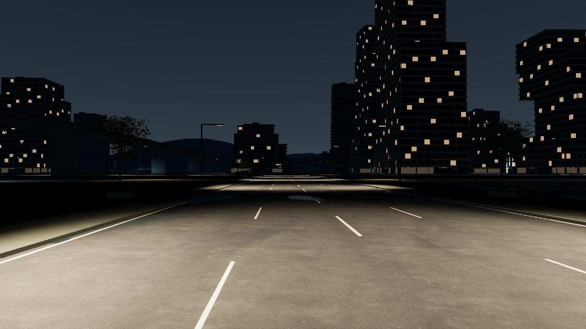
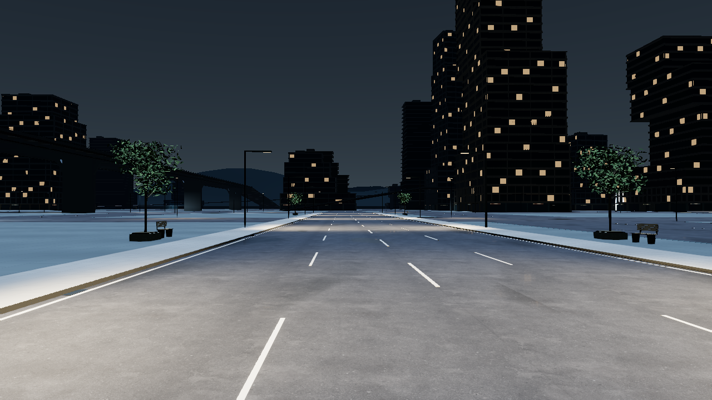

# 3.16 城市街道、铺装与夜间层次专项

## 结论与证据边界

本轮继续 3.15 的原城，重点处理 **Weave 细街 → Central Cross Street → Foundry → 原有上层连接** 的连续空间，同时给原有普通网格街道补足可辨认的路边与夜间灯光。没有改写原来的街区布置、路网拓扑和高架路径。道路外的大面积沥青被明确区分为平齐的矿物铺装前场，横街有清楚的车道组织、座椅树池与候车设施；Foundry 过渡段的人行边界接续原有北段。所有实际新增的凸起支撑仍进入既有物理世界。[连续性报告](../qa/city-continuity-3.16.json)和[专项报告](../qa/city-quality-3.16.json)分别记录保留条件、实际几何检查及其局限。

本地 Chrome 155 的 **WebGL2 / ANGLE SwiftShader** 已实际渲染并保存 **10 组原 3.15 / 3.16 同条件对照，加两张主城座舱原图**，全部逐张打开评审。这 12 张的实际采集检查点为 `81926b470303a5f51844285ff604fbb84717a627271efddde494e228ce319ec2`，每个同帧包均有完整、通过的实际逐 draw 审计。随后 `28e9bc41…` 只修改诊断 PNG 调度及阶段记录，已另行完成原 1280×720、原 14 个场景与原 20 s 期限的矩阵；原图没有改标为新构建重拍。宽大道的车道与前场、人行边界、细街湿铺装、底层暖窗和道路反射有可见变化；宽大道两侧仍较空、远景方楼重复、夜间高层实体偏暗，Foundry 维护庭仍欠照明。这是实际栅格图的局部改善，不能据此声称整城已达到照片级或玩家机器上的帧率目标。[全部原图对照](../qa/city-native-3.16/index.html)、[严格条件与绘制报告](../qa/city-native-3.16/report.json)、[逐张画面评审](../qa/city-native-3.16/visual-review.json)、[28e9 原矩阵](../qa/capture-matrix-native-3.16/index.html)

下图来自上述 81926 实际检查点，已包含完整门灯安装、Foundry 横路修复、保留逐窗表面的预算修复和同步烘焙。PNG 与条件 JSON 来自应用已有的同帧 ZIP，未经裁切、补绘、重着色或生成图替代。较早的局部材料开发图和失败原件继续保留在本报告后文，身份没有改写。

## 81926 实际检查点的画面覆盖

所有对照保持 1280×720、high、原固定相机、静止物理状态和相同天气；晴天曝光 0.87，湿夜 1.02。实际导出的相机位置与四元数、投影、分辨率、车辆位置/姿态/速度、暂停状态、灯态和曝光逐项比较，10 对全部一致（数值容差 1e-9）。装饰动画的墙钟时间不同，未把它声称为逐像素时间同步。以下每个链接均是完整分辨率原 PNG；[对照页](../qa/city-native-3.16/index.html)同时展示原 3.15，并链接每张同帧 JSON。

| 既有视点 | 81926 检查点白天 / 湿夜原图 | 实际观察与限制 | 候选白天 / 湿夜 draw |
| --- | --- | --- | --- |
| Weave 入口细街 | [白天](../qa/city-native-3.16/candidate/roadster-3.16.0-weave-entry-clear-day.png) · [湿夜](../qa/city-native-3.16/candidate/roadster-3.16.0-weave-entry-wet-night.png) | 原密度保留，湿人行道较暗且可读；店面灯池与路面反射有层次，部分近立面亮斑仍强，上层和局部街角仍暗 | 1,658 / 1,851 |
| Crosstown 宽大道 | [白天](../qa/city-native-3.16/candidate/roadster-3.16.0-crosstown-clear-day.png) · [湿夜](../qa/city-native-3.16/candidate/roadster-3.16.0-crosstown-wet-night.png) | 车道、矿物前场、树池座椅可见，暖窗让楼层秩序可辨；两侧仍空旷，远景方楼与简化山体重复，夜间塔身仍暗 | 755 / 803 |
| 跨区路口 | [白天](../qa/city-native-3.16/candidate/roadster-3.16.0-cross-east-gateway-clear-day.png) · [湿夜](../qa/city-native-3.16/candidate/roadster-3.16.0-cross-east-gateway-wet-night.png) | 前场与车道区分，车道线在路口中止，保留斑马线/箭头/原高架；夜间建筑底层更可辨，路口、斜坡结构与灯池之外仍较空暗 | 609 / 654 |
| Foundry 维护庭 | [白天](../qa/city-native-3.16/candidate/roadster-3.16.0-foundry-work-bay-clear-day.png) · [湿夜](../qa/city-native-3.16/candidate/roadster-3.16.0-foundry-work-bay-wet-night.png) | 原门架、标牌、板缝与内侧路缘保留；湿夜主要变化是远处暖窗，庭内地面和墙体仍近黑。此相机位于实际导航终点南侧，不能当作已驶抵入口 | 604 / 459 |
| 原上层连接 | [白天](../qa/city-native-3.16/candidate/roadster-3.16.0-terrace-arrival-clear-day.png) · [湿夜](../qa/city-native-3.16/candidate/roadster-3.16.0-terrace-arrival-wet-night.png) | 原路径与护栏保留，真实护栏灯照到近处路面与栏杆；近灯高光仍明显剪切且 bloom 呈方块感，上层远处仍暗；不是完成爬升记录 | 543 / 382 |
| 主城真实座舱 | [白天](../qa/city-native-3.16/candidate/roadster-3.16.0-cockpit-clear-day.png) · [湿夜](../qa/city-native-3.16/candidate/roadster-3.16.0-cockpit-wet-night.png) | 上半幅可见真实街道、天空、廊桥和店面；A 柱/门顶/仪表台有实际光照响应，仪表与材料仍简化。未新增同镜头旧座舱对照声明 | 1,892 / 1,708 |

原 3.15 采集前已把全部 271 个网站文件与原候选 ZIP 逐字节核验，每张同帧 JSON 保留原构建和光场身份；采集后还有完整 161 源/三场实际 fetch 核验。来源帮助器在这 10 张采集之后才加入，不能倒写成原报告已有前后两次 fetch。检查点 81926 的 12 张则在同一个独立浏览器会话采集，前后实际 fetch 核验全部 172 个声明源及三场八个体积，两端都匹配 81926 检查点构建。[原文件核验](../qa/city-native-3.16/baseline-candidate-file-verification.json)、[原基线后验 served 核验](../qa/city-native-3.16/baseline-served-source-audit.json)、[81926 会话完整报告](../qa/city-native-3.16/candidate-collection-report.json)

原 3.15 若干湿夜反射 draw 的 GL 1282 仍保留在原始 JSON，并没有为了对照将其删掉。因此“原图有效”不等于“原基线绘制链无错”。81926 Crosstown 湿夜同帧报告实际执行了 512×288 湿路反射 FBO 刷新，其中有 171 个真实 draw；先前会反馈读写的 5 个沥青 draw 全部没有 pre-draw、draw 或 diagnostic GL 错误。该证据包含真正写入反射目标的过程，不是复用缓存纹理的通过帧。[81926 实际湿路刷新同帧报告](../qa/city-native-3.16/candidate/roadster-3.16.0-crosstown-wet-night.json)

<!-- NATIVE_CITY_MATRIX_316_BEGIN -->
14 帧逐 draw 矩阵仍单独验收。`81926b47…` 的 1280×720 尝试完成了第一案例的普通暂停绘制（1,209 draw，全部通过），随后请求完整导出绘制和 PNG 的应用原有 20 s `requestProgramFrame` 期限触发；0/14 个完整矩阵帧。该期限从排队开始，不能把总耗时当作 PNG 编码时间。完整失败 JSON、前一个普通帧的 `partialAudit` 与原始 ZIP 保留。[原 1280 失败及完整 partialAudit](../qa/city-native-3.16/matrix-1280-failed/gpu-switch-matrix.json)

同一构建的 800×450 第二次尝试保留了原 14 个案例、逐 draw 门槛和 20 s 期限，完成 4 张原 PNG、8 个通过的普通/导出 draw 审计；第 5 案例 `03-ultra-wet-night-viaduct` 的普通帧通过 1,458 draw 后，完整导出请求再次触发应用期限。物理状态保持，shaderFailures 为 0，仍是 **4/14，矩阵未通过**。这两次是应用实际 deadline，不能归为浏览器工具下载挂起。4 张原图已逐张打开评审；[第二次完整失败报告](../qa/city-native-3.16/matrix-800x450-failed/gpu-switch-matrix.json)与[独立逐图记录](../qa/city-native-3.16/matrix-800x450-failed/visual-review.json)均保留。

源码核查确认：旧暂停主循环在 PNG 回调等待期间仍重复提交场景与 composer；旧失败记录也没有保存失败导出自身的阶段。`28e9bc41…` 修复这条暂停调度，维持 rAF、DOM 取消和 `lastTime`，不改变驾驶中物理推进，并增加已有任务的轻量阶段时间与自身审计。10 组实际函数抽取检查及 55 项相关原门槛通过后，已完成 **原 1280×720、原 14 case、原期限的原生复验**：14 张原 PNG、28 个普通/导出实际 draw 审计全部通过，前后 172 源/三场八体积身份一致，14 张原图逐张打开评审。实测请求至回调 3.433–13.232 s，均低于原 20 s；同步 `toBlob` 跨度与回调调度分别保存，未冒称纯编码耗时。两个旧失败原件仍保留。[完整新矩阵与逐图记录](../qa/capture-matrix-native-3.16/index.html)、[修复和阶段范围](capture-scheduler-3.16.md)
<!-- NATIVE_CITY_MATRIX_316_END -->

## 3.15 继承核查

开发前读取了 `docs/release-3.15.md`、`docs/acceptance-3.15.md` 和城市源码，并查看用户候选证据中的 stage1 湿夜图、stage4 日间/湿夜停车图。用户原图显示了可见的车辆、道路和建筑；本轮从未把项目描述为“没有真实 3D”。stage4 的短程直线驾驶、路口偏航与工具超时也不被扩大解释为导航、制动或全路线验收。

严格对照所用 3.15 基线为提交 `9f6c8f47a2678beee3915a0320ac2bf93312e96b`，候选构建 `0ca13961ae8e9db6061a0e6ca63f9e56ada83ead5848b1724b48a05ee778978b`。恢复期间先发现原始二进制光场缺失，早期 `baseline-matched` 图因此作废。随后以原候选 ZIP 补齐，271 个网站文件逐字节核对全部一致，才保存本报告中的 3.15 白天图。[完整基线文件核验](../qa/city-pixels-3.16/baseline-file-verification-315.json)

原有 114 个建筑地块、12 条命名街道、113 段高架/连接路径的创作数据逐项保留；3.15 已修正的机造入口 12 cm 路缘切口仍保留。原有导航、城市挑战、路标、维修通道、上下层连接并未另写一套。前述数量只用于确认继承完整性，不作为视觉质量提升的依据。[连续性报告](../qa/city-continuity-3.16.json)

## 连续街道改进落在哪里

| 空间 | 本轮处理 | 道路与物理约束 |
| --- | --- | --- |
| Weave 入口、市场和交换所 | 保留细街密度与原有设施；湿矿物铺装压低漫反射，原有街灯、垂灯和廊下灯降低过强照地倾向；底层展示窗与门灯形成较低的暖色层次 | 10 m 原车行道、人行台阶、既有挑棚及全部碰撞包络保留 |
| Central Cross Street | 18 m 宽道补足内部车道虚线，路口前停止；宽路外改为有铺装尺度的平齐前场；复用既有树、座椅造型形成街边停留位置；既有人行带内增加候车棚、座椅、实际顶灯和指向 Foundry 的标识 | 原宽度与路口不变；树池、树干和座椅的实际支撑有物理代理，全部避开命名道路与原有 28 m 交叉道路 |
| Foundry 南北过渡 | 在 z=-84 至 138 m 的过渡段接上两侧 3 m 人行带，路口处保持完整开口；北段已有的灯具外壳获得对应的真实有限灯源 | 保留 18 m 车行道；人行带高度 0.12 m，在原 z=-100、0、100 m 交叉道路处各留 32 m 开口，[-117,-84] 原路面保持平坦 |
| 原有爬升通道与 Forum 上层街道 | 低位导引灯实装于现有侧护栏；上层灯实装于现有廊顶；选灯按相机实际所在的地面、坡面或上层路面判断 | 使用原有倾斜四元数和支撑结构，不增加新的坡道；保留每档 2/3/4 盏实时街灯预算 |
| 普通背景网格与远景 | 28 m 原网格道路之间的建成/未建成地块使用平齐矿物前场和低调边界；普通路灯内倾并错列；背景楼底层复用不同店面秩序；北侧远景补低位轨道与稀疏公用设施轮廓 | 原道路始终可见、可行；不靠更多重复楼填空；远景结构位于原可达区域之外，不增加可导航地块 |

这些工作通过 `city-continuity.js`、新增的 `city-street-sections.js`、`city-environment.js`、既有外立面与街道家具模块实现。它们使用同一套城市数据和真实渲染几何，驾驶视角与检视镜头共享这些改动。

### 前场不是新的隐形障碍

原始城市有一整块 1240 m 的沥青底面。部分沿命名街道清出的原网格地块没有建筑，沥青一直延伸到远处，因此宽大道像停车场。本轮在原 100 m 网格内使用 72 m 的矿物前场，并扣除全部地面命名道路、坡道入口与地标预留区域，保留原 28 m 网格道路。铺装顶面不足 1 cm，是视觉面层；它依然由原有地面及原摩擦模型支撑，不增加隐形路缘，不阻止越界驾驶。[独立区域相交检查](../qa/city-quality-3.16.json)

因此，车道与前场的区别是清晰的使用边界和材质区别，不是假装存在新的人行高台。需要承载台阶的 Foundry 人行带和树池等，另以真实共享几何实现并验证。

## 湿夜校准：从实际画面改下一版

最初的 3.16 湿夜图已经出现更连续的车道灯池和较清楚的楼上暖窗，但前场仍是一大块浅蓝色，人行道仍偏白。该图完整保留，作为开发迭代证据，而非被删除的失败样本：

后续修正针对具体材质和原有灯具，并未修改夜间天气预设、全局曝光、天空、全局环境强度或车道材质：

- 新矿物前场由 `0x737e7a` 调至 `0x505950`，横街石材由 `0xb8b5a4` 调至 `0x8c9185`。前场、路缘、人行石材的层次更接近深灰矿物和灰石，不再依赖高亮边带定义道路。
- 湿矿物材质的漫反射吸收增强，实际雨量调制下的常见漫反射倍率由约 0.68 降至约 0.36；前场使用更高的湿粗糙度。细缝、块材变化在湿态仍保留，避免把整个人行道当作连续平滑镜面。
- 部分底层玻璃使用低亮封闭展示背板，夜间强度约为楼上零散暖窗的四分之一。这个背板没有假内景、透明房间或额外室内求解，也不会作为未烘焙的光源照亮世界。
- 既有门灯的发光点从灯面前方移回真实灯面下方约 6.5 mm；光束改为贴近门廊和门侧构件，减少继续照亮外侧前场的倾向。原灯的数量、强度档位和有限照射距离保留，两类夜场按新的真实灯源方向重烘。

对未经改动的两张 1280×720 PNG 取相同的小矩形区域，结果如下。这里的数值是 **sRGB 编码像素的加权灰度中位数，范围 0–255**；它们用于确认这次修正确实改变了局部画面，不能当作现实照度或整体美术评分。[完整区域坐标和像素统计](../qa/city-pixels-3.16/local-tone-pixel-samples.json)

| 同位置区域 | 校准前 | 校准后 | 图像中实际改变的关系 |
| --- | ---: | ---: | --- |
| 左侧矿物前场 | 125.21 | 62.04 | 浅蓝大面回落为较深的矿物底色 |
| 左侧近景人行带 | 201.72 | 138.70 | 白色亮带回落为灰石层次 |
| 右侧底层展示窗区域 | 3.58 | 66.97 | 近黑底层出现低亮暖色，门店层可以分辨 |
| 天空对照区 | 43.60 | 43.60 | 相机与天空亮度保持一致 |
| 车道对照区 | 142.64 | 142.64 | 原有车道灯池保留 |

该镜头的高层主体仍然是偏暗、风格化的矿物框架。低亮窗与门廊层次并不等于完成每一块立面的真实照度设计，雨夜的全部转弯、坡道和运动过渡也仍需整轮实际驾驶/采集检验。

## 灯光连续性与真实安装

普通网格街灯原来位于道路中心两侧约 12 m，并主要向正下方照射；车道中心经常落在灯锥之外。本轮把对侧灯排错开 27.5 m，灯头向车道内倾，同时继续按实际位置排除与命名街道和高架冲突的灯杆。Foundry 原有北段灯面补上了对应真实灯源，解决“看得到灯具但这一段没有有限实际灯源”的源码缺口。

原上层选灯始终以近地高度计算覆盖，容易让地面与上层灯跨层竞争。本轮选灯先从原始街道、连接路径的实际高度获取相机所在的路面层，再在同一层评价候选灯。0、4、8 m 三种道路层，以及上下空间投影重叠的对照都已检查。此修改没有把每盏灯都变成实时灯，原有 2/3/4 街灯预算、20% 选择迟滞和逐槽交接仍保留。[选灯和安装检查](../qa/city-quality-3.16.json)

灯具支持与光源位置进行了独立几何检查：坡道灯背板实际嵌入原护栏顶部约 22 mm；Forum 灯上方的射线命中原有 15.7 m 廊顶下表面；374 个门灯发光点逐一向上发射短射线，命中实际 Three 灯面三角形，下方距离约 6.5 mm。随后严格外部包络检查发现：修前这 374 个门灯的真实源位于完整闭合建筑包络内约 12 cm，目标内约 8 cm，夜场会把自己的门灯挡掉。因此最终将整个灯面、背板和标牌一起向外移 20 cm，加装两根真正嵌入墙面的钢支架；没有单独把光源浮移。源现在在包络外 8 cm、目标外 12 cm，灯面→背板→标牌→至少两根钢支架→实际墙体均有正体积连接。每盏灯向其包络外 60 cm 接收点的独立三角形光线均畅通，生产直接场也得到 1 个有效贡献。原强度不变，原外部包络门槛不变。[修前否证](../qa/door-light-envelope-3.16-before.json)、[真实安装与接收点检查](../qa/city-quality-3.16.json)。这些检查确认几何及传输关系，不代表光度计认证或 GPU 绘制完整性。

### 与 3.15 的独立稀疏直接光对照

测试从实际运行时灯具记录重建光锥，以 Three 三角形射线独立判断遮挡，没有调用生产用夜间传输求值函数，也没有纳入车灯。3.15 同位置的合成样本和来源哈希保存在[固定基线夹具](../qa/fixtures/city-lighting-3.15-before.json)。表中是工程场景单位下的平均线性 RGB 中位数，不是经过校准的 lux。

| 抽样路径 | 样本 | 3.15 中位数 | 3.16 中位数 | 小于 0.01 的样本：前 → 后 |
| --- | ---: | ---: | ---: | ---: |
| Weave | 14 | 2.28344 | 1.56986 | 3 → 3 |
| Crosstown | 14 | 3.52792 | 3.52792 | 2 → 2 |
| Foundry | 22 | 0 | 1.81806 | 22 → 0 |
| 普通宽路 | 20 | 0 | 1.42359 | 19 → 0 |
| 原有爬升通道 | 11 | 0 | 0.14384 | 11 → 1 |
| Forum 上层街道 | 13 | 0 | 1.17785 | 13 → 0 |

Weave 的样本能量下降与本轮压低过亮地面的方向一致，Crosstown 原有道路照明能量保持。原爬升通道终点 `[280,8.35,300]` 仍高于最后一盏低位护栏灯的有效照明范围，因此该点依然为零；本轮没有通过降低阈值、删掉这个点或用车灯补数来声称上层抵达照明全部通过。有限的稀疏样本也不能证明每一段道路都连续受光。[全部原始样本与限制](../qa/city-quality-3.16.json)

## 严格回归暴露的两处缺陷与实际修复

### 交叉道路没有因新路缘变窄

原 3.14 几何合同拒绝了 3.16 新增的 13 个连续性支撑和 18 个树池/树干/座椅代理。这一拒绝被保留；新增 31 个对象现在逐 ID、顺序、完整尺寸/位姿、作者数据和 SHA-256 声明。只去掉这 31 个精确对象后，原 3.15 的 **2,220 个物理实体**恢复原始完整 canonical hash；原 108 个街道家具代理和墙面调色板也继续逐字节一致。没有增加按名称前缀忽略的通用排除规则。[精确新增合同](../qa/fixtures/city-additions-3.16.json)、[26 项合同与独立几何检查](../qa/city-geometry-scope-3.16.json)

独立检查进一步发现最初的新 Foundry 人行带从 z=-117 起，横穿原 z=-100 的东西道路。y=0.06 m、x=80→120 m 的真实 Three 三角形射线，在原 3.15 无命中，在修前候选于 x=88、91、109、112 m 命中两块 12 cm 路缘。这是新增的实际路障，不能仅把对象加入合同便通过。最终首段从 z=-84 起，完整保留原横路 [-116,-84]，也不留下 [-117,-116] 的孤段。z=-100、0、100 三处交叉路的全 32 m 开口分边缘和中心 21 条独立射线全部畅通；修前两块障碍仍以原数据重放，保持四个预期命中。[修前与修后完整证据](../qa/foundry-crossroad-correction-3.16.json)

### 渲染预算通过减少不可见面和合并相同响应

最初的 3.16 架构与街道总分配为 1,961,342 三角形、1,433 批次，未通过原 3.5 的严格预算。没有提高预算上限、缩短原有 LOD 距离或删除新的店面/窗户。最终保留全部 144,164 个建筑实例，将 23,200 块位于实体墙内的密封不透明玻璃薄盒改为其原外侧正面，保留 45 个需要完整体积的玻璃盒；每块窗的实际四顶点、法线、UV、米尺度 UV、颜色、原 LOD 与独立保存的修前生成器逐项对照。顶点最大舍入差为 0.0541 mm，UV、米尺度 UV 和颜色完全一致。

原封闭玻璃、低亮展示窗和暖窗最终都使用同一 0.13 粗糙度的玻璃表面响应。现在同扇区和同 LOD 的三类玻璃合批，每个实例保留原线性发光 RGB 与显式环境贴图强度，日间关闭/夜间 2.1 倍的原切换保持；默认环境继续使用 Three 的 scene.environmentIntensity。只增加一项 vec4 实例属性，不增加采样纹理。细框仍使用 80 m 扇区，其余小型灯座/支架与原立面共用 160 m 扇区，每个原形体和距离层级都保留。[逐窗与材质保真](../qa/city-glazing-budget-3.16.json)

| 同一分配指标 | 原 3.5 严格基线 | 完整原 3.15 | 最终 3.16 |
| --- | ---: | ---: | ---: |
| 架构＋街道三角形 | 1,816,606 | 1,760,124 | 1,729,342 |
| 架构＋街道批次 | 1,225 | 1,172 | 1,074 |

原五个相机 × 三档画质的 15 视点规则全部保留：每个视点 draw 不超过原 3.5，三角形不超过原 1.10 倍，balanced 另保持 <300 draw / <650,000 triangles。全部通过；high botanical 从修前新 55 降至 43（原阈值 47），high aerial 降至 119（阈值 137），ultra aerial 降至 190（阈值 210）。实际建筑几何 buffers 从修前 14,376,212 降至 14,335,472 字节。这些是同协议 Three 实例/可见提交数，不是硬件 GPU 帧率或像素覆盖结论。[原失败及三版本对照](../qa/exterior-budget-three-versions-3.16.json)、[最终完整 15 视点](../qa/city-budget-opaque-glazing-batched-3.16.json)

## 检查、烘焙与身份

| 检查 | 结果 | 实际覆盖 |
| --- | --- | --- |
| `node tests/city-quality-3.16.test.mjs` | 6 项通过 | 前场与原道路相交、Foundry 实际三角形路面/路缘、家具共享支撑、道路层选灯、灯具安装射线、独立直接光样本 |
| `node tests/city-continuity-3.14.test.mjs` | 9 项通过 | 原街区数据不丢失、全宽道路/高架净空、实际 OBB 与 Three 实例变换、已有维修/入口/悬灯结构、低档主形体保留、远景边界 |
| `node tests/city-lighting-3.10.test.mjs` | 最终整轮运行记录为准 | 当前夜场身份、非负有界传输、静态遮挡与无源零能量、每场采样和纹理预算、昼夜隔离、固定相机选灯和交接 |
| `node tests/city-geometry-scope-3.14.test.mjs` | 26 项通过 | 保留原 17 项严格历史检查；新增精确 31 对象反例与三条横路实际三角形检查 |
| `node tests/city-glazing-budget-3.16.test.mjs` | 3 项通过 | 144,164 个实例保留，23,245 个玻璃实例逐表面与材质响应对照，原 LOD 保留 |
| `node qa/exterior-materials-check.mjs` | 通过 | 原材料/UV/共享几何门槛与原 15 视点预算均未放宽 |
| `node scripts/validate-city-shaders.mjs --compareBaseline` | 152 对离线编译通过 | 含真实新合批玻璃 6 个变体，当前最多 14 片元纹理单位；保留旧 3.12 的 4 个超限反例，不等于 GPU 验收 |

连续性测试中原本把一个特定背景灯候选坐标视为“必须被排除”。27.5 m 错列后，该坐标已不再是候选点，所以测试调整为：两处已知危险位置都不能保留实际灯杆，并仍要求其中未移动的一侧明确记录为排除；所有真实候选灯杆继续接受完整的 OBB 道路净空检验。修订及理由写入报告，没有放宽真实道路净空或碰撞门槛。

最终本专项城市共享几何 SHA-256：

`68e4ea47a2b76a895596fb59c4ff6f0f46b9ef0c6a1640475a5abec8340f4a2a`

修复完整灯具安装后的实际夜间灯源 SHA-256：

`3b133961271b95dc7dc4144c1f6156516b1891b19ebaa21b7b73d85814b7e543`

最终夜间反射场身份为 `e8cb5f70a9fdfdaeedbc34051c47e37ec471fbbf3bed24f30ed5defd9b0c96f9`，直接场身份为 `2551329d231fd64acfe39ec9dee521d02df064b94d0f689309644376bdb17557`。两场均按修复横路和最终窗面批次后的来源重新生成；完整灯源、几何、15/16 项显式源码及全部 6 个体积长度/哈希均保留。[夜间反射烘焙](../qa/night-irradiance-bake-3.16.json)、[夜间直接光烘焙](../qa/night-direct-bake-3.16.json)。整合步骤另外生成白昼场，并对三场作独立聚合核验；最终发布身份以整轮报告为准。

`city-street-sections.js` 和 `street-life.js` 已加入三种场的显式来源依赖；直接夜场也补全了会改变其灯源的外立面模块依赖。白昼 GI 由整合步骤按最后的 `urban-architecture.js` 来源哈希同步，独立三场实际来源/体积聚合另见最终验收。最终发布以整轮烘焙/构建身份为准。平齐光学前场继续使用原物理地面支撑，因此离线漫反射仍以原地面代表反照率近似，未为每块光学前场另写完整材质路径追踪器。静态灯场的 4/8 m 路线、24 m 普通区域采样会软化小尺度立面光照，室内、车辆动态 GI 和精细透明传输不在本实现内。

## 开发原图清单与尚不能据此验收的项目

| 原图 | 身份与用途 |
| --- | --- |
| [3.15 Crosstown 白天](../qa/city-pixels-3.16/crosstown-315-clear-day.png) | 完整候选原件，271 文件核验后采集；high，1280×720，曝光 0.87 |
| [3.16 Crosstown 白天开发图](../qa/city-pixels-3.16/crosstown-316-clear-day-iteration.png) | 同镜头/天气/曝光，能看到车道、前场和树椅变化；发生在最终白昼重烘与本轮最后材质校准前，明确仅作迭代图 |
| [3.16 湿夜校准前](../qa/city-pixels-3.16/crosstown-316-wet-night-before-local-tone.png) | 记录最初仍偏白的人行道和偏浅蓝前场，不能代替 3.15 湿夜基线 |
| [3.16 湿夜校准后开发图](../qa/city-pixels-3.16/crosstown-316-wet-night.png) | 局部材料校准阶段，随后还有门灯安装、横路和预算修复；保留开发身份，同镜头/天气/曝光 1.02 |

本节列出的开发照片通过应用已有公开 DOM 控件设置天气、固定镜头、画质与曝光；车辆仍停在原始出生位置，没有通过受保护控制接口移动车辆。应用已有只读导出用于保存条件。这些开发 PNG 与条件 JSON 为暂停状态下的两次导出，未把它们说成同一帧号的原子包。前文最后构建的 12 张则来自应用原有同帧 ZIP，两个证据层次分别保留。最终提交之前的工作区照片所带构建字符串也未被当作最终线上提交的发布身份。[可复现的公开控件采集脚本](../qa/capture-city-3.16.mjs)

早期开发阶段，Weave 的若干页面截图和下载在自动化 45 s 时限下超时，降低至 800×450 的一次截图仍超时；与此同时 Crosstown 页面和原生 PNG 已真实成功，且没有观察到对应的应用异常或 WebGL 上下文丢失。这里如实记录自动化未完成，不能直接诊断为应用导出失败、城市缺绘、没有 WebGL，或把用户早先 42 分钟工具挂起当成同一故障。[包含失效基线在内的完整错误摘要](../qa/city-pixels-3.16/capture-errors.json)

本专项的固定照片和数值检查不能单独证明完整 Weave→Foundry→上层原生驾驶已经完成、所有区块运动中都无闪烁，或某档已达到指定 GPU 帧时。14 帧矩阵另按前文实际原始结果判定，不由固定照片的通过项数量替代。

之后已在 `28e9bc41…` 上另行完成一次从合法出生点经 Weave、Crosstown 到 Foundry **下层车行入口**的连续真实按键驾驶。现有导航显示抵达并刹停，保存/下载了 190.4 s、22,848 步的完整原生输入记录。1,130 个实际驾驶接收事件与请求顺序完全一致；25 个末片刚体计数阳性和 26 个微步阳性样本、8 个缺少 `returned` 的外部日志条目，以及遥测原计数 1 行差异分别保留。复合刚体包括车轮硬限位，计数本身不能识别车壳或接触冲量；独立只读几何分析单列。原有上层坡道、维护庭和横向 `z=-100` 穿越均不由这条下层路线代替。[原生驾驶报告及完整原件](native-city-drive-3.16.md)
## 补充：新开发图中的深色道路矩形身份

车辆专项提供的实际开发图里，车前侧的深色矩形已经与源码对应：[原 PNG](../qa/city-pixels-3.16/road-cover-316-development.png)、[坐标与投影证据](../qa/road-cover-identification-3.16.json)。它是 `city-environment.js` 中现有 Weave 检修盖板序列的第 3 块，中心 `[-198,0.032,-341]`、尺寸 `1.3×0.014×1.3 m`、Y 轴旋转 `1.4 rad`，使用钢材。按该开发图已记录车辆位姿和原有 orbit 相机重建投影，四角约为 `(390,730)`、`(578,665)`、`(702,743)`、`(498,834)`，与图中矩形吻合。

这张开发图中盖板确实被绘制；目前缺少框、盖缝与吊装细节，识别线索不足，所以像孤立暗多边形。这里只确认这张 3.16 新开发图，不外推用户此前未绑定相机的未知路面多边形；该识别也不等于最终 draw 验收。运行源码冻结后未为此追加几何或材质修改。

