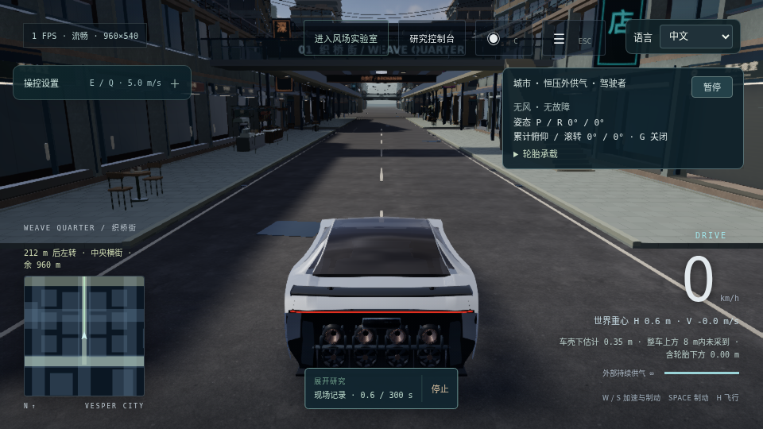
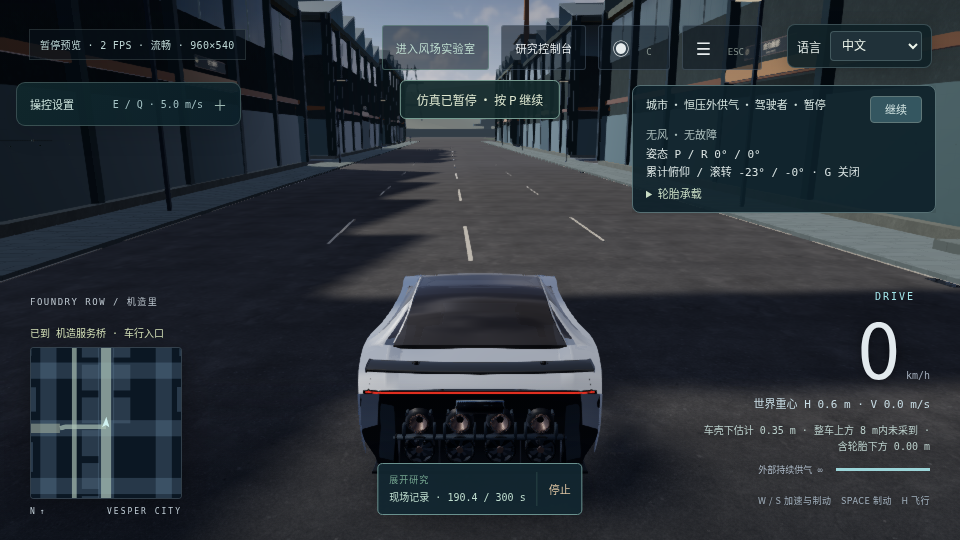

# 3.16 原生连续驾驶：Weave → Crosstown → Foundry 下层入口

**本轮在冻结构建 `28e9bc415a0509990cb88dcbb0a95117f013969e2283260208df5921c54b1d8f` 上，用一次连续的真实键盘运行到达了既有 Foundry 车行入口，并刹停、保存和下载了原生记录。** 原有导航的入口半径是 8 m；记录结束时车辆中心为 `[100.120622, 0.596996, 309.095367]`，距目标 `[100, 0, 315]` 的水平距离约 5.906 m，速度约 `0.000857 km/h`。这个结果覆盖下层入口，不覆盖维护庭、原有上层坡道或完整城市驾飞挑战。[原始执行报告](../qa/city-drive-native-3.16/report.json) · [原生记录](../qa/city-drive-native-3.16/native-experiment.json) · [完整范围核查](../qa/city-drive-native-3.16/review.json)

## 运行条件与路线

运行时间为 2026-10-20 19:50:29 至 20:19:39 UTC，自动化全程墙钟约 1,750.249 s，包含加载、选择导航、驾驶、截图、保存、下载和前后源码核验。环境为 Chrome 155 / WebGL2 / ANGLE SwiftShader 软件渲染，960×540、balanced、晴天与干路面。开始前选择 3,600 墙钟秒、280 仿真秒和 18 km/h 巡航目标；运行中没有调高预算或判定门槛。这些墙钟时间不能当作用户硬件帧率。[原运行方案](../qa/city-drive-native-3.16/plan.json) · [操作日志](../qa/city-drive-native-3.16/ui-actions.ndjson)

车辆从菜单“进入城市”的原有出生点 `[-200, 0.62, -345]` 开始，地图选择“机造服务桥 → 导航到车行入口”。现有导航返回 Weave `x=-200` → Crosstown `z=-132.5` → Foundry `x=100`，中心线约 960 m。实际键盘按下/松开只有 W、A、D 和 Space；第一次向 +X 转入横街，第二次向 +Z 转入机造大道。外部脚本只读取公开导航和遥测来选择按键，实际车辆始终由同一个应用求解器推进，没有设置身体位置或速度，没有导入数值轨迹，没有复位拼接。[原脚本](../qa/native-city-drive-3.16.mjs) · [每次按键选择](../qa/city-drive-native-3.16/key-decisions.ndjson)

源记录保持原有 `bench` 恒压外供、350 bar、无风、无故障。驾驶没有请求飞行推力，原记录全程气体吞吐为 0 kg；这不能用来宣称有限气源飞行通过。按键选择程序也不能代替人的驾驶手感评审。[原生记录的完整初态和统计](../qa/city-drive-native-3.16/native-experiment.json)

## 实际到达与记录覆盖

| 证据 | 本次实际结果 | 覆盖边界 |
| --- | --- | --- |
| 导航与停车 | 首次同时观察到 `arrived` 和低于 0.8 km/h：仿真时间 190.475 s，0.124444 km/h | 使用原有 8 m 入口半径；不是要求车心触及目标坐标 |
| 完整原生实验 | 190.4 s，22,848 个 120 Hz 物理步；初末快照步骤差也为 22,848 | 这是原生运行记录，不是重新求解得到的替代记录 |
| 原始与应用输入 | 两者各 1,131 个连续压缩区间，均覆盖 22,848 步；本次两序列逐项相同 | 保存了每步输入，不代表保存每步所有刚体内部状态 |
| 原生轨迹曲线 | 3,809 点，步号 0 到 22,848，每 6 步一采，20 Hz；没有抽稀 | 刚体接触 pair、形体编号和冲量不在这条曲线内 |
| 应用按键接收 | 1,130 个驾驶 down/up 与请求顺序完全一致，也与原生实验内对应事件逐字节相同；没有拒绝 | 按键接收与外部调用返回日志分别判断 |
| 接收日志 | 序号 1 至 1,146 连续；应用丢弃数为 0 | 还包含菜单和释放事件，不把它们计作驾驶按键 |
| 源码身份 | 运行前后实际抓取的 172 个声明源码、3 份光场 manifest 和 8 个体积全部吻合 | 原本地记录的提交/树身份仍是 `null`，没有填造发布身份 |

以上数据由原件重新计数，并通过应用现有 `validateExperimentRecord` 校验。[派生覆盖检查](../qa/city-drive-native-3.16/review.json)和[原校验输出](../qa/city-drive-native-3.16/validator-result.json)保留结果。记录内只有终点释放输入的三个公开命令，没有途中复位、补气或改参。[原生完整记录](../qa/city-drive-native-3.16/native-experiment.json)

原始外部日志有两项保留缺口：1,130 条请求只有 1,122 条 `returned`，缺少 8 次 Space 调用的返回条目；它们都有相应应用接收和原生物理输入证据，但不能回填没有记录到的返回时刻。原 `report.json` 记为 1,245 次遥测，实际 NDJSON 有 1,244 行，差 1 的原因尚未定位。全部 1,229 个控制决策时点都有对应遥测行；这些事实不会把原始计数差自动变成“无缺口”。[原请求日志](../qa/city-drive-native-3.16/key-requests.ndjson) · [原接收日志](../qa/city-drive-native-3.16/received-input-events.ndjson) · [逐项缺口](../qa/city-drive-native-3.16/review.json)

记录区间内有 1,237 个原生遥测样本，首个样本比记录初态晚 0.166667 s，正向仿真采样间隔最小约 0.075 s、中位 0.158333 s、最大 0.8 s。原生实验本身仍保有这段起始输入与 20 Hz 初态曲线；外部遥测不能据此声称覆盖每一次瞬时接触。[原遥测与导航日志](../qa/city-drive-native-3.16/telemetry-navigation.ndjson)

## 速度、偏航与接触：分别解释

全 120 Hz 统计的速度峰值为 **23.331049 km/h**，高于 18 km/h 的目标值；外部遥测采样最高为 22.664157 km/h。原生导航采样的最大横向偏离为 **1.362205 m**，没有 `offRoute=true` 样本。外部采样滚转/俯仰绝对峰值为 2.320377° / 1.512598°，20 Hz 原生曲线则为 2.302487° / 1.562304°；两种采样不能挑一组较小值来代替另一组。120 Hz 全步车心高度范围为 0.595117–0.608304 m，原生曲线 3,809 点和记录区间遥测 1,237 点都为四轮支撑。[原生统计与曲线](../qa/city-drive-native-3.16/native-experiment.json) · [分层动力学核查](../qa/city-drive-native-3.16/review.json)

**这次不是“全程零刚体接触”。** 25 个遥测样本的末积分片 `rigidContactCount=1`，分布在 Crosstown 与 Foundry；另有 1 个末片为 0、但内部微步存在接触的样本，共 26 个微步阳性采样。25 个末片阳性点从仿真时间 49.358333 s 到 188.716667 s，均为四轮支撑，采样 g 值约 1.346–1.383。相邻采样之间存在时间间隔，不能把这些点拼成真实接触持续时间或用计数计算撞击力。[全部阳性样本和邻点](../qa/city-drive-native-3.16/review.json)

独立只读核查确认，`rigidContactCount` 统计的车辆复合刚体包含 **4 个车轮硬限位圆柱和 4 个车身盒体**，不是只统计车壳。按保存的姿态与原有几何变换顶点后，相关姿态下四个车身盒最低点仍距 `y=0` 约 0.300 m；前轮 FR/FL 硬限位圆柱则有约 0.067–0.384 mm 的最低点进入地面，附近唯一静态 AABB 候选是原有 ground。它支持“车轮硬限位触地”的几何推断，**不等于已经捕获了对应 Cannon 接触 pair**。现有原件没有保存实际接触对象/形体编号、接触点、求解乘子、力或冲量，不能把这些缺字段当成 0，也不能由接触计数宣称车壳擦地。[独立报告、原几何哈希与全部计算](../qa/city-drive-native-3.16/rigid-contact-readonly.json)

该只读计算还指出，软冠状轮查询的悬架长度为 0.243864–0.244301 m，而硬限位以 0.24 m 行程及圆柱边缘构造；约 4 mm 的几何近似差异值得后续用共同轮胎几何核对。当前证据没有指向本轮新增路沿挡住此条路线，因此没有借验收临时关闭碰撞、放宽 EPS 或移动实体。原 `z=-100` 横向路口的独立射线修复证据仍单独保留：此次车辆沿 `x=100` 北行，并不覆盖那条横向穿越。[接触核查边界](../qa/city-drive-native-3.16/rigid-contact-readonly.json) · [原路口修前/修后射线](../qa/foundry-crossroad-correction-3.16.json)

## 保存、下载与原始画面

现有研究库实际保存成功，状态为 `saved`、非仅会话、没有未保存条目。通过原“选中记录 JSON”操作得到 **4,149,005 字节**文件，SHA-256 为：

`23e2f26043f33ffdd8ef9515b1b780d8184eda66903c2f52cf4ae6e7454480b2`

应用报告 2,382.8 ms 后已交给浏览器，worker 内序列化 413.6 ms；从外部请求导出到实际下载保存的观察时间为 5,968.4 ms。应用仍明确标记浏览器最终保存完成不可由应用直接观察，这与工具确实拿到文件是两个层次。下载没有失败，也不能用本次一项结果否定或重写用户上一轮的工具挂起记录。[原导出状态和校验值](../qa/city-drive-native-3.16/report.json)

结束截图在保存之前拍摄，显示暂停和 0 km/h。随后打开既有研究/导出工作区使仿真继续推进约 1.37 s，输入已经释放，车辆位置仅有微小静置收敛；记录结束快照、截图和导出后的遥测分别保留，不把导出后的状态替换为记录终态。[完整生命周期日志](../qa/city-drive-native-3.16/ui-actions.ndjson)

两张完整 PNG 已实际打开审读，没有裁切或亮度后处理。起点可见细街、步廊、车辆与天空；终点可见原导航抵达提示、车道线、人行边界与实验尾部安装结构。Foundry 立面仍明显简化、重复。它们是起终点原图，不是全程录像，也不是原子化的同帧遥测包。[原图页面](../qa/city-drive-native-3.16/index.html)

原浏览器日志没有记录 `pageerror`，但有一条缺少具体资源 URL 的 console 404，因此保留为身份未确定的资源错误；没有借用另一轮采集的 URL 来补写本次来源。全部 13 个原件及独立接触分析共 36,637,282 字节，逐字节复制并列出校验值；原始运行目录也保留。[原错误](../qa/city-drive-native-3.16/browser-errors.ndjson) · [全部文件清单](../qa/city-drive-native-3.16/review.json)
