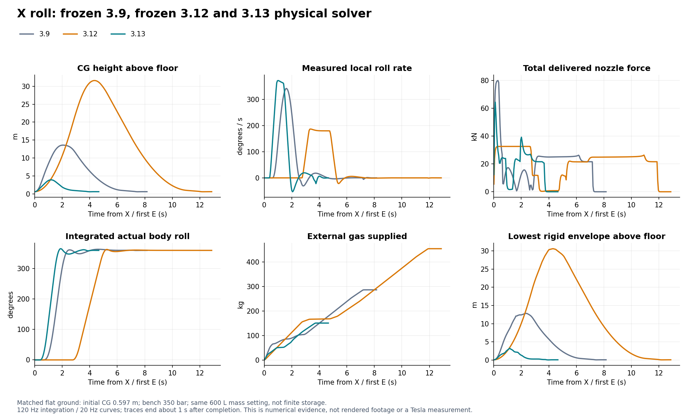

# Roadster Flight Lab 3.13

承接公开 **3.12 / `70e98013d6da246c78c4c50ca2ef44595d1f356b`**，在原仓库、原完整城市与原研究系统上修改。原路线的修订与尚未验收事项继续保留在 [AUDIT-AND-CHANGES](../AUDIT-AND-CHANGES.md)，没有另起替代项目。

本轮完成了湿夜着色器超预算路径的实质修正、独立低空 X 快翻、实际设备具名绘制诊断、车身接缝与透明层改造、南岸水庭入口及三套光场重烘焙。**数值、几何、DOM 与离线 GLSL 证据和真实 GPU / 画面验收分开报告。** 当前云端 WebGL 为 Disabled，没有把新版本三维后图或驾驶帧率写成已验收。

## 1. 高画质缺绘：根因及修复

实际读取用户的 3.12 高→流畅→高三张原 PNG 和条件：1280×720、湿夜、曝光1.02、同一桥下固定机位、暂停。高档主体立面及道路缺失，流畅恢复，再切高再次缺失；普通显示与导出一致。原 console 明确具名 `Urban / aged mineral plaster`，报片元纹理单元超过16、1281/1282 与 VALIDATE_STATUS false。道路同次缺绘有像素证据，但原日志没有等价的道路具名 active-array 证据。

冻结3.12完整绑定链确认：日间GI、夜间反弹、夜间静态直接光与局部太阳深度同时进入材质，即使 uniform 设零，链接资源仍活跃。另加阴影数组、环境和基础纹理后超过目标预算。3.13 按昼夜做真正编译期组合，将城市/路线夜间反弹与静态直接场分别无损打包为一张3D atlas，保留接触AO及所需反射/阴影。高与极高共享fine缓存；切换会正确重建材质程序与uniform绑定。

| 湿夜最终片元 sampler 元素 | 3.12冻结源码 | 3.13 | 对16上限的余量 |
|---|---:|---:|---:|
| 流畅矿物 / 道路 | 13 / 14 | 9 / 10 | 7 / 6 |
| 高矿物 / 道路 | 17 / 18 | **12 / 13** | 4 / 3 |
| 极高矿物 / 道路 | 18 / 19 | **13 / 14** | 3 / 2 |

这是仓库实际 Three 程序生成器与 glslang 的逐stage active反射，数组按size累加。98组包含92组当前与6组冻结基线；4个旧超限被复现。工具需要在临时编译输入中改名 stock Three 的保留标识符 `average`，生产vendor未改；报告明确标记兼容检查，不冒充驱动实际链接。两种atlas各5,405,040个half word逐位一致；每种场6,300个独立插值位置最大算术误差不超过8.90e−14。代价是有限的CPU/纹理padding和最多两档缓存，详见 [sampler说明](sampler-budget-3.13.md)。

新增诊断会在真实主相机颜色draw之后查询当前program、LINK_STATUS、VALIDATE_STATUS、active sampler数组、绑定unit与GL错误，并关联矿物、具名道路、实例建筑和车辆。阴影、SSAO及反射draw不能替代主体覆盖；链接失败不能被误记为零sampler。14帧城市矩阵、10帧检视矩阵、暂停导出及实际运行单帧入口均保留。同步GL诊断帧从性能统计和自适应分辨率判断中剔除。

**结论边界：** 超限来源与新组合离线预算已经验证；3.13目标GPU链接、实际主体绘制、普通显示/导出一致性和运动稳定性等待本地短采集。不能把该问题仅称为夜景过暗，也没有默认切流畅、删楼、关掉全部反射或压暗掩盖。

## 2. X：恢复独立快翻，没有扩充执行器

原3.9是2秒五次轨迹，峰值参考337.5°/s、519.6°/s²。3.11/3.12 X 控制区块相同：绑到标准手动设置后变为2.5秒、180°/s、360°/s²；预升速度反而由11.21增至13.6625m/s，净起跳加速度又限制在5m/s²，而该初态实际可用约26.56m/s²。这些属于人为轨迹、舒适包络和预算政策造成的退化，并非喷口变弱；3.9冻结求解器没有直接设置实际姿态的路径。

3.13新 `quick-roll-1` 使用1.5秒、360°/s、720°/s²参考及短起跳，初始升速目标4.0025m/s、起跳加速度不超过实际可用值的88%。单主喷口20kN、真实阀门、供压、气量、惯量与分配器限制保持原义。预检分开处理倾角、初始角速度、双向力矩、下降制动、上方包络和有限气源冲量；未满足完整旋转/回正时明确失败，同时继续物理恢复。

### 同条件真实求解器结果

统一平地、无风、零初速、350bar/293.15K；下面为 **恒压外供气、600L质量设定**。吞吐量是外供气经过喷口的模型质量，不能解释为真实600L储气容量。

| 实测量 | 冻结3.9 | 冻结3.12 | 3.13 |
|---|---:|---:|---:|
| 开始旋转时刻 | 0.608s | 2.750s | **0.392s** |
| 开始旋转CG高度 | 4.542m | 19.434m | **1.603m** |
| 最大CG高度 | 13.584m | 31.593m | **3.905m** |
| 实际滚转峰值 | 342.37°/s | 187.00°/s | **372.63°/s** |
| 旋转阶段结束 | 2.617s | 5.258s | **1.900s** |
| 自动流程退出进入drive | 7.175s | 11.892s | **3.692s** |
| 最大总喷口推力 | 79.958kN | 32.574kN | **64.383kN** |
| 完成时外供气吞吐 | 286.018kg | 454.247kg | **150.180kg** |

新动作旋转期间最低刚性碰撞包络净空1.053m，无轮胎/车壳接触；该量与CG高度分开，不包含视觉悬挂延伸的完整包络。旋转末仍有−3.217m/s真实下降速度，需要实际制动。首次承载轮胎射线约3.500s，内部完成3.692s，独立研究协议确认连续0.5s稳定落地约4.325s。曲线结束时约1.01m水平漂移，**尚未完成精确原地落点**。

有限600L地面：新X实际完成，排气157.065kg，内部完成时余92.493kg；两个旧版按各自原预检拒绝，没有强行绕过。有限900L地面：3.9实际排气322.015kg，新版160.484kg，3.12按原策略拒绝。低气量/低压/喷口故障/梁下/大初始倾角/大角速度/低空快速下降保留明确拒绝或真实失败；拒绝不是对实车极限的证明。

### 手动可练习，但必须留制动角

第四预设“快翻练习”为升速4m/s、升加速度10m/s²、滚转360°/s、俯仰90°/s、角加速度720°/s²。标准与机动预设保留。G关闭，先E，再Z/B，约实际270°时松键并G制动，恒压地面实际峰值371.18°/s、最大累计360.12°、最大CG4.850m，4.200s连续回稳，吞吐190.188kg。

保留355°才松键的反例：累计角先超调至410.72°再回正，不能把它画成精确一周。G辅助完成不等于纯手动逐时复制X，也不自动返回起始高度；有限600L手动练习回稳后的持续悬停/着陆储备未验。全部原始输入、力矩、单喷口、姿态、XYZ与供气曲线及拒绝原因在 [X专项](x-flip-3.13.md) 和 [完整曲线](https://windscode.github.io/roadster-flight-lab/qa/x-flip-curves-3.13.json)。发布会视频的真实性与条件仍未知，没有反推为已验证参数或先行否认。

## 3. 车模、夜景与城市的实际改动

保留3.11已被七隔离验证的局部接收阴影密纹修正；宽环境高光和全车多机位另外验收。

- 机盖/维修盖原凸出2.83–2.86mm的黑管改成三个LOD实际切口、3.2mm槽宽与2.6mm内凹底面、漆面回边。车身主要楔形截面、轮胎悬架包络和碰撞不变。
- 五块玻璃拆成独立透明排序项；透明灯罩与内部光学件分开，修正镜像导致的一半灯罩三角面反向，增加窗口密封边与窄安装边。没有通过降低全车环境反射掩盖高光。
- 南岸水庭入口新增开放雨棚、格栅、方向标识与座凳层次，全部可触碰实体来自共享几何，原干道和坡道仍连通；两盏局部灯使用原有有界灯池。
- 白天GI、夜间反弹和夜间静态直接场都实际重烘焙，统一几何SHA `ad28b4192e8367ac32491a5c3d0e08667b9946d667aa2c2405c375c0a15e8e4b`。没有只更新manifest伪称烘焙。

high静止车模146→152个drawables、225,551→228,677三角形属于资源成本，不能当成效果评分。外围夜场24m探针不能锐利还原薄棚遮挡；入口实际后图、暗部层次、透明叠层、运动闪烁及全城边界/远景仍待推进。详见 [车辆与南岸](visual-quality-3.13.md)。

## 4. 研究与继承成果

G恢复网格就绪文案按真实10Hz显示，完成/取消/错误结果不会再被就绪状态覆盖。高度警告改为“过程中曾持续超过高度误差限值；最终是否恢复请看末段判据”，区分中途偏差与最终恢复。新增控件、拒绝原因与说明同步英文。

完整记录和旧3.9/3.10/3.11/3.12记录保留自己的身份，明确重算不冒充旧求解器复现。真实3.12移动实验室和中途X快照保留轮速、随机状态、气源、观测器及旧2.5秒轨迹参数；旧完整城市记录若与新增共享碰撞几何不一致，会明确拒绝重算，仍可查看/导出。700kW机械功率预算、干地μ1.25、轮系子步功率、3.12制动联合分配、连续输入、相机和G网格回归保留。

历史用户记录的54km/h、20%轴4秒转向段峰值为0.113891°，后续制动段达0.630224°；90km/h松油50%轴段由90.143降到窗口最低69.272686km/h、峰值1.140063°。两者都为dry/μ1.25，仍不当湿路或新版本真人驾驶验收。

## 5. 验证与发布身份

最终整体验证于2026-10-20实跑通过，耗时193.971秒，涵盖实际物理、几何、记录/迁移、DOM事件、无绘制时必须失败的诊断合同、最终城市/检视/后处理离线着色器。详见 [实际运行记录](../qa/validation-final-run-3.13.json) 与 [当前验证报告](../dist/validation.json)。前两次分别停在过期的3.13历史版本映射测试、旧日夜场同时驻留测试；保留失败日志与原因，修订判据后完整重跑，没有删除原始历史证据。319项数值/几何判据及独立DOM/离线GLSL通过不等于用户设备图形、操控手感或路线帧率通过。

模型构建：`461466391bff8e9907d95c157ba2f8ce52b76eae0a202aaed6aac31a768fe2d0`。

公开提交和原站实际部署的最终对应关系由 [deployment.json](https://windscode.github.io/roadster-flight-lab/deployment.json) 提供；发布完成前不预写成功。在线校验须同时核对modelVersion、modelBuildId、sourceCommit与sourceTree。

## 6. 最少本地补采

1. 主城1280×720，进入“渲染完整性诊断”，执行“高 / 极高切换检查 + 原始帧 ZIP”；自动采晴天/湿夜、反复切档、桥下和车辆，共14张PNG及具名program数据。
2. 车辆工坊执行“检视材质切换与绘制诊断 ZIP”；当前机位与实际姿态固定，采两种灯光和反复切档，共10张PNG。
3. 主城高档湿夜驾驶一小段，执行“继续运行并采集实际驾驶帧”，附普通屏幕截图；另做空旷地面恒压X完整按键至落地记录即可检查快翻手感。

完整条件和失败门禁见 [图形采证协议](visual-3.13.md)。三份ZIP帮助判断真实GPU是否修复；它们不取代连续路线帧时、全城艺术质量和任意飞行状态下的安全边界。
