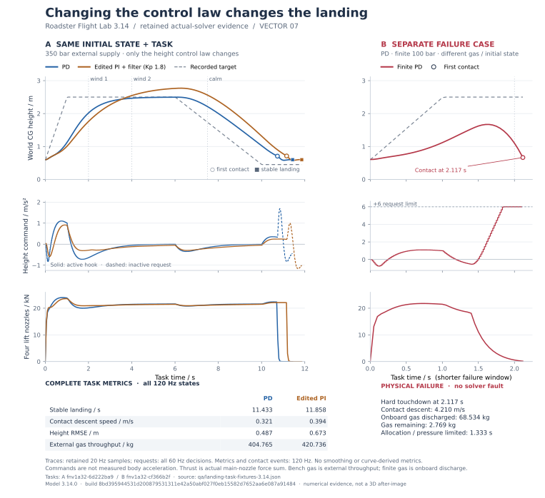

# 3.14 研究平台：保存安全、受限高度控制律与抗扰着陆

本轮在既有标准研究、现场记录、流程和 120 Hz 车辆求解器上继续开发。新增入口位于研究控制台的 **「控制律 / 着陆」** 页签。标准研究、原固定输入 A/B、风场、G 恢复网格和既有历史记录继续保留。

本报告的数值来自真实 `RoadsterSim` 求解；DOM 检查使用隔离 JSDOM、Canvas 与 Worker 调度替身。它们不能替代目标设备上的三维画面、原生键盘手感、整个城市路线、GPU 或性能验收。最终构建身份以本版本聚合报告、`model-build.js` 和发布提交为准；专项 JSON 同时保留实际执行的模型身份和源文件 SHA-256，不把开发中的临时 build digest 冒充最终发布证明。

## 交付与证据状态

| 项目 | 已实现 | 已检查 | 仍需实机观察 |
| --- | --- | --- | --- |
| 三类旧库与新挑战库的保存安全 | 独立保存警告、只读隔离、候选写入、完整会话导出 | 配额/拒写/容量/损坏/未知版本/局部坏条目、失败删除/清空/参数保存、导入与重载 | 真实浏览器长期容量和多标签页使用；没有删除真人历史测试 |
| 高度控制律 V1 | 可编辑 AST、积分/滤波组合、受限输出进入原喷口分配 | 非法节点、长表达式、NaN、除零、频率/状态/幅值边界；相同初态真实不同决策与重执行 | 原生编辑器、移动屏尺寸和三维操作可用性 |
| 公平比较 | 同任务重新决策；已保存任务之间比较；原固定输入 A/B 保留 | 初态/模型/风/供气/任务/算法差异；不匹配时描述性比较 | 目标设备完整用户体验 |
| 抗扰着陆 | 固定场地、任务预览、定时风/可选喷口降额、接管/取消/重试、事件遥测回看、个人最好 | 真实成功与有限气源硬着陆失败；UI 保存、导出、导入、刷新；主循环固定步接口 | 正常 WebGL 中一次完整真人挑战及接管，不以后台数值冒充三维体验 |
| 可靠失败末态 | 预复位全态或明确 diagnostic-only，非有限字段可导出 | 有限越界、NaN、控制器先检测异常两类路径；未将原点复位态加入结果统计 | 真实长时操作中的罕见故障 |
| 流程 rate 范围 | 编辑器、协议、帮助、参数上限共用配置 | `+360°/s` 滚转、`−120°/s` 俯仰保存/重载保值 | 请求与实际达到的角速度仍由真实执行器约束，不能把 UI 上限当实测能力 |

## 一、保存失败不会被“完成”覆盖

### 已核对的旧证据

实际查看了用户 3.12 实验室证据中的 `21-storage-quota.jpg` 像素：它显示 `roadster-research-library-v2` 写入触发配额错误。该图证明当时写失败，不证明普通追加静默删除了旧历史，也不证明 G 网格已经完成重载。本轮没有对真人库执行删除、清空或容量压力测试。

3.13 已修复 G 网格就绪文案覆盖完成/取消/失败状态，本轮保留这一成果。这里修复的是另一条路径：流程和现场记录完成提示会遮掉保存错误，以及损坏流程库/结果库与先改内存再写盘的破坏性编辑。

### 三种状态分开

- **执行状态**：计算/流程是否结束、取消、超时或出错。
- **物理结果**：是否接触、落稳、撞击、受限或未完成任务。
- **持久化状态**：是否真正写入浏览器；写失败持续显示「仅本会话 / 未保存」。后续完成消息不能清除此警告。

`research-storage.js` 提供候选写入与受保护读取。保存失败不会调用清库、回退覆盖或配额裁剪。标准研究将结果、执行日志和待运行编辑稿的保存状态分别保留；新挑战同样区分运行结束、结果判据和保存结果。

| 操作 | 写入失败时的行为 |
| --- | --- |
| 新计算结果、现场记录、流程结果、合并导入 | 新成果留在会话中，可导出完整结果及整库；磁盘旧库保持原字节 |
| 删除现场记录、删除流程、清空标准研究 | 先构建候选，再验证/写入；成功后才更新内存、选择状态和界面 |
| 保存流程控制参数 | 失败不替换已保存参数；表单仍可保留用户尚未保存的编辑 |
| 损坏 JSON、未知版本、含局部非法条目的库 | 整份原文只读隔离；不筛掉坏条目后覆盖其余原文；可导出受保护原文 |
| 并发修改旧库 | 破坏性替换核对读入时原文，不覆盖另一页面的新存档；新的会话成果仍可先导出 |
| 新挑战 Worker 无法启动或运行异常 | 保留尝试身份、算法、任务、最后进度和确切错误；无末态时不捏造物理结果 |

保留现有 localStorage 架构，没有升级时删除旧库或迁移清理。当前容量仍有限：标准研究最多 64 条/4 MiB；现场库 32 条/4 MiB；流程库和结果库沿用既有容量；新挑战 32 条结果、32 个控制图、4 MiB。完整会话导出/导入允许更大的已声明上限，超过本地写入预算的成果明确保持未保存，不静默淘汰旧记录。

现场和流程的既有展示曲线抽稀继续保留，但 `sampling` 明示原始/存储数量、间隔和抽稀状态。统计、物理初态、输入身份不由抽稀曲线重算。当前会话仍可导出未压缩的保留曲线；刷新后的历史曲线只声称磁盘实际保存的分辨率。新挑战保存全部 20 Hz 展示点和全部声明控制频率的决策，不再额外抽稀。

### 实际关闭的两个失败

首次新 DOM 门禁发现：编辑第一个流程并保存后，代码先删除旧项再追加到尾部；刷新自动选中了另一个流程，最大合法 rate 看似丢失。现在原位置替换已有项，只有新流程才追加。原 `360 / −120` 的编辑、保存、重载断言保留。

另一新故障见下文“失败末态”。两个首次失败及处理理由保存在 `qa/research-platform-3.14-first-failures.json`，没有删除原验收要求获得绿灯。

## 二、可以改变组合的高度控制律

`bounded-height-controller.js` 实现纯 JSON 数据树，接口 `height-outer-acceleration-1`。它不是任意 JavaScript，也不只是固定增益滑条。用户能改变误差、比例项、积分、滤波、运算和限幅的连接关系。

两个模板：

- PD：`3.2 × error − 3.6 × verticalSpeed`。
- PI + 滤波速度：`2.6 × error + 0.35 × integrate(error) − 3.4 × filter(verticalSpeed)`。

这两个公式只是本模型实验模板，不是经过实车标定的控制器。测试另外修改第二个模板中的比例项为 1.8，保存为独立自定义算法，在同一完整初态与任务上重新决策，保留实际不同的输出和轨迹。

| 契约 | 限制 |
| --- | --- |
| 只读输入 | `error`、世界 `height`、`targetHeight`、`verticalSpeed`、任务 `time`、控制步 `dt` |
| 节点 | `const`、`input`、`add/sub/mul/div/min/max`、`clamp`、`integrate`、`filter` |
| 状态 | 固定 4 槽；槽不重复占用；积分/滤波有界，绝对值不超过 20 |
| 静态预算 | JSON 最多 12,000 bytes、80 节点、深度 14 |
| 单次执行 | 最多 96 节点运算；非有限值、过大的中间值或接近零的除数立即停用 |
| 频率 | 10/20/30/40/60/120 Hz，均为物理 120 Hz 的整数分频 |
| 输出 | 世界竖直加速度请求，绝对不超过 6 m/s²；可声明更小范围；变化率最高 30 m/s³ |
| 下游 | 仅研究实验室 hover + G hold；进入既有控制、力/矩分配、喷口上限、阀门与气源；X 和原始喷口不接受此覆盖 |

无 `eval`、网络、文件、DOM、动态代码或循环。Worker 只提供调度隔离，安全边界由可检查的 AST、预算和物理接口共同建立。物理模块再次校验控制步、命令过期时间、输出范围和变化率。图可以请求一个仍然无法被喷口实现的动作；饱和和实际应用请求单独记录。

算法内容、FNV-1a 内容标签、接口/模型版本、控制频率、初/末内部状态、每次读取输入、原始输出、限幅输出、状态与操作数均保留。该哈希用于内容身份，不冒充密码学签名。异常记录确切控制步、原因和最后有效内部状态；不是伪装成传感器延迟。

界面在语言切换时不重写 JSON、名称或编辑值。新页面的错误、结果、指标、图轴单位和控制权说明均有英文路径。

## 三、同任务重执行与抗扰着陆

### 原固定输入 A/B 和新任务重新决策各自保留

原现场 A/B 继续固定输入日志和命令时序，改变声明控制增益。新任务协议 `windlab-disturbance-landing-1` 从同一完整物理初态和同一任务重新调用控制律；不照抄原控制输出。相同图还恢复其初始内部状态。

比较先显示完整初态内容标签、可读初态姿态/速度、模型/构建、碰撞身份、风时序、供气、任务和算法差异，再显示物理结果及数值。已保存任务可选择另一条记录比较。初态、模型、任务等不一致时明确标为描述性比较，不自动判 B 更好。个人最好只在同任务、算法、供气、模型/构建中比较已成功落稳的记录，先保留碰撞/失败身份，再比较时间和气量，没有总分掩盖撞地。

流程摘要仍通过 `liveExperimentId` 链接现场原始记录。本轮流程新增完整 120 Hz 统计累积，标准研究与现场记录继续保持自己的统计身份；旧 20 Hz 历史不会被重新标注成 120 Hz。若调用方没有完整固定步回调，流程明确退回实际拥有的 20 Hz 统计，不虚构高频数据。

### 固定任务与边界

场地是实际风场实验室中央区域，工作区 X ±24 m、Z ±42 m，净高 24.1 m。开始前显示全部任务时序、供气模式、成功条件、超时和控制权。目标超过净高时警告，不静默夹紧。

默认任务从地面静止初态起飞到 2.5 m 世界重心高度，1 s 参考爬升、6 s 开始下降、10 s 参考到 0.45 m。2 s 施加 3 m/s 侧风及 1 m/s 正弦阵风，4 s 切为反向 4 m/s 与 1.5 m/s 阵风，7.5 s 归静风；可在 4.5 s 将 FL 主喷口降额。默认 350 bar 恒压外供气，16 s 超时，半径 1.5 m 目标区。

V1 保留观测种子 31415，但使用理想观测和确定性风时序，没有偷偷加入随机扰动。因此相同种子的可重执行有意义，不能把这一任务包装成随机鲁棒性扫图。

成功需要真正离地和达到起飞高度，随后确认接地，再连续 0.5 s 满足至少三轮接触、倾角 <8°、水平速度 <0.4 m/s、垂速 <0.35 m/s、角速度 <0.15 rad/s 且落点在目标区。首次接地前垂速 >1.4 m/s、姿态超限、车体碰撞、提前接地、离开工作区或超时均保留具体失败原因。按驾驶输入立即交还控制；取消不直接改变刚体姿态或速度。

专业指标记录落点误差、接地前垂速/倾角、估计包络间隙、饱和时间、气量及落稳时间。**“末次风变化至落稳”包含任务规定的下降阶段，不是单独风阶跃的收敛时间。** 最小间隙来自当前车体碰撞 AABB 到真实平地地面的竖直距离，只适用于这个任务场地；不是轮胎行程、城市 AGL 或可恢复高度。

关键事件回看显示精确 120 Hz 事件步、最近的 20 Hz 展示样本及其时间差、最近控制决策，并在曲线上定位。它不移动现场车辆，也不将最近展示样本冒充事件瞬间的完整三维状态。

### 同条件数值结果

以下均使用实际车辆求解器和现有主喷口上限，不直接设置运动状态。完整合成结果位于 `qa/landing-task-fixtures-3.14.json`，汇总位于 `qa/research-platform-3.14.json`。



此图从最终构建 `8bd395944531d200879531311e42a50abf027f0eb15582d7652aa6e087a91484` 的原始结果生成，是数值响应图，不是三维后图。左侧只改变控制律；右侧有限气源 100 bar 的初态和任务身份不同，单独报告。高度/推力使用保留的 20 Hz 样本，控制请求使用全部 60 Hz 决策，接触标记与表中统计来自 120 Hz 记录。接地后 hook 未启用时只以虚线显示控制律请求，不把保留的旧 `applied` 数值冒充实际应用；喷口曲线仍来自真实输出。外供气吞吐量和有限车载排气量分别标明。

[PNG 预览](../qa/landing-response-3.14.png) · [数据与身份说明](../qa/landing-response-3.14-provenance.json) · [绘图脚本](../scripts/plot-landing-3.14.py)。脚本运行前核对 fixture 与当前构建一致，且核对两条外供气记录的完整初态、控制器初值、任务及碰撞身份相同；用 `python scripts/plot-landing-3.14.py` 重建。

| 指标 | PD，350 bar 外供气 | 用户改法：PI + 滤波、比例项 1.8，同外供气/初态 | PD，有限车载 100 bar |
| --- | ---: | ---: | ---: |
| 物理结果 | 落稳完成 | 落稳完成 | 硬着陆失败 |
| 终止时刻 / s | 11.433333 | 11.858333 | 2.116667 |
| 全部统计物理步 | 1,372 | 1,423 | 254 |
| 最大世界 CG 高度 / m | 2.497773 | 2.771046 | 1.670339 |
| 高度 RMSE / m | 0.486762 | 0.672963 | 1.009272 |
| 首次接地前下降速度 / m/s | 0.321401 | 0.393776 | 4.209523 |
| 最小车体包络间隙估计 / m | 0.029489 | 0.028400 | 0.053851 |
| 分配/供压受限累计 / s | 0.008333 | 0.008333 | 1.333333 |
| 外供气吞吐量 / kg | 404.765051 | 420.735763 | 0 |
| 车载排气量 / kg | 0 | 0 | 68.533757 |
| 判据通过 | 是 | 是 | 否 |

前两列仅改变算法组合，具有受控比较条件；用户改法产生更大的高度超调与误差，并没有因为“自定义”就被评价为更好。第三列供气和初态压力改变，只作描述性失败对照。其失败是实际气源不足和硬接地，不是求解器异常。恒压吞吐量不能解释成车载储罐用量。

默认风工况中最大水平偏移仅约 0.00302 m；这对当前重车/水平控制模型是温和扰动，不证明极端侧风或任意喷口故障都可恢复。极小的数值落点误差也不代表实物精度。此任务提供可完成、可失败、可改控制律、可重执行的首个闭环，尚非全场景安全边界地图。

## 四、失败末态不能变成复位原点

现场记录和新任务统一使用预复位终态处理：

1. 若物理安全系统保留了可编码的 `triggerContinuationSnapshot`，它才是完整终态；诊断姿态不是 Cannon 的完整继续状态。
2. 若状态含 NaN/Infinity，保存明确的字段描述、触发步、最后有效诊断、短时输入/接触记录；`physical=null`、`terminalReplayable=false`，拒绝冒充精确终态重放。
3. 若控制器先于物理安全步检测非有限观察，最终全态编码也可能失败。本轮新增 `captureTerminalState` 捕获这一分支，保留最后有限遥测和无效字段，记录 `terminal_capture_failed`，安全释放研究命令。它不捏造物理求解器已经捕获了故障。
4. 故障触发步没有有效有限物理积分时，不把安全 reset 返回的原点遥测加入统计。`stepCount` 与有效 `statisticsCount` 可以相差一步，报告保留这种差别。

隔离夹具覆盖有限越界、非有限状态、控制器前/后两个注入时点。故意直接修改状态只用于故障注入测试；它不是可由普通驾驶输入复现的任务，报告没有把未记入输入日志的人工注入宣传成精确重放。

旧 3.13 记录继续可读、可导出；3.14 增加了控制状态且城市碰撞几何改变，没有放宽严格快照导入。未声明的旧全状态迁移明确拒绝，用户可以在当前模型重新建立任务/加载历史标准方案产生新记录，而不是伪装旧模型原样运行。

## 五、验收入口与剩余工作

```sh
node tests/research-platform-3.14.test.mjs
node qa/research-safety-3.14-dom-check.mjs /path/to/jsdom/lib/api.js
node tests/experiment-records.test.mjs
node tests/flight-programs.test.mjs
node qa/experiment-console-dom-check.mjs /path/to/jsdom/lib/api.js
node qa/research-panel-dom-check.mjs /path/to/jsdom/lib/api.js
```

新专项分别生成 `qa/research-platform-3.14.json`、`qa/research-safety-3.14-dom.json`；既有现场/流程/标准研究门禁保留并继续执行。所有 storage fixture 是隔离内存或 JSDOM 库。旧历史容量、原文保护、执行状态与复现判定分离、输入保存和英语不因本轮新增任务而回退。

目标浏览器只需补一组具体操作：

1. 从网站进入研究控制台「控制律 / 着陆」，确认模型/构建和场地说明；先保留原记录并导出备份。默认 350 bar 外供气做一次三维挑战，查看起飞、风变化、接地、落稳和实际保存状态。
2. 编辑积分/滤波模板中一个比例项，保存并运行「原算法与编辑算法对照」；确认同任务条件、两条曲线和不同实际决策。切英文时检查名称与 JSON 值未变。
3. 改为有限气源 100 bar，观察实际失败和事件回看；另做一次驾驶输入接管和一次取消。不要把失败取消结果当落稳完成。
4. 导出整库，刷新，打开算法及成功/失败记录，重执行当前模型任务，再返回驾驶。若出现配额提示，先导出当前完整会话，警告应持续存在；无需清空真实历史来制造成功。

仍未完成的是目标设备的这组原生闭环、真实三维图像和布局验收，而不是缺少数值任务或保存实现。城市视觉、车模、GL1286/14 帧矩阵等图形证据由对应 3.14 报告单独给出，不从本报告的 DOM 或求解器结果外推。

## 附：独立接口边界复核

另增 `tests/research-boundaries-3.14.test.mjs` / `qa/research-boundaries-3.14.json`，只针对接口与失效边界，没有扩展功能。它包括真实 Node Worker 调度；仍不等于目标浏览器 Worker、WebGL 或原生输入验收。

复核确认 JSON AST 没有可执行字符串入口，同时修正了三个具体边界：状态导入原先没有拒绝额外字段、稀疏数组及任意 fault 载荷；同一控制步重复调用会重复积分；旧 Worker 的无身份 `onerror` 回调可能干扰随后任务。现在节点/状态在读取前检查 own 数据描述符，拒绝原型/额外/访问器字段；状态只允许四个稠密槽，遵循实际积分限值和未用槽为零，故障载荷有界且不能递归；同一步幂等，倒序或遗漏声明的决策步会明确停用。正常连续 120 Hz 调用与合法快照继续的结果不变。

输出/取消专项检查验证：除零与溢出不提交半完成积分，80 个有效节点只执行 80 次解释运算，超额节点在解析时拒绝；取消与观察回调失败不让旧高度命令继续生效，也不直接改变刚体运动。Worker 只拥有一个任务，拒绝并发/重复请求，旧回包和旧错误不能结束新任务，异常结果及取消发送失败能收尾并保存执行尝试。初始控制器内部状态也纳入比较条件，不能把不同积分初值伪装成同一初态。

状态契约沿用当前 V1 的同一字段结构，只收紧非法输入；合法已生成记录继续保存、导入与重执行。原开发候选的缺口和处理理由追加到首次失败文件。定向命令：

```sh
node tests/research-boundaries-3.14.test.mjs /path/to/jsdom/lib/api.js
```
