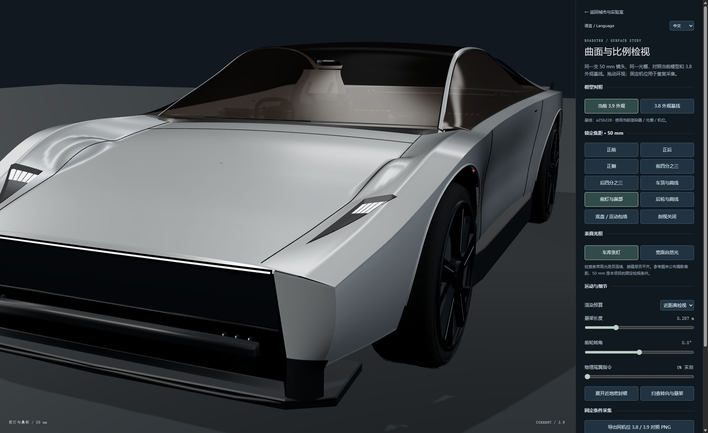
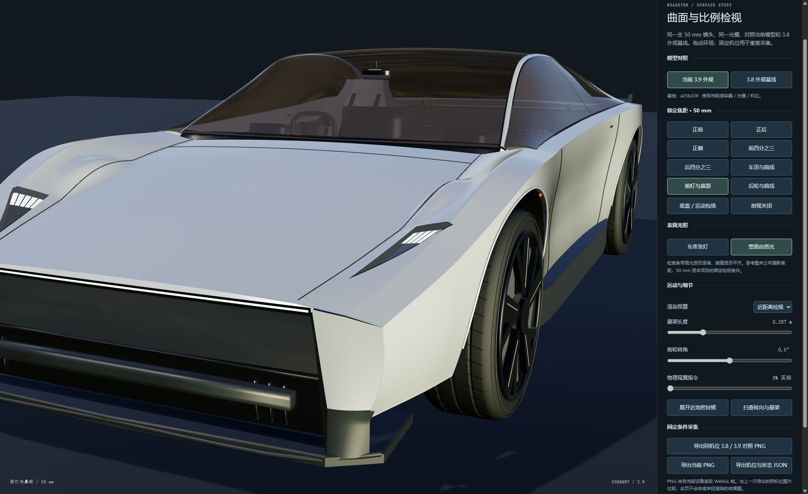

# 3.10 车辆外形修订：依据、修改与待采后图

本轮先查看用户上传的真实 WebGL 原图，再修改车辆曲面。已经实际看到 3.9 条灯与宽自然光下的前翼子板起伏、玻璃后浅色简化座舱、前口外露横杆和轮拱边缘；不再把这些问题归结为没有图形证据。新的代码和几何回归已完成，**新版本的真实三维后图仍待同条件采集，本文不作画质达标或 FPS 结论**。

## 原始证据与参考边界

主要依据是用户提供的 `roadster-evidence-supplement.zip` 中的：

- `Roadster-08-End-Desktop.jpg`：Tesla 当前官方 End 原图，SHA-256 `342e862f7239479b0d1994d1f842e50d05e926b8fd4c9158c02cc9f011bcc71b`。
- `tesla-pilot-browser.jpg` 与 `tesla-end-browser.jpg`：用户实际浏览官方参考的截图。
- [38-studio-front-lights.jpg](../qa/screenshots/3.9-evidence/38-studio-front-lights.jpg) / [39-studio-front-lights.jpg](../qa/screenshots/3.9-evidence/39-studio-front-lights.jpg)、[38-studio-side.jpg](../qa/screenshots/3.9-evidence/38-studio-side.jpg) / [39-studio-side.jpg](../qa/screenshots/3.9-evidence/39-studio-side.jpg)、[38-studio-front-three-quarter.jpg](../qa/screenshots/3.9-evidence/38-studio-front-three-quarter.jpg) / [39-studio-front-three-quarter.jpg](../qa/screenshots/3.9-evidence/39-studio-front-three-quarter.jpg)：同一 50 mm 检视光棚下的 3.8 / 3.9 对照。
- [39-day-front-three-quarter.jpg](../qa/screenshots/3.9-evidence/39-day-front-three-quarter.jpg) 与 [39-day-front-lights.jpg](../qa/screenshots/3.9-evidence/39-day-front-lights.jpg)：宽自然光下仍能看见局部表面问题，排除了仅靠更有利条灯布置掩盖形体的做法。

首批文件的画面为 1280×720，增补为 2031×1244；分辨率、车辆状态和位置不同，不跨批次作严格性能或亮度 A/B。官方图的摄影内参、镜头畸变和实车标定尺寸未知。项目的 50 mm / 36 mm film gate 是重复检视条件，不能把照片匹配称为 CAD 精度。

官方来源：[Tesla Roadster 页面](https://www.tesla.com/roadster)、[End 原图 URL](https://digitalassets.tesla.com/tesla-contents/image/upload/f_auto,q_auto/Roadster-08-End-Desktop.jpg)。本次没有混用 2017 圆润概念车来修改当前折线外形。

下面两张是用户上传的 **3.9 原始缺陷证据**，不标作 3.10 产品效果：

## 地标对照

| 参考中可辨认的地标 | 本模型的处理 | 尺寸或推断边界 |
|---|---|---|
| 薄的水平前灯、低鼻部、明确折返的前脸 | 保留前灯宽度与低鼻部；前进气横杆收进壳体，增加侧回板与底部遮蔽 | 沿用车体鼻部 `z=+2.30 m`；细小内部光学构造独立设计 |
| 机盖两侧近直线折缝与前肩硬边 | 将前盖切线固定为近直线；在切线和肩脊处分带采样，宽主面保持连续 | 机盖半宽由后端约 0.718 m 过渡到前端 0.647 m；不是从照片解算的毫米尺寸 |
| 宽而受控的前翼子板主面 | 一套截面同时确定机盖、上升面和肩面，取消成面后再贴轮拱椭圆抬高的局部补丁 | 保留轮胎/悬架全部运动包络，以安全间隙检验，而非缩小轮胎 |
| 较平缓的座舱顶、收束的侧窗、宽后肩 | 使用保形插值避免站点极值超调；只轻调车顶后段站点，保留当前长顶与后肩比例 | 源图透视未知，不伪称恢复原厂曲率 |
| 比较平整的车门与细窄下侧裙 | 减弱旧车门下部的椭圆凹面，厚矩形侧裙改为浅的闭合折面 | 细节为外形重建，未改碰撞质量、重心或阻力系数 |
| 回折轮拱边缘 | 外贴白色圆管改成与开口相接的薄板回折；下端有回边 | 轮距 1.78 m、轴距 2.84 m、胎半径 0.372 m 沿用现有物理假设 |
| 深色玻璃与有层次的轮毂 | 烟色玻璃减少浅色示意座舱透出；轮毂银色区由平挤出三角片改为连续浅碟面 | 玻璃仍是 alpha 表面近似，无光学折射求解；没有真实玻璃和车漆光谱标定 |

## 已见缺陷 → 修改位置

| 原图中看到的问题 | 3.9 源码诊断 | 3.10 修改 |
|---|---|---|
| 前灯近景中，机盖缝旁出现双重隆起和反复扭转的高光 | `bodySurfaceY()` 完成机盖分面后，再对 `archCrown()` 作局部 soft-max 抬面；普通平均斜率的站点插值还会越过宽度/高度极值 | `interpolate()` 改用保形单调切线；`bodySection()` 定义统一截面，删除顶点级抬面；机盖网格列对齐切线与小圆角 |
| 接缝略浮起、轮拱像外贴白线 | 机盖线高于曲面 5.5 mm；拱口采用半径 4.6 mm 的圆管 | 机盖线贴齐到 1.9 mm；轮拱改为向轮罩内回折的薄片边缘 |
| 玻璃内浅色座椅与反射共同主导前景 | 内饰浅色材料；`setCutaway(false)` 硬写玻璃 opacity 0.78，覆盖初始 0.86，采对照时也会触发 | 深色示意座舱与中性烟色玻璃；记录并恢复各材质原始 opacity，采集/剖视往返不再改变外观状态 |
| 挡风玻璃上方可见突出的黑色镜体 | 后视镜杆顶部在 `y=.612, z=.250`，穿出真实玻璃网格 | 将镜体和固定点移回风挡内侧；以实际玻璃网格射线检查遮蔽与穿插 |
| 前脸粗横杆和角部见底透光，使保险杠像搭出来的框架 | 横杆位于开口最外侧，角部缺少连续遮蔽 | 横杆变薄并退入开口；补侧回板和下部封闭面，保留真实开口深度 |
| 灯内大白条像贴片、轮毂银色片缺少体积 | 大面积共面的发光矩形；轮毂银色扇区是固定深度挤出 | 每灯三个低于外盖的黑色灯座、反光圈、发光面和凸光学罩；轮毂银色扇区有径向碟形深度和暗色回边 |

白色前灯条与红色尾灯条仍是当前外形的重要部分，没有因为避免“贴片”而删掉它们。项目的喷口、密封裙、储气罐、气路和未公开机构属于实验改装假设；尾部多个外观端口不额外增加物理力。物理尾翼位置和攻角仍直接读取统一遥测状态。

## 已完成的回归与成本

- 既有车辆几何回归继续覆盖轮胎完整外形、转向 `±0.49 rad`、悬架长度 `0.24–0.41 m`、轮罩/壳体/喷口避让、所有密封段、驾驶 LOD 与剖视。最小轮罩间隙仍约 **17.69 mm**；壳体顶面最小间隙从约 **16.47 mm** 提升到 **29.51 mm**。没有缩胎或视觉钳住悬架。
- 新的针对性回归检查原 3.9 车辆源码与布局身份、同一主面分带边界的法线、材质复位、轮/尾翼姿态不受显示切换影响以及后视镜穿玻璃。旧镜体最大穿出约 **62.72 mm**，当前样本保持在玻璃内侧，最小内收约 **25.25 mm**。
- 前翼子板三个几何剖面中的局部法线反复转向减少。这是定位并排除造型函数中的多余隆起的数值证据，**不是屏幕高光质量评分**。
- 当前静止可见几何预算：流畅约 **53,547** 三角形、驾驶细节约 **225,551**、近检约 **367,459**；原 3.9 为约 **50,595 / 222,555 / 359,095**。增量主要用于明确折线附近的采样、光学元件和边缘回板。这里如实报告了小幅成本增加，不将它写成帧率优化或质量证明。近检和驾驶继续依据屏幕占比使用不同预算；流畅仍仅保留车壳与四条轮胎共五个投影轮廓。

产物：[几何与运动包络](../qa/vehicle-geometry-3.10.json)、[表面和材质状态诊断](../qa/vehicle-surface-3.10.json)、[场景图预算](../qa/vehicle-3.10-render-cost.json)。

## 可直接采集的后图

[车辆检视页](../dist/vehicle-inspection.html) 增加了冻结 **3.9 / 6083bbf** 基线，原 **3.8 / a25b228** 仍可选。冻结构造函数与原提交逐字节对应，仅将布局导入改到隔离的同版本文件；不会装作旧物理模型正在执行，也不替换旧历史结果。

先固定视口、设备像素比和画质，将转向设为 0、悬架设为 0.287 m、尾翼设为 0、剖视关闭、裙边收回、自动悬架扫查关闭。使用“对照原始帧 + 同次条件 ZIP”，分别采：

1. **前灯与鼻部**，条灯与宽自然光各一组：检查旧高光鼓包是否消失，保留机盖硬折线；同时看灯座深度、缝隙和后视镜是否穿出。
2. **前四分之三、正侧**，两种照明各一组：检查整体轮廓、玻璃/座舱比例、车门与侧裙、轮毂体积。
3. **后四分之三、后轮与肩线**：确认前部改动没有破坏后肩、尾翼与轮罩衔接。
4. 固定同一机位连续扫查转向/悬架，另拍低速相机运动短片：检查轮拱干涉、透明排序和运动中的高光、边缘锯齿，不能只看一张静帧。

本页沿用原 3.9 光棚、主光与填充光、曝光 0.92、条灯环境强度 0.72、自然光环境强度 0.68，**未用新的检视灯光掩盖曲面问题**。ZIP 包含原始基线 PNG、原始当前 PNG、另加标签的并排对照 PNG 和不可变的条件 JSON（`roadster-surface-frame-pair-1`）。文件名与两帧记录共用 `captureId`，两次实际 WebGL 绘制之间没有推进物理状态、相机、输入或渲染尺寸；每帧在绘制后立即以原始 drawing buffer 尺寸复制，之后才异步编码和打包。相机输入与全部设置在采集中暂时禁用，窗口 resize 延后处理，自动悬架扫查也暂停。

包内各帧条件沿用 `roadster-surface-capture-2` / `roadster.surface-comparison` 第 2 版，明确 `recordScope: rendered-frame-conditions`，记录当前/基线身份、实际镜头和 drawing buffer、pixel ratio、光照、`simTime`、悬架/尾翼状态以及浏览器实际允许读到的 renderer 信息。旧基线保留自己的历史材质复位行为；元数据同时给出两者当时的玻璃 opacity。原来的“导出同机位 … 对照 PNG”仍可单独使用，但其后再点击“导出当前状态 JSON（独立）”只会生成当次点击的状态（`recordScope: current-state-unbound`、`captureId: null`）；不能将它伪称为先前图片的伴随记录。只有 ZIP 保证图片与条件同次绑定。

还需在城市场景的晴天和湿夜下验证车漆/玻璃反射、受局部灯照明后的明暗关系。检视光棚结果不能替代街景。尚未收到并审看本轮后图之前，README 不应把这些改动标成“视觉已达标”。
