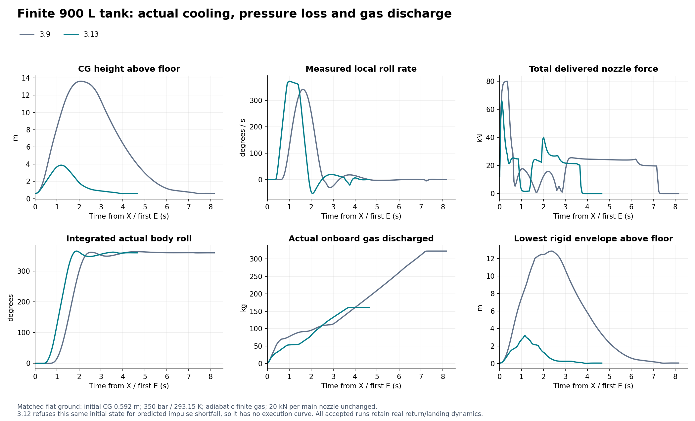
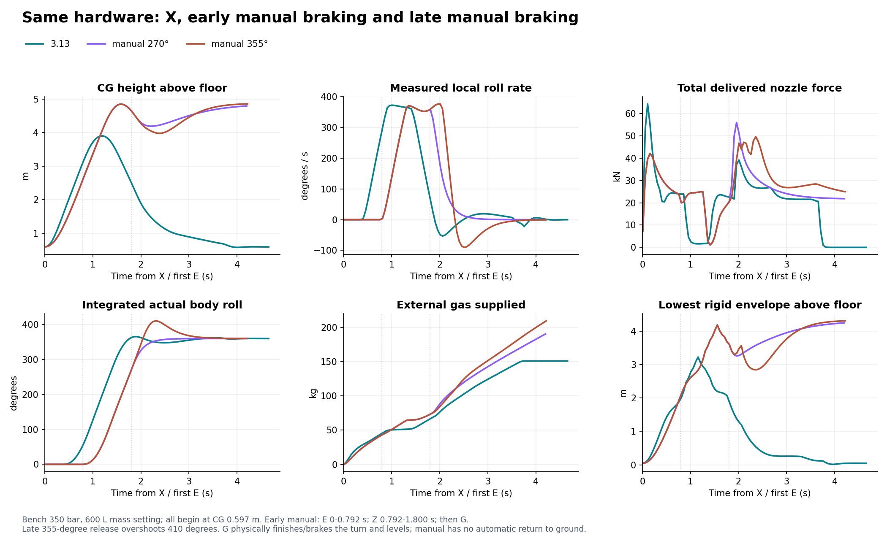

# 3.13：X 快翻退化、物理修改及同条件对照

## 已确认的结论与边界

用户关于“3.11 / 3.12 的 X 比 3.9 慢、先爬得过高”的反馈在原求解器中复现。主要退化是控制策略：把 X 的轨迹机械绑定到舒适手动设置，同时把起跳加速度限制为 5 m/s²，并继续按整个旋转时间计算预升速度。没有证据支持把这次退化解释为执行器突然变弱或浏览器的物理限制。

本次保留原质量、惯量算法、20 kN 主喷口、阀门动态、压力 / 温度 / 有限气量、故障与力矩分配。新的 X 使用独立的 1.5 s 快翻参考，并按可用推力建立短起跳。默认地面恒压工况最大 **CG 高度 3.905 m**，实际峰值 **372.63°/s**，3.692 s 完成落地；原 3.9 为 13.584 m / 342.37°/s / 7.175 s，3.12 为 31.593 m / 187.00°/s / 11.892 s。这里的“完成”包含旋转后的实际着陆或原高度恢复，不只是参考轨迹计时结束。

这是本项目工程模型的数值结果。未将它当成真实 Tesla 参数、发布会视频复原、WebGL 画面验收或人的操控体验验收。发布会视频的原始素材、拍摄条件与真实性未在本项工作中核实，也没有据此先肯定或否定用户的描述。

## 1. 原版本究竟改了什么

冻结基线分别来自 `6083bbf0e01f4eef5447f2c1b951d8b41e691f46` 和 `70e98013d6da246c78c4c50ca2ef44595d1f356b`。3.11 `ab9372b` 到 3.12 的 X 轨迹、预检和飞行控制区块没有改变；其间的物理差异主要是轮系制动。下面的实际曲线使用完整冻结的 3.9 与 3.12 物理源文件，没有把新控制器套在“旧参考”上冒充旧版本运行。

| 项目 | 3.9 | 3.11 / 3.12 默认 | 3.13 新 X |
|---|---|---|---|
| 参考轨迹 | 五次多项式一周 | 手动速率包络的梯形一周 | 独立 `quick-roll-1` 梯形一周 |
| 参考持续时间 | 2.0 s | 2.5 s | 1.5 s |
| 参考角速度峰值 | 337.5°/s | 180°/s | 360°/s |
| 参考角加速度峰值 | 519.62°/s² | 360°/s² | 720°/s² |
| 起跳垂速目标 | 11.21 m/s | 13.6625 m/s | 4.0025 m/s |
| 起跳净加速度限制 | 实际剩余推力 | 实际余量与手动 5 m/s² 的较小值 | 实际可用净加速度的 88% |
| 此 600 L 质量设定下净加速度上限 | 26.56 m/s² | 5.00 m/s² | 23.37 m/s² |
| 开始旋转所需 CG 到地面距离 | ≥1.55 m，且垂速达标 | 同左 | 同左，独立记录为 profile 条件 |
| 姿态控制响应参数 | 旋转 6，起跳 / 恢复 4.3 | 公共参数默认 4.5 | 继续使用公共参数默认 4.5 |
| 有限气源预检 | 旧起跳、旋转、制动、回稳预算 | 更慢预升导致预算显著增加 | 分项实算、仍有 16% 冲量余量 |

1.55 m 是**进入旋转阶段的 CG 距离门限**，不是按 X 的最低触发高度，更不是最低车身净空。X 可以从水平地面起步；必须先靠实际推力抬升到旋转条件。3.12 为达到更高垂速又受 5 m/s² 限制，实测旋转开始时 CG 已到 19.434 m，远高于同一 1.55 m 门限。这正是旧行为退化最明显的证据。

3.9 没有被查出“直接设车身姿态”的作弊路径。它的问题是用整段旋转的 `gT/2 + 1.4` 计算预升、使用独立较强控制响应，却只给手动较慢包络。3.11 为统一手动与 X，把 X 降慢并扩大预升，误解了“手动应能合理复现 X”的目标。本次保留统一物理执行器，分别声明舒适驾驶和自动机动的参考策略。

## 2. 为什么新动作能更低，而没有增加推力

`dist/vehicle-models.js` 新增 `quickRollManeuverProfile()`：0.5 s 加速经过 0–90°，0.5 s 匀速经过 90–270°，0.5 s 制动经过 270–360°。主动滚转加 / 减速主要发生在车体朝上的两个四分之一圈，倒置阶段短。左右差动主喷口产生滚转力矩时也产生实际合力；分配器的正推力约束、世界坐标方向和阀门响应仍然决定真实轨迹。

`dist/physics.js` 用这段倒置匀速时间估算起跳目标，保留 1.55 m/s 跟踪 / 阀门余量；起跳限于实际剩余推力的 88%。没有把车体位置、速度或四元数写成规划值。原姿态控制器继续请求力矩，原非负有界分配器输出各喷口实际推力。

默认初始质量 2199.558 kg、滚转惯量 945.810 kg·m²。新参考的惯量力矩需求约 11.885 kN·m，几何双向滚转上界 26.020 kN·m，比例 2.189。预检要求比例至少 1.65。这个几何上界**不能**同时当作全六维可用控制能力；1.65 门限是明确的控制裕量，不是实车认证结论。实际地面恒压动作峰值滚转力矩 13.494 kN·m、总喷口力 64.383 kN、最高单喷口使用比例 80.48%，没有到 20 kN 上限以外取力。

预检分别计算起跳冲量、角动量建立与制动所需冲量、预计旋转结束时的下降制动冲量、1.5 s 回稳冲量，再乘 1.16。上方净空仍按上限式垂直运动估计和五个足迹射线检查，保留 1.8 m 轨迹裕量与 1.2 m 上方包络裕量。下降初态另外按实际可用减速度和阀门延迟判断能否先制住下落。它们是可审查的近似和政策余量，拒绝只表示当前模型与策略未通过，不等于真实车辆不可能。

此 600 L 有限气源工况初始可用支撑冲量 110.605 kN·s，新计划需求 104.863 kN·s；实际地面动作耗用 82.145 kN·s。有限 150 L 的相同检查只有 27.7 kN·s，而计划需 95.1 kN·s，仍明确拒绝。

## 3. 同条件真实求解器结果

每组保持同一地面、初始 CG、姿态、零速度、气源模式、350 bar / 293.15 K、无风、相同轮胎和喷口参数。地面先运行 2 s 让悬架真实静置；600 L 质量设定的 CG 为 0.597009 m，900 L 为 0.592302 m。空中工况从 CG 4.000 m 开始。除声明的初态外，测试过程中没有改写位置、姿态或速度。

求解频率 120 Hz。所有极值和接触判据读完整子步；曲线按 20 Hz 保存，手动曲线另保留最后的回稳确认样本，末段采样间隔可能小于 0.05 s。曲线包含位置、速度、完整四元数、真实角速度、参考角速度 / 加速度、各喷口命令和实推、期望 / 实现六维力矩、压力与耗气。自动动作完成后继续观测约 1 s：最后遥测在完成后 119/120 s（0.991667 s），20 Hz 曲线末点可能更早。完成时气耗单独列出，避免把继续悬停的气耗混入动作成本。

高度术语：`heightM` / `heightWorld` 是 CG 世界高度；`rigidEnvelopeClearanceM` 是变换后的刚性碰撞形状包络最低点到 y=0 平地的距离，含车轮行程止挡，不包括悬架射线的伸出或视觉轮胎延伸。刚体接触和轮胎射线接触另行检查。不能把 CG 3.905 m 说成整个车辆离地 3.905 m。

### 地面起步，恒压，600 L 质量设定

此处“600 L”只决定初始气体质量和惯量。恒压由外部气源持续补充，下面列的是**外供气吞吐**，不是 600 L 实际储气所能供给的气量。

| 实测项目 | 冻结 3.9 | 冻结 3.12 | 3.13 |
|---|---:|---:|---:|
| 起跳到旋转开始 | 0.608 s | 2.750 s | 0.392 s |
| 旋转开始 CG 高度 | 4.542 m | 19.434 m | 1.603 m |
| 实际旋转阶段结束时刻 | 2.617 s | 5.258 s | 1.900 s |
| 最大 CG 高度 | 13.584 m | 31.593 m | 3.905 m |
| 旋转阶段最低刚性包络净空 | 3.992 m | 18.884 m | 1.053 m |
| 真实滚转角速度峰值 | 342.37°/s | 187.00°/s | 372.63°/s |
| 最大累计滚转角 | 363.72° | 363.23° | 365.79° |
| 旋转结束垂直速度 | −2.804 m/s | −6.730 m/s | −3.217 m/s |
| 总喷口力峰值 | 79.958 kN | 32.574 kN | 64.383 kN |
| 任一喷口命令≥98.5% 上限的累计时长 | 0.350 s | 0 s | 0 s |
| 完成实际落地 | 7.175 s | 11.892 s | 3.692 s |
| 完成时外供气吞吐 | 286.018 kg | 454.247 kg | 150.180 kg |
| 旋转期间轮胎或刚体触地 / 起飞后车壳撞地 | 无 / 无 | 无 / 无 | 无 / 无 |

表中的完成时刻是自动控制器退出动作、转入驾驶状态的时刻。独立研究协议仍要求持续 0.5 s 的稳定着陆；同一默认恒压工况首次承载轮胎射线出现在 3.500 s，研究稳定确认在 4.325 s。三个事件没有混为一个“结束时间”。

新动作保留了可见的惯性和真实掉高：最高 CG 3.905 m，旋转结束已降到 2.195 m，仍有 −3.217 m/s 的下降速度，随后用实际喷口制动着陆。实际角速度超过 360°/s 参考约 3.5%，累计滚转也有约 5.8° 超调，再物理制动回正；没有把真实角速度硬夹在参考值。


### CG 4 m 空中起步，同一恒压条件

| 版本 | 最大 CG 高度 | 实际滚转峰值 | 返回起始高度的完成时刻 | 完成时外供气吞吐 |
|---|---:|---:|---:|---:|
| 3.9 | 16.910 m | 342.37°/s | 6.342 s | 255.600 kg |
| 3.12 | 35.009 m | 187.00°/s | 12.700 s | 487.702 kg |
| 3.13 | 7.013 m | 372.47°/s | 3.267 s | 137.026 kg |

3.13 完成后额外观测约 1 s 的最后遥测中，CG 3.997 m、垂速 0.0184 m/s、滚转 0.0334°。回稳最低 CG 相对起点约低 0.038 m。另有同设置 CG 80 m 工况验证该控制轨迹没有靠近地隐藏纠正；完整数据保留在 JSON。

### 有限储气，同样初态，不绕过旧版拒绝

| 储气 / 初态 | 3.9 原逻辑 | 3.12 原逻辑 | 3.13 实际完成 / 气耗 / 完成时剩余 |
|---|---|---|---|
| 600 L / 地面 | 冲量预检拒绝 | 冲量预检拒绝 | 3.692 s / 157.065 kg / 92.493 kg |
| 600 L / CG 4 m | 冲量预检拒绝 | 冲量预检拒绝 | 3.267 s / 142.390 kg / 107.168 kg |
| 900 L / 地面 | 7.200 s / 322.015 kg / 52.323 kg | 冲量预检拒绝 | 3.683 s / 160.484 kg / 213.853 kg |
| 900 L / CG 4 m | 冲量预检拒绝 | 冲量预检拒绝 | 3.275 s / 146.847 kg / 227.490 kg |

600 L 初始储气质量 249.558 kg，900 L 为 374.337 kg。这里都是实际车载气体排出量，温度下降、压力下降和质量 / 惯量变化均在求解。被拒绝的旧版本没有强行推进，故没有伪造运行曲线。空中动作完成后继续悬停仍消耗气体，例如 600 L 空中例额外观测约 1 s 的最后遥测中余气约 62.367 kg；一次动作通过不代表可无限连续翻转或悬停。



## 4. 手动可以练出同等级快翻，但不会自动返回起点

第四预设“快翻练习 / Quick-roll practice”提供：升降目标 4 m/s、升降加速度 10 m/s²、滚转 360°/s、俯仰 90°/s、角加速度 720°/s²。标准和原机动预设保持不变。它只设置参考，不改变喷口额定推力；不使用按住越久越快的输入方式。

使用 G 关闭、普通飞行控制，依次实际输入 E、Z、G；没有调用自动 X：

1. E 升高，到测得垂速≥3.76 m/s 且 CG 到地面距离≥1.65 m。
2. 松 E，按 Z，到实际累计滚转角约 270° 时预留最后约四分之一圈的制动角。
3. 松 Z，启用 G，让原回正控制器用真实力矩完成最后四分之一圈并制动。
4. 连续 0.5 s 满足滚转 / 俯仰各 <1°、角速度模 <0.2 rad/s、|垂速|<0.2 m/s 才记回稳。不是碰巧穿越一次阈值就报告成功。

恒压地面实测 E 0–0.792 s；Z 0.792–1.800 s（约 1.008 s）；在 270.00° 实际累计滚转、滚速 358.92°/s 时松 Z 并开 G。G 用同一套实际喷口完成和制动最后四分之一圈，最大累计角 360.12°；4.200 s 才确认连续稳定。最大 CG 4.850 m，真实滚转峰值 371.18°/s。松 E 切入 Z 当刻刚性包络净空为 2.049 m；从下一物理子步开始统计的旋转 / 恢复阶段最低净空为 2.080 m，含切换当刻的最低值应取 2.049 m，无触地。这是手动输入加 G 辅助的完整时序，不冒充纯手动精确复制 X 的全部轨迹。

原先“355° 才松键开 G”的实跑没有删除：在 356.70°、376.40°/s 时松键，惯性令累计角先达到 **410.72°**，再被 G 拉回，完整确认窗口外供气 **209.300 kg**。提前到约 270° 时交给 G 制动，外供气降至 **190.188 kg**，峰值角速仍为 371.18°/s。两条完整曲线同图保留。这说明要预留实际制动角，不能把“松键”理解成角速度瞬间归零。

| 气源 / 初态，均采用提前制动 | 真实峰值滚速 | 最大 CG 高度 | 连续稳定确认 | 完整确认窗口气耗 / 吞吐 | 当时余气 |
|---|---:|---:|---:|---:|---:|
| 恒压 600 L 质量设定 / 地面 | 371.18°/s | 4.850 m | 4.200 s | 外供 190.188 kg | 恒定 249.558 kg |
| 恒压 600 L 质量设定 / CG 4 m | 371.18°/s | 8.271 m | 4.258 s | 外供 194.396 kg | 恒定 249.558 kg |
| 有限 600 L / 地面 | 371.03°/s | 4.855 m | 4.192 s | 排气 203.841 kg | 45.717 kg |
| 有限 600 L / CG 4 m | 371.02°/s | 8.240 m | 4.242 s | 排气 209.033 kg | 40.525 kg |
| 有限 900 L / 地面 | 371.28°/s | 4.855 m | 4.217 s | 排气 205.711 kg | 168.627 kg |
| 有限 900 L / CG 4 m | 371.27°/s | 8.240 m | 4.258 s | 排气 209.814 kg | 164.523 kg |

手动练习比 X 消耗更多：它需要驾驶者松键和回正，G 沿用当前飞行的高度参考，不自动降回原地。有限 600 L 的两例在确认窗口末仅余 45.717 / 40.525 kg、32.98 / 27.88 bar；后续持续悬停和安全着陆没有在这组试验中通过验收。不能把“做完一周并暂时回稳”包装成“整段低空任务有充分返航储备”。恒压和有限 900 L 更适合作为这组练习的数值对照条件。

上述秒数是确定初态下脚本按测量阈值切换的结果。真实浏览器的键盘时序、手感和视角仍须本地体验；不是向用户承诺任意高度按固定秒数就能成功。原 G 开启时 Z/B 为横移的语义不变，因此必须先确认 G 关闭再练习。



## 5. 失败、模式切换和历史记录

进入 X 前新增或明确检查：已有滚转正在运行、初始倾角超过 10°、初始角速度超过 0.5 rad/s、压力 / 供电不足、双向滚转 / 制动力矩余量不足、下降制动净空不足、上方包络不足、有限冲量不足。拒绝不移动刚体，也不改气体或喷口状态。150 L 拒绝现在直接显示可用与所需 kN·s。

真实反例：CG 40 m、正常启动 X，0.667 s 将左前主喷口 `lift-FL` 故障倍率设为 0。旋转窗口后只累计约 334.4°，未满足完整一周 / 回正判据。3.13 留下 `abortReason`；研究流程标记 `failed`，保留物理 `recover` 控制，继续演化姿态和速度。旧流程仅因 maneuver 消失就认为 roll 成功，现已修正。这个反例验证失败不误报、恢复不瞬停；没有宣称持续故障下最终一定能回稳。

重复按 X 不会重置正在执行的轨迹。G 中途切换取消 X 并捕获当时投影航向，回正目标不会继承滚转倾斜；CG 40 m、初始航向 0.45 rad 的验证仍保持相同航向语义。G 切换当刻车身物理状态完全不变，之后喷口制动恢复。

还修正了一个回稳交接问题：原恢复分支刚写入水平手动目标，函数末尾又用同一子步早先计算的水平位置纠偏倾斜覆盖它。快动作完成后曾留下约 3.7° 的持久滚转参考。现在在交接子步清除的是残留的 **rollRef / pitchRef**，不是实际姿态；实际回正仍由力矩完成。

新快照接受严格的 `quick-roll-1` 参数和物理起跳加速度上界。旧 `pilot-rate-envelope` 继续接受，并保留其存储的 2.5 s、180/360 和 5 m/s² 起跳语义。`qa/fixtures/x-midroll-3.12.json` 是真正 3.12 求解器在旋转中的完整快照。新测试检查同模型连续导出 / 导入精确一致，以及显式新模型映射后旧 profile 不变；公共研究记录的迁移另由历史兼容门禁验证。原历史文件、旧报告和原始数值不被重写。

## 6. 修改、复现入口与仍待验收

| 文件 | 本项修改 |
|---|---|
| `dist/vehicle-models.js` | 新快翻 profile，保留旧 profile 函数，版本 3.13.0 |
| `dist/physics.js` | 短起跳、独立 X 预检、清晰拒绝、真实完整旋转判据、中止原因、恢复交接 |
| `dist/simulation-snapshot.js` | 新 profile 验证和旧 profile 保留 |
| `dist/flight-programs.js` | 不完整旋转不能作为流程成功；保留中止后的物理恢复 |
| `tests/x-flip-3.13.test.mjs` | 冻结源码完整性、21 个自动条件、6 个提前制动手动序列及 1 个晚制动反例、故障 / G / 记录门禁 |
| `qa/fixtures/baseline-3.9-x` / `baseline-3.12-x` | 原求解器与 manifest，只有相对 import 重定位 |
| `qa/x-flip-3.13.json` | 全部摘要、预检分项、接触、气源和输入切换事件 |
| `qa/x-flip-curves-3.13.json` | 全部实际曲线，schema version 2，按 `columns` 解释行数组 |
| `scripts/plot-x-flip-3.13.py` | 从上述曲线重建三组 PNG / SVG 图，不生成假轨迹 |

复现：

```sh
node tests/x-flip-3.13.test.mjs
node tests/vehicle-dynamics-3.11.test.mjs
node tests/research-dynamics.test.mjs
node tests/physics.test.mjs
node tests/flight-programs.test.mjs
node tests/flight-controls-3.7.test.mjs
node tests/physics-research-3.8.test.mjs
# 先用仓库的模型构建步骤更新 model-build，再运行研究身份门禁
node tests/research-study.test.mjs
python scripts/plot-x-flip-3.13.py
```

上述关联测试已在最终3.13构建的整体验证中全部通过，包括 research-study、有限气源与保留的8 s研究协议；实际运行与前两次过期门禁失败记录见 [总验证记录](../qa/validation-final-run-3.13.json)。原“有限 900 / 1100 L 必须拒绝”和“X 不超过舒适手动设置”的旧策略断言随根因修订，改成 150 L 实测冲量不足、无物理状态突变、执行器限幅、完整一周、接触和恢复判据。风场实验室地面现在有足够净空容纳快翻，因此真正的顶棚拒绝用同一实际梁下 CG 22 m、约 2.1 m 上方净空检验；没有为了保留旧拒绝结论把新动作强行抬高。

待真实浏览器补采只需两类片段：空旷地面默认恒压 X（从按键前到落地），以及“快翻练习”G 关→E→Z→G（含输入和实际角速度记录）。同时保留气源、起始 CG、手动设置与完整导出；若做有限气源对照，每次重新初始化相同储气状态。无需为测 X 换渲染引擎或扩大喷口推力。

快翻仍有真实水平漂移：此默认恒压地面动作在完成后约 1 s 的曲线末端距离起点约 1.01 m（该保存样本距完成时刻 0.967 s）。这里完成的是低空旋转与回到地面 / 起始高度，没有宣称精确落回同一点；完整 x/y/z 轨迹保存在曲线 JSON。

尚未声称完成：目标设备键盘 / 相机体验验收；任意风、前进速度、初始倾角、故障或障碍分布的完整可达域；有限 600 L 手动快翻后持续悬停 / 落地储备；发布会演示条件确认。预检是预算近似，尤其不能把其拒绝解释成实车物理极限。
